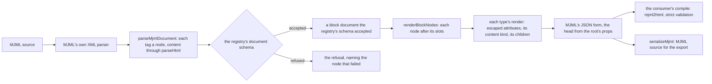

# MJML blocks

MJML's components as block types on the [editor core](../../specs/headless-block-editor/editor-core/design.md), published as the workspace package `mjml-blocks`. The package holds each component's attributes, MJML's defaults for them and its nesting rules. It renders a block document to MJML and reads MJML back into one. The email editor's canvas, preview and fields are the [email](../resource-page-builder-email/design.md) change's, and the server's compile is the [document model](../resource-page-builder-document-model/design.md)'s.

## Why a package

`grapesjs-mjml` joins GrapesJS to MJML: it registers a GrapesJS component per MJML tag, with traits for its attributes, and compiles in the browser. With GrapesJS gone, what is left of that connection is MJML's component set as typed blocks, and that is not specific to Esposter. Any email builder on MJML rebuilds the same things: an attribute table per component in MJML's own type grammar, MJML's defaults, which tag may hold which, the attribute cascade `mj-attributes` applies, and a faithful path to MJML and back. By the [dependency admission](../../specs/architecture/dependency-admission/design.md) standard, a rewrite that holds behaviour of its own is a headless package, and an absorbed adapter meets parity with the surface it replaced, with every issue in its scope given a verdict. Rejected: the email types as modules of the app's shared layer, where the [program](../resource-page-builder-program/design.md) first placed them. That location could not carry the Upstream table, and the next consumer would rebuild MJML's tables.

What stays the app's is what only Esposter means by an email: the rich text inside a text block, which is the Note's ProseMirror JSON; merge fields, which are inline nodes in that text; the survey invite; the palette's labels and icons; and the canvas.

## The component set

Parity is with MJML's current component set rather than with the plugin's older one, so a component the plugin lacks is in scope too. Each block type's name is its MJML tag, so the render, the slot rules and the canvas key on one name.

| Block types                                                               | Notes                                                                                 |
| ------------------------------------------------------------------------- | ------------------------------------------------------------------------------------- |
| `mj-wrapper`, `mj-section`, `mj-group`, `mj-column`                       | the layout; a section holds columns and groups, a group holds columns                 |
| `mj-hero`                                                                 | a background image with a slot of content                                             |
| `mj-text`, `mj-button`, `mj-image`, `mj-divider`, `mj-spacer`, `mj-table` | the leaves; an image requires its `alt` or a decorative flag that writes an empty one |
| `mj-social` of `mj-social-element`, `mj-navbar` of `mj-navbar-link`       | the networks MJML names, with its icons from Mailjet's host                           |
| `mj-carousel` of `mj-carousel-image`                                      | MJML's image carousel, which falls back to its first image where a client lacks CSS   |
| `mj-accordion` of `mj-accordion-element`, each of a title and a text      | MJML's accordion, open in a client that cannot toggle it                              |
| `mj-raw`                                                                  | sanitised HTML, allowed wherever MJML allows it                                       |

The head is the root's props, since a head component belongs to the whole email rather than to a place in it:

- `lang` and `dir` on `mjml`;
- `mj-title` and `mj-preview`;
- `mj-font`, as a list of a name and a stylesheet address;
- `mj-breakpoint`;
- `mj-body`'s width and background colour;
- `mj-attributes`, as an attribute map for all components (`mj-all`) and one per type;
- `mj-style`, as a list of stylesheets, each inlined or not. The plugin carries `mj-style`, so the package does too. Whether the email editor offers a free stylesheet is the editor's decision, and the package's schema refuses a `<` in it so it can never close its element.

What is left out of MJML's set:

- `mj-include`, which reads files from the compiling server's disk;
- `mj-html-attributes` and `mj-class`, which target attributes by selector and share named classes between nodes. The plugin carries neither, and they are the shared classes the program leaves out of the webpage;
- the community components (the charts and the QR code), which are not part of MJML's own preset.

Each is written down as out of scope in the Upstream table wherever an issue asks for it.

**Slots are MJML's own nesting rules.** Each container type has one slot, `children`, whose allow list is the tag's entry in the dependency map MJML's core preset registers for its validator (`mjml-preset-core`'s `dependencies`). The root's content takes the `mj-body` entry. A test holds every type's allow list equal to that map in the installed MJML, so a release that changes the nesting fails a test rather than producing emails the validator refuses. A consumer's own leaf, such as the survey invite, is added wherever MJML allows a leaf: the column's and the hero's slots.

## Attributes and the cascade

Each type declares its attributes once, as a table in MJML's own type grammar: `color`, `enum(left,center,right)`, `unit(px,%)`, `unit(px,%){1,4}`, `boolean`, `integer`, `string`. Two things are derived from that table:

- **the props schema**: each type string becomes a Zod schema that accepts what MJML's type validator accepts, so a value the validator would refuse never reaches the compile;
- **the field descriptors** the editor's style fields read: the kind of control, the units, the count of values and the options, so the email's fields need no attribute table of their own.

A test holds every table equal to the installed component's `allowedAttributes`, less the excluded `css-class` and `mj-class`. A second test holds every type's `defaultAttributes` equal to the component's own. An MJML upgrade that adds, removes or retypes an attribute, or changes a default, fails a test.

**An unset attribute stays absent.** A node's props hold only what the author set, and `resolveMjmlAttributes` answers what an attribute resolves to, in MJML's order: the node's own value, then the root's per-type `mj-attributes`, then its `mj-all`, then MJML's default. The canvas draws with what it answers and the style field shows it as the inherited placeholder. The compile is left to apply the same cascade itself. Rejected: MJML's defaults as Zod defaults on each props schema, which the email change first chose. Parsing would then write every default into every node, so `mj-attributes` could never apply and the MJML would carry every attribute of every node.

## Content

Three kinds of component carry content rather than children:

- **Rich text**, in `mj-text` and `mj-accordion-text`. Its schema and its HTML come from the consumer: `createMjmlRegistry` takes a rich text definition of a content schema, a `renderHtml` and a `parseHtml`. The app passes the Note's ProseMirror node schema and the `@tiptap/html` functions the Note's server rendering already uses, so the package knows nothing of ProseMirror.
- **Plain labels**, in `mj-button`, `mj-navbar-link`, `mj-social-element` and `mj-accordion-title`. These are written through `escapeText` from `@esposter/shared`.
- **Raw HTML**, in `mj-raw` and `mj-table`. Its schema stores what `sanitizeHtml` returns, as the webpage's custom HTML does, so the closed vectors are regression tests here too.

## Rendering and reading back



`renderMjmlDocument` folds the document through the core's `renderBlockNodes` into MJML's JSON form: a tag, its attributes, and its children or its content. `mjml2html` takes that form in place of markup and skips its XML parser, so no MJML source is built just to be parsed again. MJML writes an attribute value into its output exactly as given, unescaped, so the render escapes every value once with `escapeAttribute`, and every address prop passes `checkIsAllowedUrl` at its schema. `serializeMjml` writes the same JSON as MJML source for the export, its values already escaped. An option stamps each node's id as its `css-class`, so the [proof](../resource-page-builder-performance-and-proof/design.md) can find each node's box in the compiled email.

`parseMjmlDocument` is the inverse, at parity with the plugin's MJML import. MJML's own XML parser reads the source into the same JSON form. Each tag the registry knows becomes a node with its attributes as props, rich content goes through the consumer's `parseHtml`, and the result is parsed by the registry's document schema. A tag the package leaves out, an attribute it does not take or a value its type refuses is named in the refusal, so an import fails at the node that does not fit and keeps no part of a document silently. A test round-trips every type: rendering a parsed document returns the source's JSON form.

The compile is not the package's. It is one call to `mjml2html` with strict validation, on MJML's Node package, in whatever runtime the consumer compiles in. The package's runtime holds no copy of MJML, which is a development dependency for the tests that hold its tables equal to the installed release.

## Upstream

The plugin's tracker holds a few hundred issues and pull requests, most of them closed. It routes questions to its discussions. Every item gets one verdict in the package area's Upstream table before any code is written. Most items are editor behaviour, such as the canvas, the rich text, the style and layer managers and the toolbar. Those are out of scope and owned by the page builder's editor changes. The in-scope defects fall into a handful of themes, and each theme is a decision above:

- **Unescaped attributes**, an XSS through an `id` ([#391](https://github.com/GrapesJS/mjml/issues/391)) and an `href` holding a quote. These are closed by the render's escaping.
- **Nesting** the validator refuses: a wrapper or a hero placed directly in the body, and a stray `mj-body` inside a wrapper. These are closed by slots held to MJML's own map.
- **Head components missing from the output**, such as fonts, `mj-style` placement and `mj-attributes` defaults that never applied. These are closed by the head as root props and by the cascade.
- **Output shape**, such as a self-closing image swallowing its siblings on export. This is closed by the serialiser writing every closing tag.
- **A compile that needs a browser**, because the plugin's parser reads `window`. This is closed by a package that runs where there is no DOM.

The component requests (the table, the carousel, the preview text, a social element's label, a divider's alignment, a column's inner background) are in-scope features, built here with the rest of MJML's set.

## Key files

| File                                                                       | Role after the change                                        |
| -------------------------------------------------------------------------- | ------------------------------------------------------------ |
| `packages/headless-block-editor/src/services/createBlockDocumentSchema.ts` | the registry's document schema, which a parsed import passes |
| `packages/shared/src/services/sanitizeHtml/escapeAttribute.ts`             | escapes every attribute value the render writes              |
| `packages/shared/src/services/sanitizeHtml/escapeText.ts`                  | escapes every plain label                                    |
| `packages/shared/src/services/sanitizeHtml/sanitizeHtml.ts`                | what the raw types store                                     |
| `packages/shared/src/services/sanitizeHtml/checkIsAllowedUrl.ts`           | the check every address prop's schema runs                   |

New code lands here:

```text
packages/mjml-blocks/src/models/      the attribute grammar, MJML's JSON form, the rich text definition
packages/mjml-blocks/src/services/    one module per component type, the registry, the cascade, render, serialise, parse
openspec/specs/mjml-blocks/           the package's area: how it works, the Upstream table, Sources
```

## Sources

- [MJML documentation](https://documentation.mjml.io/) — the component set, each component's attributes and defaults, the head components, and "Using MJML in JSON", the object form `mjml2html` takes in place of markup.
- `mjml-core` 5's `createComponent` — `htmlAttributes` writes `name="value"` with the value as given, which is why the render escapes. `mjml2html` parses only a string input.
- `mjml-preset-core`'s `dependencies` — the allowed children of every tag, which the slots are held equal to.
- [GrapesJS MJML](https://github.com/GrapesJS/mjml) — the plugin whose surface the package meets, and whose tracker the Upstream table answers.
