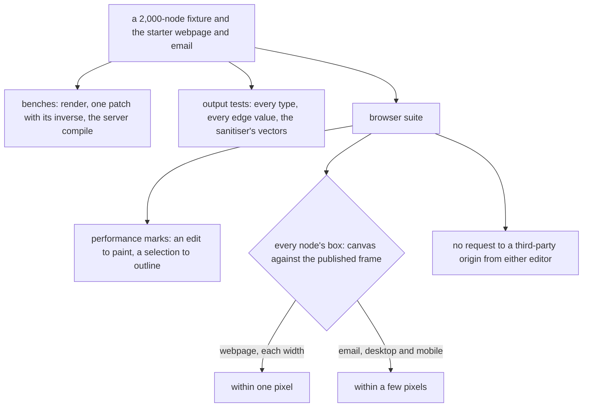

# Performance and proof

The targets the finished editors hold and the proof of their output. It runs over the [canvas](../resource-page-builder-canvas/design.md) and the [email editor](../resource-page-builder-email/design.md), on the [document model](../resource-page-builder-document-model/design.md)'s nodes and patches.

## Performance

| Target                                                     | Number                                                                             | Held by                                        |
| ---------------------------------------------------------- | ---------------------------------------------------------------------------------- | ---------------------------------------------- |
| Requests the editor itself makes to a third-party origin   | none; only content the author adds — an embed, MJML's social icons — loads its own | a browser test over each editor's own requests |
| Render a 2,000-node document to HTML                       | under 20 ms                                                                        | a committed bench                              |
| Apply one patch to a 2,000-node document, inverse recorded | under 0.5 ms                                                                       | a committed bench                              |
| A prop or style edit, input to paint, 2,000 nodes          | under 50 ms at the 95th percentile                                                 | a browser test's performance marks             |
| A selection change, input to outline                       | within one animation frame                                                         | the same                                       |
| Server compile of the starter email                        | under 250 ms at the 95th percentile                                                | a committed bench on the compile service       |

The editors' script ceiling is the [cutover](../resource-page-builder-cutover/design.md)'s own acceptance check, since only its production build holds the editors as a reader loads them.

## Proof

There is nothing saved to hold the new editors to, so parity is proved against the published output and against the canvas itself:

- **Every type's output** is asserted whole with `toStrictEqual`: its HTML or MJML for a fixture of each prop's edge values, its accessible attributes, and the sanitiser's vectors on the raw-HTML types.
- **Every patch round-trips:** applying an edit and then its inverse returns a document equal to the original, for every command over a fixture document.
- **The canvas is the page.** A browser test renders the starter webpage in the canvas and in the published view's frame at each device width — the published copy rendered for the test with each node's id stamped on its element — and holds every node's box within one pixel across the two. The same test checks that the published page's own scripts run under the policy its frame inherits from the app.
- **The email canvas is close to the email.** The same test for the starter email, compiled with a class per node that MJML's `css-class` carries onto the output, holds each section, column and leaf box within a few pixels at desktop and mobile width.
- **Editor interactions** have component tests (the tree, the panels, the commands and the patches each issues, under happy-dom like the library's) and browser tests: a drag from the palette across the frame boundary, Alt-arrow moves with their announcement, Move to…, and focus into a text node and back out. The browser tests run in the app's browser suite, which the canvas sets up.



## Key files

| File                                                          | Role after the change                                   |
| ------------------------------------------------------------- | ------------------------------------------------------- |
| `packages/configuration/src/getVitestBrowserConfiguration.ts` | the browser suite the box, mark and origin tests run in |
| `apps/web/app/components/Resource/SrcdocIframe.vue`           | the published view's frame the canvas is held against   |
| `apps/web/configuration/security.ts`                          | the policy a published page's own scripts run under     |

New code lands here:

```text
apps/web/shared/services/pageBuilder/    the render and patch benches beside the renderer, and each type's output test
apps/web/server/services/emailEditor/    the compile bench beside the compile service
apps/web/app/components/PageBuilder/     the browser tests of the canvas, the email canvas and the editors' requests
```
