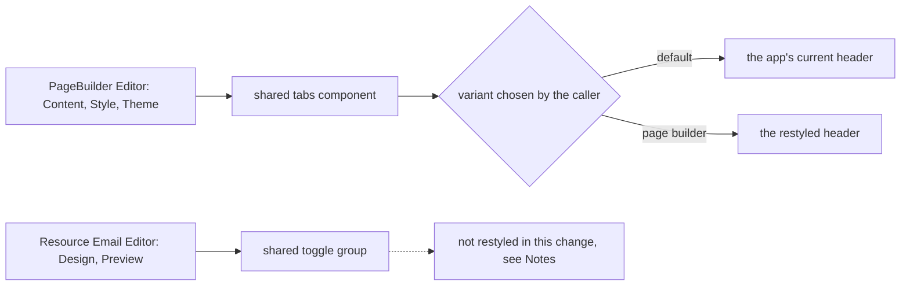

# Page builder and email editor tab headers

The page builder's header style is one decision made in the shared tabs component, with one variant chosen by its caller. The email editor's Design and Preview control is not drawn by that component.

## How it works

The page builder's node settings panel lists its tabs as `panelItems` in the editor and passes them to the shared tabs component. A caller that needs a different header style would pass a variant, so the app's other tab surfaces keep their current look. The email editor's Design and Preview control is `viewItems`, drawn by the shared toggle group, so a variant of the tabs component does not reach it.

## Data model

None.

## Key files

| File                                                | Role                                                                              |
| --------------------------------------------------- | --------------------------------------------------------------------------------- |
| `apps/web/app/components/Ui/Tabs.vue`               | the shared tabs component the page builder's tabs draw with, and its header style |
| `apps/web/app/models/ui/UiTabsVariant.ts`           | the header variant the page builder's tabs take                                   |
| `apps/web/uno.config.ts`                            | the `ui-tab` shortcut's `data-variant=Header` rules                               |
| `apps/web/app/components/PageBuilder/Editor.vue`    | the node settings tabs (`panelItems`): Content, Style, Theme and Check            |
| `apps/web/app/components/Ui/ToggleGroup.vue`        | the shared toggle group the email editor's Design and Preview control draws with  |
| `apps/web/app/components/Resource/Email/Editor.vue` | the email editor's Design and Preview control (`viewItems`)                       |

## Notes

- The change is visual, so it has no spec delta. The check is the owner's eyes in the browser, as the `run-app` skill sets out. A screenshot suite is not added for it.
- The tab headers, read from source because no browser pass was run:
  - The page builder's node settings tabs (`panelItems` in `apps/web/app/components/PageBuilder/Editor.vue`) are Content, Style, Theme and Check. The email editor mounts the same editor with the email kind, so its node settings tabs are Content and Style only.
  - Layout is not a tab. It is the first sector of the Style tab: its title is in `STYLE_SECTORS` (`apps/web/app/services/pageBuilder/constants.ts`), and `apps/web/app/components/PageBuilder/StylePanel/Index.vue` draws each sector as a `UiCollapsible`. The palette's `Layout` category heading (`apps/web/app/components/PageBuilder/Palette.vue`) is a second Layout on the same surface. The Layout meant is the Style panel's sector: the complaint is about a header whose active state is hard to see, and the palette's heading is not interactive, so it has no active state to show. The tabs variant does not reach a sector, which is a `UiCollapsible` header, so task 2.2 restyles the Style panel's sector headers through a variant of `UiCollapsible` that no other collapsible takes, and never Layout alone, since one sector drawn differently from its siblings would be the mismatch the change removes. The palette heading is left as it is.
  - The email editor's Design and Preview are `viewItems` in `apps/web/app/components/Resource/Email/Editor.vue`, a `UiToggleGroup`, not tabs.
  - Toggle groups on the same surfaces that are not tabs, and are not restyled here: the style state and the style choice groups (`apps/web/app/components/PageBuilder/StylePanel/Index.vue`) and the canvas device toggle (`apps/web/app/components/PageBuilder/Canvas/DeviceToggle.vue`).
- The page builder's tabs take `UiTabsVariant.Header`. The `ui-tab` shortcut draws its selected tab in the full text colour under an indicator twice the default's thickness. Tab padding and the tab list's inset are unchanged, so the spacing the proposal names is not yet changed. The owner's check decides whether it needs to be.
- Email Design and Preview stays a `UiToggleGroup`. `UiTabs` mounts only its selected panel, so choosing Preview would unmount the design editor and lose the pane widths and node-settings tab it holds (`apps/web/app/components/PageBuilder/Editor.vue`). The toggle group keeps the design mounted under `v-show`. A header look for it is not built here. The owner picks between a toggle-group variant that draws the same indicator and leaving the control as it is.
