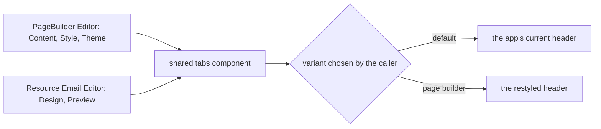

# Page builder and email editor tab headers

Both surfaces draw their tabs with the app's shared tab primitive, so the header style is one decision made in one place or one variant chosen by its callers.

## How it works

The page builder's node settings panel lists its tabs as `panelItems` in the editor, and the email editor's blade lists its Design and Preview tabs as `viewItems`. Each passes its items to the shared tabs component. A caller that needs a different header style would pass a variant, so the app's other tab surfaces keep their current look.

## Data model

None.

## Key files

| File                                                | Role                                                                    |
| --------------------------------------------------- | ----------------------------------------------------------------------- |
| `apps/web/app/components/Ui/Tabs.vue`               | the shared tabs component both surfaces draw with, and its header style |
| `apps/web/app/components/PageBuilder/Editor.vue`    | the node settings tabs (`panelItems`): Content, Style and Theme         |
| `apps/web/app/components/Resource/Email/Editor.vue` | the email editor's Design and Preview tabs (`viewItems`)                |

## Notes

- The change is visual, so it has no spec delta. The check is the owner's eyes in the browser, as the `run-app` skill sets out. A screenshot suite is not added for it.
- The Layout tab is not in the code under these names. The first task finds it in the browser, and the change restyles it only once it is found.
