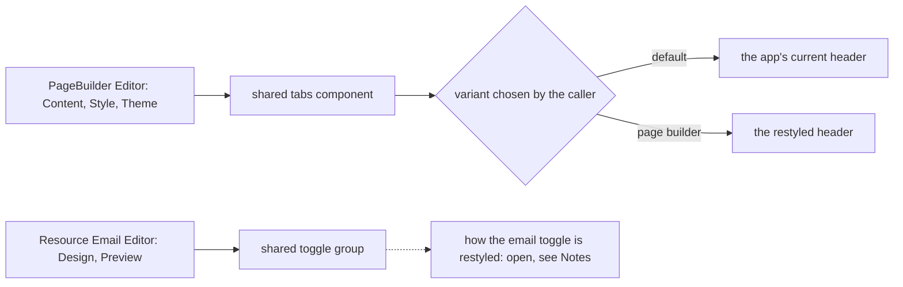

# Page builder and email editor tab headers

The page builder's header style is one decision made in the shared tabs component, with one variant chosen by its caller. The email editor's Design and Preview control is not drawn by that component.

## How it works

The page builder's node settings panel lists its tabs as `panelItems` in the editor and passes them to the shared tabs component. A caller that needs a different header style would pass a variant, so the app's other tab surfaces keep their current look. The email editor's Design and Preview control is `viewItems`, drawn by the shared toggle group, so a variant of the tabs component does not reach it.

## Data model

None.

## Key files

| File                                                | Role                                                                              |
| --------------------------------------------------- | --------------------------------------------------------------------------------- |
| `apps/web/app/components/Ui/Tabs.vue`               | the shared tabs component the page builder's tabs draw with, and its header style |
| `apps/web/app/components/PageBuilder/Editor.vue`    | the node settings tabs (`panelItems`): Content, Style and Theme                   |
| `apps/web/app/components/Ui/ToggleGroup.vue`        | the shared toggle group the email editor's Design and Preview control draws with  |
| `apps/web/app/components/Resource/Email/Editor.vue` | the email editor's Design and Preview control (`viewItems`)                       |

## Notes

- The change is visual, so it has no spec delta. The check is the owner's eyes in the browser, as the `run-app` skill sets out. A screenshot suite is not added for it.
- The Layout tab is not in the code under these names. The first task finds it in the browser, and the change restyles it only once it is found.
- The email editor's Design and Preview control is `UiToggleGroup`, not the tabs component, so the tabs variant does not restyle it. Whether it takes a variant on the toggle group or moves to the tabs component is open, and is decided before the email half of task 2.1 is built.
