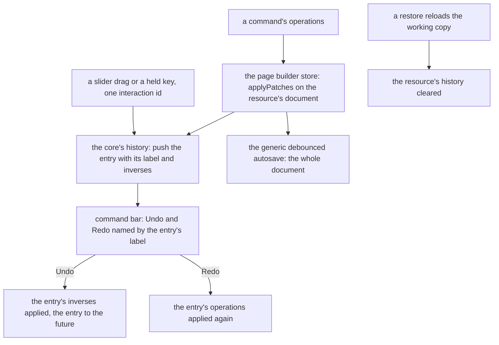

# Undo as patches

The page builder's undo and redo, built once the [document model](../resource-page-builder-document-model/design.md) holds each editor's document in its store, over the [headless core](../resource-page-builder-headless-core/design.md)'s commands and history.

## Undo and redo as patches

An edit is a list of operations in JSON Patch's add, remove and replace, each addressed by a JSON Pointer from the document root. `applyPatches`, the one JSON Patch applier, which the [agent content tools](../../specs/architecture/agent-content-tools/design.md) also apply on the server and the headless core moves into `@esposter/shared`, copies the path to each changed node, so the new document shares every untouched subtree with the old one and a canvas node whose object did not change does not re-render. As it applies each operation it records the inverse, so undo is the inverse list applied in reverse and redo is the forward list again. A move is a remove and an add.

The core already records an entry, coalesces consecutive replaces of one path within one interaction and bounds the stack. This change owns none of that again: it keeps one history per open resource in the page builder's store, names each entry for the command bar, and decides what one interaction is.



- **One history per open resource**, in the page builder's store, keyed by the resource's id: the history and the future, and the undo and redo labels the command bar shows. The sheet's history is a single unkeyed store, so the page builder's keying is its own rule, not a copy of the sheet's.
- **An interaction** is one pointer drag, one held key, or one text session: a slider passes the core one interaction id from its first change to its `end`, so ten steps of a drag coalesce into one entry, and leaving a text node commits one entry, as the [canvas](../resource-page-builder-canvas/design.md) says.
- **A restore clears the history**, since its entries describe a document that is gone. The page builder's store registers on `ResourceContentHookMap.Reload`, the hook every Vue-rendered type's store already takes, and clears the resource's history there. That is the only restore hook the new editors need, because the canvas renders the content ref and a restore replaces the ref ([third-party document adapters](../../specs/architecture/third-party-document-adapters/design.md)).
- **The editor's patches never leave the browser.** A save is still the whole document through the one door, which [delta content saves](../../specs/resource/delta-content-saves/design.md) already make cheap; [JSON Patch content saves](../../rejected/resource/json-patch-content-saves/design.md) stay rejected.

## Decisions

- **The bounded history moves to `@esposter/shared` when the sheet takes it.** The core's history is generic over its entry, and the sheet's command objects are the second consumer, so the stack moves into the shared utilities, unchanged, and both the core and `useSheetHistoryStore` build on it. Rejected: the sheet importing `headless-block-editor` for it, which would make a sheet's undo depend on a block editor, as the core's own decision on the applier already refused.
- **The sheet keeps its commands.** Its entries stay command objects with their own `execute` and `undo`, since a sheet edit is not a patch over a document tree; only the stack under them is shared. Rewriting them as patches was rejected: it would touch every sheet command for no behaviour a reader sees.

## Key files

| File                                                         | Role after the change                                                        |
| ------------------------------------------------------------ | ---------------------------------------------------------------------------- |
| `apps/web/app/store/resource/sheet/history/index.ts`         | the sheet's history over the shared bounded history, its commands as entries |
| `apps/web/app/composables/resource/sheet/useSheetHistory.ts` | unchanged callers of the sheet's undo and redo                               |
| `apps/web/app/services/resource/ResourceContentHookMap.ts`   | the `Reload` hook the page builder's store clears its history on             |
| `apps/web/app/composables/ui/useCommands.ts`                 | Undo and Redo registered as commands named by the entry's label              |
| `apps/web/app/components/Ui/Slider.vue`                      | its `end` closes the interaction a drag or a key opened                      |

New code lands here:

```text
packages/shared/src/services/history/   the bounded history, generic over its entry, moved from the core
apps/web/app/store/pageBuilder/          each open resource's history, applied through its document store
```

## Sources

- [RFC 6902 — JSON Patch](https://www.rfc-editor.org/rfc/rfc6902.html) and [RFC 6901 — JSON Pointer](https://www.rfc-editor.org/rfc/rfc6901.html) — the operations and paths an edit is written in.
