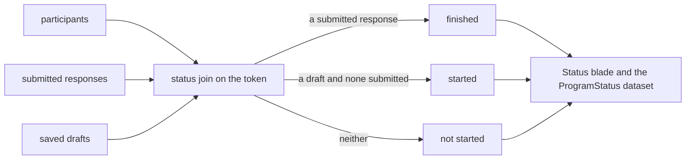

## Context

The respondent page saves a draft on every move, keyed by a per-survey response id that is scoped to the participant's token, so a stored draft already says which participant began. The status join matches participants to submitted responses on the token and reads `responded` as submitted, never as a draft, which is why a half-answered survey reads as not responded.

## How it works

A submitted response wins over a draft, so a participant who finished is never started. The blade shows the state beside the key value, and the dataset projects the same two booleans without the key value or the token.

## Gap analysis

| Feature                                  | Verdict                                                                                                 |
| ---------------------------------------- | ------------------------------------------------------------------------------------------------------- |
| Started and finished per personal link   | Built as the three states.                                                                              |
| Reminders only to unfinished respondents | Already built: Export reminders covers every participant who has not responded, a started one included. |
| Link expiry                              | Deferred: [program link expiry](../../deferred/resource/program-link-expiry/design.md).                 |
| Sending, scheduling and thank-you mail   | Deferred with [email sending](../../deferred/resource/email-sending/design.md).                         |
| Re-downloading a link list               | Already built: generating participants is idempotent and hands back every participant's link again.     |

## Decisions

- **Drafts, not a new record.** The respondent page already stores the draft per token, so started is a read of existing rows and no write path changes.
- **The dataset gains a column, not a state.** `responded` keeps its meaning for every dashboard bound to it, and `started` is a second flag a funnel reads beside it.
- **No new reminder scope.** Reminders already go to everyone who has not finished, and a started participant is the one a reminder most wants.

## Key files

| File                                                        | Role                                                    |
| ----------------------------------------------------------- | ------------------------------------------------------- |
| `apps/web/server/services/program/readProgramStatusRows.ts` | the server-only join, which also reads the drafts       |
| `apps/web/app/components/Resource/Program/Status.vue`       | the three states in the blade                           |
| `apps/web/server/trpc/routers/program.ts`                   | the status procedure and the dataset provider's columns |

## Sources

- [Qualtrics — Personal Links](https://www.qualtrics.com/support/survey-platform/distributions-module/email-distribution/personal-links/) — each set of links shows the surveys started and finished.
- [Qualtrics — Reminder & Thank You Emails](https://www.qualtrics.com/support/survey-platform/distributions-module/email-distribution/reminder-thank-emails/) — reminders go only to respondents who have not finished, and the distribution reports started and finished.
