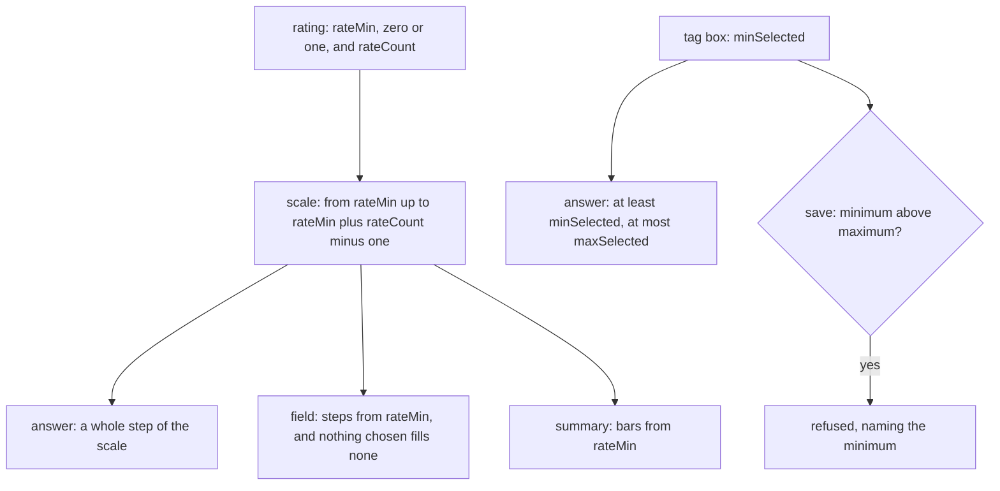

# Survey Answer Bounds

## Context

A rating holds `rateCount`, from two to twenty, and its steps run from one. The rating's answer schema accepts a whole number from one to the count, the rating field labels its steps from one and reads nothing chosen as zero, and the response summary's rating card labels its bars from one. A required question already takes zero as an answer (`packages/vue-survey-engine-headless/src/services/runner/checkSurveyAnswerEmpty.ts`).

A checkbox holds `minSelected` and `maxSelected`, and the save check refuses a minimum above its maximum (`packages/vue-survey-engine-headless/src/services/checkSurveyNodes.ts`). A tag box holds `maxSelected` only (`packages/vue-survey-engine-headless/src/models/SurveyTagBoxNodeProps.ts`), so its answer schema bounds the maximum and nothing below it.

## Gap analysis

| Feature                                       | Verdict                                                        |
| --------------------------------------------- | -------------------------------------------------------------- |
| Rating Scale: a zero-based scale              | Built here: a scale starts at zero or at one                   |
| Rating Scale: custom rate values              | Not in this change: the values need a value model of their own |
| Answer count: a minimum selected on a tag box | Built here, as a checkbox already holds it                     |

## Decisions

- **A scale starts at zero or at one.** `rateMin` is one of those two literals and defaults to one, so every stored rating keeps its meaning. Rejected: a free integer start, which would admit a negative or large start that no respondent reads as a rating.
- **The nothing-chosen state reads as the step below the first.** The step scale takes its first step as an input and reads nothing chosen as the step below it, so a zero-based scale with nothing chosen fills no step. Rejected: keeping zero as the nothing-chosen reading, which would fill step zero of every unanswered scale.
- **Matrix rating cells stay one-based.** A matrix column sets no scale, so its cells keep the constant one-based count. Rejected: a start on matrix cells, since a matrix holds no start prop and no owner has asked for one.
- **A tag box takes a minimum as a checkbox does.** `minSelected` is a positive whole number beside `maxSelected`, and the same save check refuses a minimum above the maximum. Rejected: a validator expression that counts the picks, which would show a generic message, give the owner no field to set, and skip the check that a minimum stays within its maximum.
- **The summary's bars follow the scale.** A rating card's bars run from `rateMin`. Rejected: keeping the summary one-based, which would drop every zero answer from the counts with no sign of it.
- **No stored answer is rewritten.** The default is one, so existing ratings keep their values and labels. Rejected: a backfill, which the default makes unnecessary.

## Rejected

- Custom rate values. They need a value model of their own, and a separate design owns that.

## Flow

## Risks

- A reader this change misses keeps counting or drawing the scale from one. The four readers, the answer schema, the field, the summary and the matrix call site, each have a test in the tasks.
- The Creator's form draws `rateMin` through the schema form's one-of path as a select of its two literals. If that path draws a number field instead, an owner can type a value the schema refuses, and the form test in the tasks catches it.

## Key files

| File                                                                                               | Role                                                                      |
| -------------------------------------------------------------------------------------------------- | ------------------------------------------------------------------------- |
| `packages/vue-survey-engine-headless/src/models/SurveyRatingNodeProps.ts`                          | the rating's props: `rateMin` beside `rateCount`                          |
| `packages/vue-survey-engine-headless/src/models/SurveyTagBoxNodeProps.ts`                          | the tag box's props: `minSelected` beside `maxSelected`                   |
| `packages/vue-survey-engine-headless/src/services/checkSurveyNodes.ts`                             | the save check: a tag box's minimum above its maximum, as a checkbox's is |
| `packages/vue-survey-engine-headless/src/services/runner/answer/createSurveyRatingValueSchema.ts`  | the whole-step bounds, from the scale's first step to its last            |
| `packages/vue-survey-engine-headless/src/services/runner/answer/createSurveyRatingAnswerSchema.ts` | the rating answer's schema, read from the node's scale                    |
| `packages/vue-survey-engine-headless/src/services/runner/answer/createSurveyTagBoxAnswerSchema.ts` | passes the tag box's minimum to the selection schema                      |
| `apps/web/app/services/resource/survey/getSurveyRatingItems.ts`                                    | the steps a scale draws, from a first step                                |
| `apps/web/app/components/Resource/Survey/Field/Rating.vue`                                         | the rating field: its steps and faces read from `rateMin`                 |
| `apps/web/app/components/Resource/Survey/Field/MatrixDynamic.vue`                                  | the matrix's rating cells: passes the one-based first step                |
| `apps/web/app/components/Ui/Rating.vue`                                                            | the step scale: nothing chosen reads as the step below its first          |
| `apps/web/app/services/survey/summary/getSurveyDocumentSummaryCards.ts`                            | the rating card's bars, from the scale's first step                       |
