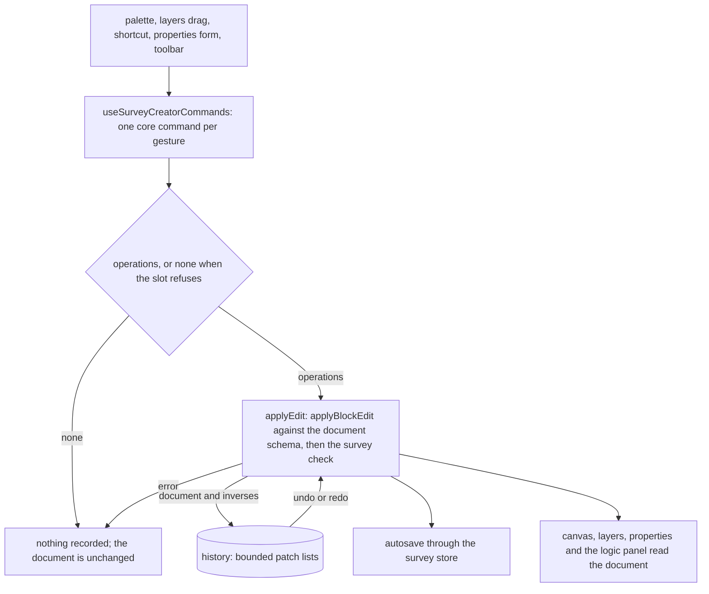

# Survey Creator

The owner's editor on the [typed document](../../specs/resource/survey-document/design.md), the same shape as the page builder's webpage editor: a store of selection and history, composables that turn a gesture into an edit, and panes drawn with the UI library. It is built on the core's tree commands, which return JSON Patch operations, and on the bounded history in `@esposter/shared`.

## How it works



## The editor

- **Shell.** `Editor.vue` is a three-pane layout: a left pane with Layers and Palette tabs, the canvas with a Design and Preview switch, and a right pane with Properties, Logic and Theme tabs, with a toolbar of undo, redo, import, export and clear. On a narrow screen the panes stack as tabs, one component for every device.
- **Store.** A survey creator store keeps, per open resource, the selected node's pointer, the history, and the preview flag. Selection is not history.
- **Commands.** Insert (from the palette, after the selection), move up and down, move into the previous element, move out after the parent, move to a chosen place, duplicate, remove and rename. Each is the core's command; a refusal returns no operations and records nothing. Shortcuts and the command palette register through the app's command scope.
- **Layers.** The tree of the document in layer order. Dragging a row moves it with the same move command, and Alt+arrow moves the selected row, read out through the tree's live region. A page and a panel are rows; a dynamic panel's template is a child list.
- **Canvas.** The survey drawn with the runner's own [field components](../../specs/resource/survey-fields/design.md) in a non-interactive design mode, with the selection outlined. Clicking an element selects it; the canvas moves nothing, because the layers tree and the shortcuts already move every element and a second pointer-only path would need its own keyboard twin.
- **Preview.** The runner itself on the current document, starting fresh each time it is opened, with no response saved.
- **Import, export and clear.** Export writes the typed document as a file. Import parses a file, runs the document schema and the survey check, and applies it as a single history entry replacing the content and the root's props, or is refused with the path. Clear is the same replacement with the empty survey.
- **Autosave.** Every applied edit saves the document through the survey store's save path, which keeps the in-flight save ordering the store already has.

## Decisions

- **Reorder lives in the layers tree.** Rejected: dragging on the canvas, which needs hit-testing against rendered fields and a pointer-only path with a keyboard twin, when the tree has both and is the page builder's own model.
- **The palette inserts; it is not dragged.** Choosing a kind inserts it at the selection. Rejected: drag from palette to canvas, for the reason above.
- **Edits are patches.** Rejected: replacing the whole document on every change, which makes undo a pile of snapshots and an agent's edit a different path from the owner's.

## Key files

| File                                                                    | Role after the change                                           |
| ----------------------------------------------------------------------- | --------------------------------------------------------------- |
| `apps/web/app/components/Resource/Survey/Editor.vue`                    | the Editor blade, rendering the new Creator                     |
| `apps/web/app/composables/survey/useSurveyCreator.ts`                   | rewritten: the Creator's state over the core's tree and history |
| `apps/web/app/store/survey/index.ts`                                    | the save path the autosave goes through                         |
| `apps/web/app/services/survey/getActions.ts`                            | rewritten to the toolbar's import, export and clear             |
| `apps/web/app/store/pageBuilder/history.ts`                             | the worked example of an edit store over the bounded history    |
| `apps/web/app/store/pageBuilder/canvas.ts`                              | the worked example of per-resource selection                    |
| `apps/web/app/composables/pageBuilder/usePageBuilderMoves.ts`           | the worked example of move commands                             |
| `apps/web/app/composables/pageBuilder/usePageBuilderHistoryCommands.ts` | the worked example of undo and redo commands                    |

New files land here:

```text
apps/web/app/store/survey/creator.ts                       selection, history and the preview flag, keyed by resource
apps/web/app/composables/survey/useSurveyCreatorCommands.ts  the commands above
apps/web/app/components/Resource/Survey/Creator/           Layers.vue, Palette.vue, Canvas.vue, Toolbar.vue, Shell.vue
```

## Notes

- The properties form, the list editors, the logic tab and the theme tab are the [properties](../resource-survey-form-engine-properties/design.md), [logic builder](../resource-survey-form-engine-logic-builder/design.md) and [theme and files](../resource-survey-form-engine-theme-files/design.md) parts, mounted in the right pane.
