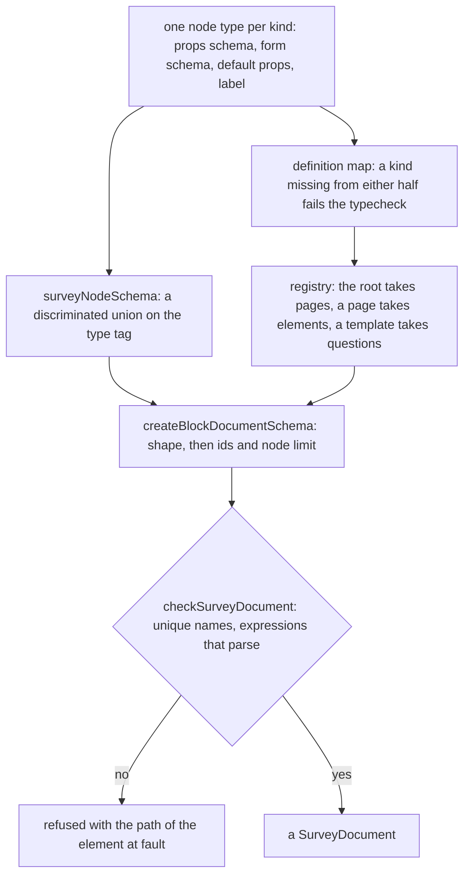

# Survey Document

The survey as a typed document in the `survey-engine` package, on the [headless block editor core](../../specs/headless-block-editor/editor-core/design.md), built on the [expression language](../resource-survey-form-engine-logic/design.md) for its save check. The document follows the shape the core already checks: a root holding pages, pages and panels holding elements, and questions holding none. It is the contract every other part reads, so its kinds, props and limits are stated here and nowhere else.

## How it works

The webpage document is the worked example: a node union, a children port, a static node schema, a registry and a document schema built with the core's `createBlockDocumentSchema`. The survey follows it file for file, in the package, with one node type per kind in its own files. The package defines its own limits and its own node id rule, since it cannot import the app's constants.



## The contract

**Node types.** `SurveyNodeType` is a string enum whose values are SurveyJS's tags. The containers are `page` and `panel`. The question kinds are `text`, `comment`, `boolean`, `radiogroup`, `dropdown`, `checkbox`, `tagbox`, `rating`, `ranking`, `matrix`, `matrixdynamic`, `paneldynamic`, `multipletext`, `slider`, `buttongroup`, `imagepicker`, `expression`, `html` and `image`.

**Slots.** A page and a panel hold a `children` slot, and a dynamic panel holds a `template` slot. The root accepts pages only. A page accepts panels and every question kind. A panel accepts panels and every question kind. A template accepts every question kind except a dynamic panel, which bounds the recursion at one level.

**The root's props.** `title`, `description`, `logo`, `accentColor` and `backgroundColor` are optional; `showProgressBar` is `off`, `top` or `bottom` and defaults to `off`; `showQuestionNumbers` defaults to false; `completedHtml`, `completeText`, `pageNextText` and `pagePrevText` are optional; `calculatedValues` is a list of `{ name, expression, includeIntoResult }`. The two colours are `#rrggbb` strings.

**Every question's props.** `id` as the core requires, `name` (1 to `MAX_SURVEY_QUESTION_NAME_LENGTH` characters, no braces), optional `title`, `description`, `requiredErrorText`, `visibleIf`, `enableIf` and `requiredIf`, `isRequired` defaulting to false, and `validators`, a list of `{ expression, text }`. A page and a panel hold `id`, optional `title`, `description` and `visibleIf` (a panel also `enableIf`), and their slot.

**Each kind's props beyond those**, with the answer the kind holds:

| Kind            | Props                                                                                                                                                                                                                             | Answer                                    |
| --------------- | --------------------------------------------------------------------------------------------------------------------------------------------------------------------------------------------------------------------------------- | ----------------------------------------- |
| `text`          | `inputType` (`text`, `number`, `date`, `datetime-local`, `time`, `email`, `tel`, `url`, `password`), `placeholder`, `min`, `max`, `minLength`, `maxLength`, `pattern`                                                             | string, or a number for `number`          |
| `comment`       | `placeholder`, `rows` (1 to 20, default 4), `maxLength`                                                                                                                                                                           | string                                    |
| `boolean`       | `labelTrue`, `labelFalse`, `displayStyle` (`switch`, `checkbox`, `radio`; default `switch`)                                                                                                                                       | boolean                                   |
| `radiogroup`    | `choices`, `hasOther`, `otherText`, `hasNone`, `noneText`, `choicesOrder` (`none`, `asc`, `desc`, `random`)                                                                                                                       | a choice value, or the typed other text   |
| `dropdown`      | `choices`, `hasOther`, `otherText`, `placeholder`, `choicesOrder`                                                                                                                                                                 | a choice value, or the typed other text   |
| `checkbox`      | `choices`, `hasOther`, `otherText`, `hasNone`, `noneText`, `hasSelectAll`, `selectAllText`, `minSelected`, `maxSelected`, `choicesOrder`                                                                                          | list of values                            |
| `tagbox`        | `choices`, `hasOther`, `otherText`, `placeholder`, `maxSelected`, `choicesOrder`                                                                                                                                                  | list of values                            |
| `rating`        | `rateType` (`labels`, `stars`, `smileys`), `rateCount` (2 to 20, default 5), `minRateDescription`, `maxRateDescription`                                                                                                           | number from 1 to `rateCount`              |
| `ranking`       | `choices`                                                                                                                                                                                                                         | list of values in the respondent's order  |
| `matrix`        | `rows` and `columns` (choices), `isAllRowRequired`                                                                                                                                                                                | record from row value to column value     |
| `matrixdynamic` | `columns` (name, title, `cellType` of `text`, `comment`, `dropdown`, `checkbox`, `boolean`, `rating`, `choices`, `isRequired`), `rowCount` (default 2), `minRowCount`, `maxRowCount` (default 100), `addRowText`, `removeRowText` | list of records from column name to value |
| `paneldynamic`  | `template` slot, `panelCount` (default 1), `minPanelCount`, `maxPanelCount` (default 20), `addPanelText`, `removePanelText`                                                                                                       | list of records from inner name to value  |
| `multipletext`  | `items` (name, title, `inputType` of `text`, `number` or `email`, `isRequired`)                                                                                                                                                   | record from item name to string           |
| `slider`        | `min` (default 0), `max` (default 100), `step` (default 1), `showValue`                                                                                                                                                           | number                                    |
| `buttongroup`   | `choices`                                                                                                                                                                                                                         | a choice value                            |
| `imagepicker`   | `choices` (value, text, `imageLink`), `multiSelect`, `showLabel`, `imageFit` (`contain`, `cover`, `fill`, `none`), `imageHeight`, `imageWidth`                                                                                    | a value, or a list when `multiSelect`     |
| `expression`    | `expression`, `displayFormat` (`none`, `decimal`, `percent`), `maxFractionDigits` (0 to 10, default 2)                                                                                                                            | the calculated value                      |
| `html`          | `html`                                                                                                                                                                                                                            | none                                      |
| `image`         | `imageLink`, `altText` (empty means decorative), `imageHeight`, `imageWidth`, `imageFit`                                                                                                                                          | none                                      |

A choice is `{ value, text }` with a string or number `value` and an optional `text`. Every list and string is bounded by a constant in the package's constants module, so no field is unbounded. The question name and count bounds the app keeps today move into that module, and their importers read them from the package.

**Cross-field rules are not in the schema.** A `min` above a `max`, or a `rateCount` below the answer given, is an owner's mistake that the runner shows and does not refuse. Rejected: refinements across fields, which the core's static node schema cannot take without a per-kind refine hook that the property grid would also have to know.

**The save check.** `checkSurveyDocument` walks the parsed document after the core's schema: question names are unique across pages and panels, a dynamic panel's template names are unique among the template's own, a calculated value's name collides with no question name, and every `visibleIf`, `enableIf`, `requiredIf`, validator, calculated value and expression question parses through the package's `checkSurveyExpression`. A reference to an unknown name is not refused, since a calculated value or a forward reference is a legitimate target.

**The empty survey.** `createSurveyDocument` returns one empty page and default root props, which a new survey and a cleared one both use.

## Decisions

- **The document is bound later.** The package, with its schema, registry and kinds, lands beside SurveyJS and are not yet the resource's content schema. Binding the schema earlier would leave SurveyJS saving a string the schema refuses. The [respondent part](../resource-survey-form-engine-respondent/design.md) swaps the store, the router and the two pages together.
- **One answer for "other".** The respondent's typed other text is the answer itself, not a separate `-Comment` key as SurveyJS writes. Rejected: SurveyJS's pair of keys, which makes a response record's columns depend on what a respondent chose.
- **A dynamic panel's template does not nest.** Rejected: unbounded nesting, which the Creator's canvas and the runner's scopes would each have to bound for themselves.

## Key files

| File                                                                       | Role after the change                                                  |
| -------------------------------------------------------------------------- | ---------------------------------------------------------------------- |
| `packages/survey-engine/package.json`                                      | the private package's manifest                                         |
| `apps/web/shared/models/resource/survey/SurveyResource.ts`                 | unchanged here; bound to the package's document in the respondent part |
| `apps/web/shared/services/survey/constants.ts`                             | the question name and count bounds, moved into the package             |
| `apps/web/shared/services/pageBuilder/webpageNodeSchema.ts`                | the worked example of a static node schema                             |
| `apps/web/shared/services/pageBuilder/webpageRegistry.ts`                  | the worked example of a registry                                       |
| `apps/web/shared/services/pageBuilder/webpageNodeChildren.ts`              | the worked example of a children port                                  |
| `apps/web/shared/services/pageBuilder/webpageDocumentSchema.ts`            | the worked example of a document schema                                |
| `packages/headless-block-editor/src/services/createBlockDocumentSchema.ts` | the document schema's builder                                          |
| `packages/mjml-blocks/package.json`                                        | the worked example of a package of block types on the core             |

New files land here:

```text
packages/survey-engine/src/models/     SurveyNodeType, SurveyNode, SurveyQuestionNode, SurveyPlaceableNode, SurveyRootProps, SurveyDocument,
                                       SurveyNodeTypeDefinition, SurveyChoice, SurveyImageChoice, SurveyMatrixColumn, SurveyMultipleTextItem,
                                       SurveyValidator, SurveyCalculatedValue, Survey<Kind>Node and Survey<Kind>NodeProps for each kind
packages/survey-engine/src/services/   survey<Kind>NodeType for each kind, surveyNodeSchema, surveyNodeChildren, surveyRegistry,
                                       surveyNodeTypeDefinitionMap, surveyDocumentSchema, checkSurveyDocument, createSurveyDocument, constants
```

## Notes

- The shared files that name every kind are written once, before the kinds, so building a kind creates only its own three files: its node, its props and its node type.
- The package's tests run in the plain Node environment, the same as the core's.
