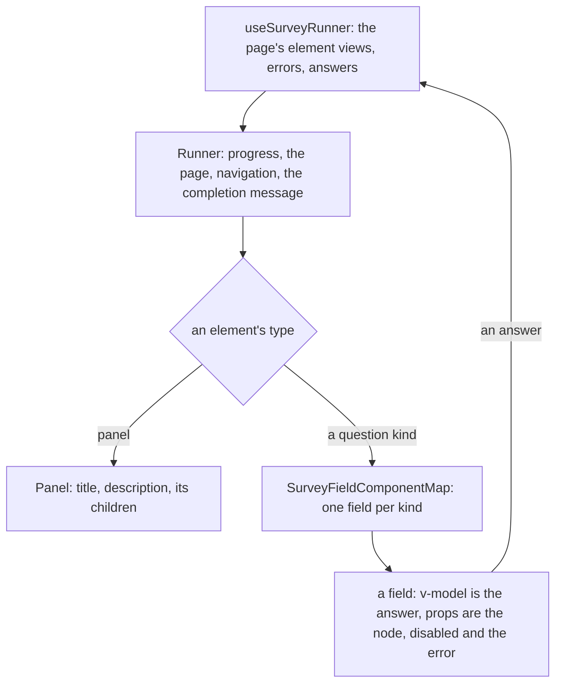

# Survey Fields

One field component per question kind, and the renderer that draws a page of them, over the [runner](../resource-survey-form-engine-runner/design.md) and the [document](../resource-survey-form-engine-document/design.md), whose types it imports from the `survey-engine` package. Each field is built from the app's UI library, so it meets the library's keyboard and ARIA contracts rather than a contract of its own.

## How it works



## The fields

A field takes `node` (its typed node), `isDisabled` and `error`, and binds the answer with `v-model`. It renders the question's title as the field's label, its description as hint text and the error beside the control. A field never evaluates a condition, validates an answer or reads another question: the runner decides all three.

| Kind            | Drawn with                                                                                           |
| --------------- | ---------------------------------------------------------------------------------------------------- |
| `text`          | the library's text field with the input type; the date field for `date`, `datetime-local` and `time` |
| `comment`       | the library's text field with rows                                                                   |
| `boolean`       | the library's switch, checkbox or radio group by `displayStyle`                                      |
| `radiogroup`    | the library's radio group, with an other option that reveals a text field                            |
| `dropdown`      | the library's select, with an other option                                                           |
| `checkbox`      | one library checkbox per choice, with select-all, none and other                                     |
| `tagbox`        | the library's token field over the choices                                                           |
| `buttongroup`   | the library's toggle group                                                                           |
| `rating`        | the library's toggle group of numbers, stars or faces, with the description at each end              |
| `ranking`       | the library's reorderable list, whose Alt+arrow moves are read out through its live region           |
| `slider`        | the library's slider                                                                                 |
| `matrix`        | a table of radios, one row per row choice                                                            |
| `matrixdynamic` | a table of the typed cells, with add and remove row buttons                                          |
| `paneldynamic`  | the template drawn once per panel, with add and remove panel buttons                                 |
| `multipletext`  | one text field per item                                                                              |
| `imagepicker`   | images as a radio or checkbox group, each image labelled by its text                                 |
| `expression`    | the calculated value as read-only text in its display format                                         |
| `html`          | the markup, passed through the shared sanitiser                                                      |
| `image`         | the image with its alternative text, or none when decorative                                         |

## Decisions

- **A field is dumb.** It holds no logic of the survey, so the preview, the respondent page and the Creator's canvas draw the same components. Rejected: a field that evaluates its own condition, which makes the preview and the page disagree the first time a condition changes.
- **The page renderer owns focus.** When a move is blocked, the renderer focuses the control of the first named error, because it alone knows the page.
- **Markup is sanitised where it renders.** The `html` field and the completion message pass through `sanitizeHtml`, as the respondent page does today, because an imported or agent-written document's markup renders in the app's origin.

## Key files

| File                                               | Role after the change                                                 |
| -------------------------------------------------- | --------------------------------------------------------------------- |
| `apps/web/app/components/Resource/Survey/View.vue` | the respondent page, which mounts the renderer in the respondent part |
| `apps/web/app/components/Ui/TextField.vue`         | the text, number and comment fields' control                          |
| `apps/web/app/components/Ui/RadioGroup.vue`        | the radio group's control                                             |
| `apps/web/app/components/Ui/setupUiStyle.test.ts`  | the helper that runs a component test once per design style           |

New files land here:

```text
apps/web/app/components/Resource/Survey/Field/      one component and one test per kind, and Index.vue choosing by type
apps/web/app/components/Resource/Survey/Runner.vue  the page renderer, Panel.vue and Progress.vue beside it
apps/web/app/services/resource/survey/              SurveyFieldComponentMap
```

## Notes

- A group of fields is built together, so a shared piece such as the other-text reveal is written once by whichever group needs it first.
