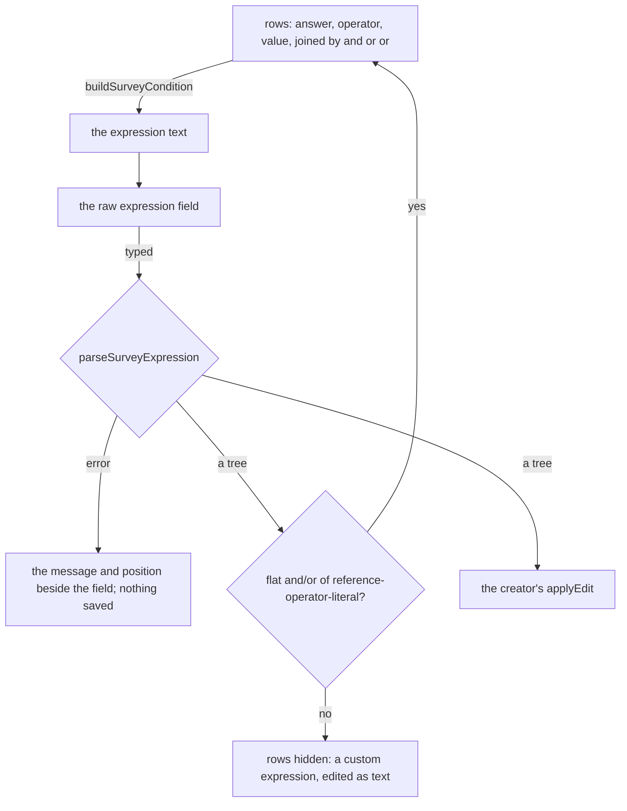

# Survey Logic Builder

The Logic tab of the [Creator](../resource-survey-form-engine-creator/design.md), over the [expression language](../../specs/resource/survey-logic/design.md). It edits the three conditions an element holds and the survey's calculated values.

## How it works



## Decisions

- **The builder covers one shape.** Rows are a flat run of conditions joined by a single kind of connective, each a reference, an operator from the comparison list and a literal. An expression with parentheses, nested connectives or functions is a custom expression, edited as text, and the builder does not try to draw it. Rejected: a nested group builder, which doubles the component for expressions an owner of a survey rarely writes.
- **The builder lists only answerable questions.** The answer dropdown lists the questions that hold an answer and the calculated values, by title with the name beside it, and offers the operators that suit the kind, so a boolean offers equals and not equals.
- **The text is the source of truth.** The rows are derived from the expression text each time it changes and never stored. Rejected: storing the rows, which gives the document a second representation of a condition that an agent would have to keep in step.
- **Calculated values are edited here.** A name and an expression each, with the name checked against the question names.

## Key files

| File                                              | Role after the change                                    |
| ------------------------------------------------- | -------------------------------------------------------- |
| `packages/survey-logic/package.json`              | the package whose parser and errors the builder shows    |
| `apps/web/app/components/Ui/SchemaForm/Index.vue` | the schema form the calculated value rows are drawn with |

New files land here:

```text
apps/web/app/services/resource/survey/buildSurveyCondition.ts        rows to expression text
apps/web/app/services/resource/survey/parseSurveyConditionRows.ts    expression text to rows, or none
apps/web/app/components/Resource/Survey/Creator/LogicBuilder.vue     rows, the raw field and the error
apps/web/app/components/Resource/Survey/Creator/CalculatedValues.vue the survey's calculated values
```
