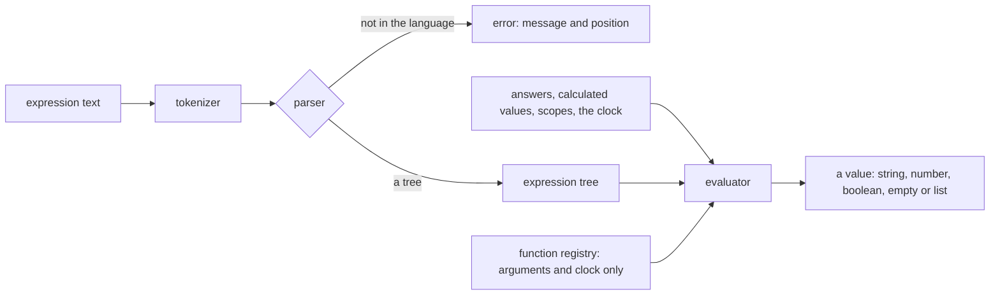

# Survey Logic

The survey's expression language as a workspace package: a tokenizer and parser that return a tree or a positioned error, and an evaluator over a record of answers. It is a grammar and an interpreter, so it is an engine of its own, and the [survey engine package](../resource-survey-form-engine-document/design.md) and the app both import it. The [math expression compiler](../../specs/math-expression-compiler/language/design.md) is numeric by design and stays out of this, since the survey's value model is strings, booleans, numbers and lists.

## How it works



## The language

- **Literals**: numbers, strings in single or double quotes, `true` and `false`, and lists in square brackets.
- **References**: `{name}` reads an answer by question name. A name may hold dots, so `{matrix.row1.col1}` reads a nested answer, tried first as a whole key and then as a path. Inside a dynamic panel, `{panel.name}` reads the panel's own answer, and inside a dynamic matrix row `{row.name}` reads the row's cell, both through the scopes the caller passes.
- **Operators, loosest to tightest**: `or` and `||`; `and` and `&&`; `not` and `!`; the comparisons `=`, `==`, `!=`, `<>`, `<`, `<=`, `>`, `>=`, `contains`, `notcontains`, `anyof`, `allof`, `empty` and `notempty`; `+` and `-`; `*`, `/` and `%`; `^`; and a unary minus.
- **Empty**: an unanswered reference is empty, an empty compares as false against anything but `empty`, and a comparison of an empty with a value is false, which is SurveyJS's rule and the oracle holds it.
- **Coercion**: a comparison of a number with a numeric string compares as numbers, as SurveyJS does; the oracle fixtures hold every case found.
- **Functions**: every built-in function of SurveyJS's function registry whose result depends only on its arguments and the clock. The functions that read the live survey object (`isContainerReady`, `isDisplayMode`, `displayValue`, `propertyValue`) are not implemented, since the package has no survey object. The clock is passed in the context, so a test fixes it.

## Decisions

- **Errors carry a position.** The parser returns a neverthrow result whose error holds a message and a character index, because the document's save check names the element and the Creator's builder shows the fault. Rejected: throwing, which loses the position at the first catch.
- **The oracle is SurveyJS while it is in the tree.** A throwaway script outside the repository runs SurveyJS's expression runner over a table of expressions and answer records at a fixed clock, and writes the results as JSON fixtures that the package's tests keep. SurveyJS leaves the tree afterwards, the fixtures stay. Rejected: fixtures written by hand, which would record what the package does rather than what SurveyJS does.
- **The package is private.** It is consumed by the app and the functions only, so it has no npm entry to keep alive. Rejected: publishing it, which adds a trusted-publisher entry for a package no one outside the repository has asked for.
- **Dates are strings until a function reads them.** The value model has no date value; a date function parses its string arguments with the same rules SurveyJS uses and returns a string or a number.

## Key files

| File                                             | Role after the change                                     |
| ------------------------------------------------ | --------------------------------------------------------- |
| `packages/survey-logic/package.json`             | the private package's manifest                            |
| `packages/math-expression-compiler/src/index.ts` | the sibling package's barrel, the layout this one follows |

New files land here:

```text
packages/survey-logic/src/models/       SurveyExpressionNode, SurveyLogicValue, SurveyLogicContext, SurveyLogicError, SurveyLogicFunction
packages/survey-logic/src/services/     tokenizeSurveyExpression, parseSurveyExpression, evaluateSurveyExpression, runSurveyExpression,
                                        checkSurveyExpression, collectSurveyExpressionReferences, one module per function under functions/
packages/survey-logic/src/services/fixtures/   oracleFixtures.json and the test that replays it
```

## Notes

- The function list is enumerated from SurveyJS's registry when the functions are written, and each implemented function is a row in the package's README, so a function SurveyJS has that is not implemented is visible there rather than missing silently.
