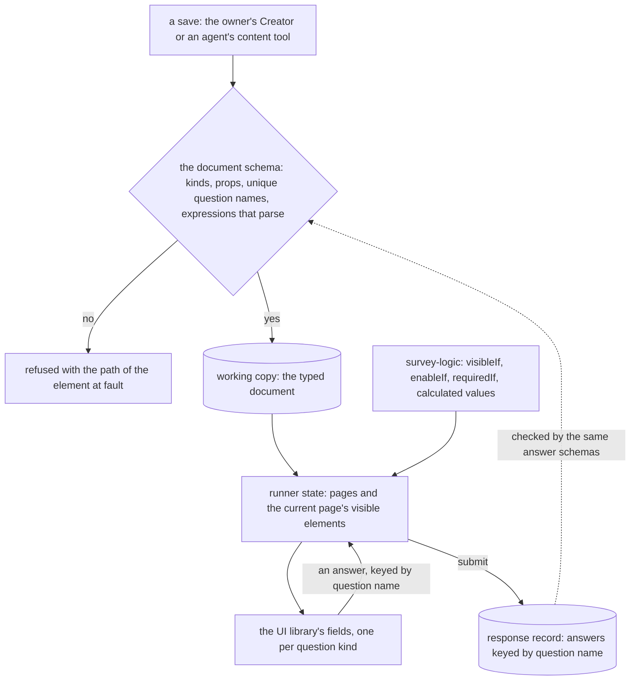
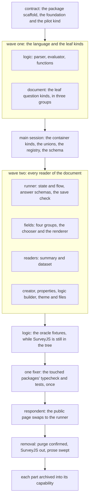

# Survey Form Engine Program

The survey is rebuilt as a typed document of our own, validated on every save, answered by a runner and authored in a Creator, both built on the headless block editor core and the UI library. SurveyJS is removed, and the stored data of the old survey type is deleted by a one-time purge through the per-resource purge. This page holds the decisions and the gap analysis that span the parts; each part is its own change with the same prefix.

## Parts

- [Logic](../resource-survey-form-engine-logic/design.md): the expression language, as the `survey-logic` package
- [Document](../resource-survey-form-engine-document/design.md): the `survey-engine` package, the typed document, its question kinds and its checks on save
- [Runner](../resource-survey-form-engine-runner/design.md): page flow, conditions, validation and completion, as plain functions in `survey-engine`
- [Fields](../resource-survey-form-engine-fields/design.md): one component per question kind, and the page renderer
- [Respondent](../resource-survey-form-engine-respondent/design.md): the public page, its resume and its submit
- [Readers](../resource-survey-form-engine-readers/design.md): the summary cards and the dataset columns
- [Creator](../resource-survey-form-engine-creator/design.md): the editor shell, history, canvas, layers and palette
- [Properties](../resource-survey-form-engine-properties/design.md): the property grid and the list editors
- [Logic builder](../resource-survey-form-engine-logic-builder/design.md): a condition built beside its raw expression
- [Theme and files](../resource-survey-form-engine-theme-files/design.md): the theme subset and the uploads
- [Removal](../resource-survey-form-engine-removal/design.md): the purge, SurveyJS's removal and the prose it makes stale

## How it works

A survey is stored as one typed object: its settings and its document, a root holding pages, pages and panels holding elements, and questions holding none. Every write passes the document schema before it is stored, from the owner's Creator and from an agent's content tool. The readers (the runner, the response summary and the dataset) read the same typed object.

The document schema is the one check on a save. The runner evaluates conditions through the expression package and validates each answer with the question's own answer schema, and the server runs that same validation on a write, so the server and the respondent's browser refuse the same answer for the same reason.

## Build order

Every part is written against the contracts its design states, so the parts that do not read each other's code are built at the same time. The two packages are scaffolded first. The shared files that name every question kind (the type enum, the node union, the children port, the registry and the definition map) are written once, by the main session, before the kinds are built, so that building a kind creates its own files and edits no shared one.

The work runs in two waves, because the document's kinds are what every later unit is typed by and the container kinds need the others' types. The first wave builds the language and the kinds; the main session then writes the shared kind files and the container kinds; the second wave builds everything that reads the document, each unit in its own worktree against the contracts above.

The respondent page and the Editor blade are the only places that stop using SurveyJS, and they swap in the same release that removes it, because binding the new page to the typed document earlier would leave SurveyJS saving documents the new schema refuses.

## Decisions

- **The document and the runner are a package.** Neither needs the app: the kinds, the registry, the save check and the runner's functions depend on the headless core, the expression language and plain libraries, and the server, the functions and the browser all run them. A package gives them the plain-Node test environment and one import for the three callers. The fields, the Creator, the store and the readers stay in the app, because they are drawn with its UI library or read its dataset types. Rejected: keeping the document in the app's shared folder as the webpage document does, which the webpage needs because it renders the Note's rich text and the app's tokens, and the survey needs neither. Both packages are private: nothing outside the repository has asked for them, and a published package owns a trusted-publisher entry that lapses when unused.
- **The scan no longer gates the build.** The earlier plan scanned every stored survey for the kinds, functions and languages in use, and built only those. The scan needs the production environment, and the stored surveys are deleted rather than converted, so the scan would only rank work and never protect data. The program builds every question kind in the gap analysis except the ones its deferred pages record. Rejected: building only what a scan finds, which blocks the whole program on read access to production for a ranking nothing else needs.
- **Question kinds keep SurveyJS's tags.** A kind's tag is the string SurveyJS uses (`radiogroup`, `paneldynamic`, `multipletext`), so the expression oracle, the dataset's column rules and anyone reading an exported document line up. Rejected: names of our own, which buy nothing the type enum's member names do not.
- **Respondent file and signature questions are not built.** Both write a respondent's bytes through a public, unauthenticated surface, which needs an upload endpoint, a per-respondent quota and a place for the bytes that the response row, bounded to one table property, cannot hold. That is a design of its own, recorded as a deferred page, and a survey does not need it to be complete.
- **The dropdown matrix is not built.** The dynamic matrix covers a matrix with typed columns, and a fixed-row dropdown matrix is that matrix with its row count locked. It is a deferred page.
- **Translations and the full theme editor are not built.** No owner has asked for either, each is large, and each has a deferred page with the trigger that revives it.
- **The JSON editor tab is rejected.** Import and export cover the need, and a raw-document editor is a second way to write the document that the property grid's forms already refuse to need.
- **A kind is added once, in its own files.** Rejected: each agent adding its kind to the shared files, which turns twenty parallel units into a merge conflict on seven files.

## Gap analysis

Each row is a feature SurveyJS provides today, or one the app relies on, with the replacement and the part that closes it. **Match** means the replacement does what SurveyJS does for the app. **Beat** means it does it better, with the reason stated. **Drop** means the replacement does not build it, and names the page that records it. A row whose verdict is not met blocks the program.

| Feature                                                   | SurveyJS today                                               | Replacement                                                                 | Verdict                                                                              | Closed by                                                                                                                      |
| --------------------------------------------------------- | ------------------------------------------------------------ | --------------------------------------------------------------------------- | ------------------------------------------------------------------------------------ | ------------------------------------------------------------------------------------------------------------------------------ |
| Page flow, progress and navigation                        | Runner pages                                                 | Pure runner functions over the document's pages                             | Match                                                                                | [Runner](../resource-survey-form-engine-runner/design.md)                                                                      |
| Visibility, enablement and requiredness conditions        | Expression language                                          | `survey-logic`, every function that depends only on its arguments and clock | Match                                                                                | [Logic](../resource-survey-form-engine-logic/design.md)                                                                        |
| Expression syntax checked on save                         | Not checked; a malformed expression fails in the runner      | Checked on save, refused with the element's path                            | Beat                                                                                 | [Document](../resource-survey-form-engine-document/design.md)                                                                  |
| Calculated values and expression validators               | Supported                                                    | Supported over `survey-logic`                                               | Match                                                                                | [Runner](../resource-survey-form-engine-runner/design.md)                                                                      |
| Required checks, messages and focus on the first error    | Supported                                                    | Supported through each answer's schema                                      | Match                                                                                | [Runner](../resource-survey-form-engine-runner/design.md)                                                                      |
| Text, comment, number and date inputs                     | Text with input type, comment                                | Typed kinds, numbers and dates by schema                                    | Match                                                                                | [Document](../resource-survey-form-engine-document/design.md), [Fields](../resource-survey-form-engine-fields/design.md)       |
| Boolean, radio, dropdown, checkbox, tag box, button group | Supported                                                    | One field per kind on the UI library                                        | Match                                                                                | [Fields](../resource-survey-form-engine-fields/design.md)                                                                      |
| Rating, ranking, slider                                   | Supported                                                    | Supported                                                                   | Match                                                                                | [Fields](../resource-survey-form-engine-fields/design.md)                                                                      |
| Matrix, dynamic matrix, dynamic panel, multiple text      | Supported                                                    | Supported                                                                   | Match                                                                                | [Fields](../resource-survey-form-engine-fields/design.md)                                                                      |
| Image picker, expression, html and image elements         | Supported                                                    | Supported; html sanitised                                                   | Match                                                                                | [Fields](../resource-survey-form-engine-fields/design.md)                                                                      |
| File and signature questions                              | Supported                                                    | Not built                                                                   | Drop, [recorded](../../deferred/resource/survey-respondent-file-questions/design.md) | none                                                                                                                           |
| Dropdown matrix                                           | Supported                                                    | Not built; the dynamic matrix covers it                                     | Drop, [recorded](../../deferred/resource/survey-dropdown-matrix/design.md)           | none                                                                                                                           |
| Completion message                                        | Sanitised html                                               | Sanitised html                                                              | Match                                                                                | [Respondent](../resource-survey-form-engine-respondent/design.md)                                                              |
| Resume on the same device, shared-device rule             | Per-survey local id                                          | Same rule, same spec scenarios                                              | Match                                                                                | [Respondent](../resource-survey-form-engine-respondent/design.md)                                                              |
| Autosave of answers and of the Creator                    | Autosave                                                     | Autosave through the store's save path                                      | Match                                                                                | [Respondent](../resource-survey-form-engine-respondent/design.md), [Creator](../resource-survey-form-engine-creator/design.md) |
| Keyboard and ARIA behaviour of every field                | Library's own                                                | Each field meets the UI library's contract, tested per style                | Match, owner checks screen readers                                                   | [Fields](../resource-survey-form-engine-fields/design.md)                                                                      |
| Look and theme                                            | SurveyJS theme, its own colours and fonts                    | Follows the app's design styles; logo, accent and background                | Beat: one look across the app's styles                                               | [Theme and files](../resource-survey-form-engine-theme-files/design.md)                                                        |
| Theme editor's full range                                 | Colours, fonts, backgrounds, backgrounds per page            | Logo, accent and background only                                            | Drop, [recorded](../../deferred/resource/survey-theme-editor/design.md)              | none                                                                                                                           |
| Logic tab (condition builder)                             | Builder beside the raw expression                            | Builder beside the raw expression                                           | Match                                                                                | [Logic builder](../resource-survey-form-engine-logic-builder/design.md)                                                        |
| Designer: add, move, delete, duplicate, rename            | Supported                                                    | The core's tree commands                                                    | Match                                                                                | [Creator](../resource-survey-form-engine-creator/design.md)                                                                    |
| Drag reorder                                              | Pointer drag only                                            | Pointer drag with the same command on the keyboard                          | Beat                                                                                 | [Creator](../resource-survey-form-engine-creator/design.md)                                                                    |
| Undo and redo                                             | Supported                                                    | The bounded history                                                         | Match                                                                                | [Creator](../resource-survey-form-engine-creator/design.md)                                                                    |
| Choice, matrix and column editors                         | Supported                                                    | Own components                                                              | Match                                                                                | [Properties](../resource-survey-form-engine-properties/design.md)                                                              |
| Logo, image question and image choice uploads             | Supported with delete hooks                                  | Through FileAssets with the same delete hooks                               | Match                                                                                | [Theme and files](../resource-survey-form-engine-theme-files/design.md)                                                        |
| Preview                                                   | Creator's preview                                            | The runner itself                                                           | Match                                                                                | [Creator](../resource-survey-form-engine-creator/design.md)                                                                    |
| JSON import, export and clear                             | Supported                                                    | Supported over the typed document                                           | Match                                                                                | [Creator](../resource-survey-form-engine-creator/design.md)                                                                    |
| JSON editor tab                                           | Edits the raw JSON                                           | Not built; import and export cover the need                                 | Drop, [recorded](../../rejected/resource/survey-json-editor-tab/design.md)           | none                                                                                                                           |
| Translation tab and multi-language surveys                | Supported                                                    | Not built                                                                   | Drop, [recorded](../../deferred/resource/survey-translations/design.md)              | none                                                                                                                           |
| Stored data shape                                         | JSON string, checked as an object                            | Typed document, checked on every save                                       | Beat                                                                                 | [Document](../resource-survey-form-engine-document/design.md)                                                                  |
| Client weight                                             | Two engines loaded on the survey routes                      | Our own code only                                                           | Beat                                                                                 | [Removal](../resource-survey-form-engine-removal/design.md)                                                                    |
| Licence                                                   | Creator commercially licensed under an open-source exception | None                                                                        | Beat                                                                                 | [Removal](../resource-survey-form-engine-removal/design.md)                                                                    |
| Response record and summary cards                         | As stated by the response summary spec                       | Same record shape and cards, rewritten over the typed kinds                 | Match                                                                                | [Readers](../resource-survey-form-engine-readers/design.md)                                                                    |
| Dataset columns and column types                          | Read from SurveyJS's JSON                                    | Read from the typed document                                                | Match                                                                                | [Readers](../resource-survey-form-engine-readers/design.md)                                                                    |

## Options considered

| Option                                              | Verdict    | Why                                                                                                                                                                                                                |
| --------------------------------------------------- | ---------- | ------------------------------------------------------------------------------------------------------------------------------------------------------------------------------------------------------------------ |
| Keep SurveyJS and check its document on save        | Rejected   | The owner rules out a third-party engine for the survey, and the Creator's licence exception ends with paid tiers. See its [rejected folder](../../rejected/resource/survey-keep-and-type-the-document/design.md). |
| Convert stored surveys to the new document          | Not chosen | The owner decided against a migration of stored survey data.                                                                                                                                                       |
| Keep stored surveys read-only beside the new survey | Not chosen | The owner decided to delete the old survey type's data.                                                                                                                                                            |
| An open-source form library                         | Rejected   | A second form engine beside the app's schema forms, with its own JSON and styling, and a third-party dependency the owner has ruled out.                                                                           |
| Our own typed model, runner and Creator             | Chosen     | No third-party dependency for the survey, one form model, and the core and schema forms the app already has.                                                                                                       |

The dependency admission test would keep SurveyJS as an engine, since its stop list names survey runtimes among the engines that stay whatever their size. The owner's decision overrides that entry, which the removal part edits with the reason recorded there.

## Key files

| File                                                         | Role after the program                                                   |
| ------------------------------------------------------------ | ------------------------------------------------------------------------ |
| `apps/web/shared/models/resource/survey/SurveyResource.ts`   | the survey resource schema, now the typed document checked on every save |
| `apps/web/server/trpc/routers/survey.ts`                     | the resource factory and response procedures, saving the typed document  |
| `apps/web/app/store/survey/index.ts`                         | the save path, taking the typed object                                   |
| `apps/web/app/composables/survey/useSurveyCreator.ts`        | rewritten: the Creator's state over the core's tree and history          |
| `apps/web/app/composables/survey/useSurveyResponse.ts`       | the respondent's resume and submit, over the runner's state              |
| `apps/web/app/components/Resource/Survey/Editor.vue`         | the Editor blade, rendering the new Creator                              |
| `apps/web/app/components/Resource/Survey/View.vue`           | the respondent page, rendering the new runner                            |
| `packages/headless-block-editor`                             | the core the document, runner and Creator are built on                   |
| `packages/survey-logic`                                      | the expression language                                                  |
| `packages/survey-engine`                                     | the typed document, its checks and the runner, with no framework or DOM  |
| `openspec/specs/architecture/dependency-admission/design.md` | the stop list's survey entry, edited with the owner's decision           |

## Notes

- The core is shipped, with the page builder's webpage and email editors as its consumers. The survey is the first consumer whose root holds pages, so a gap in the core is fixed in the core in its own commit.
- Accessibility is the largest risk the owner takes on. The runner and Creator meet the UI library's contracts component by component, and the owner checks labelled fields and screen-reader behaviour by hand.
- A program bound to a survey reads that survey's responses, so its funnel empties when the rows are deleted, and the binding goes with the survey.
- A survey invite block in a webpage or email links a deleted survey's public page after the purge. The one-time run removes each such reference as part of the deletion.

## Sources

- [SurveyJS licensing](https://surveyjs.io/licensing) and its [licensing FAQ](https://surveyjs.io/faq/licensing), which state the Creator's commercial licence and the open-source exception the app relies on.
- [SurveyJS conditional logic](https://surveyjs.io/form-library/documentation/design-survey/conditional-logic), read for the condition language the expression package must cover.
