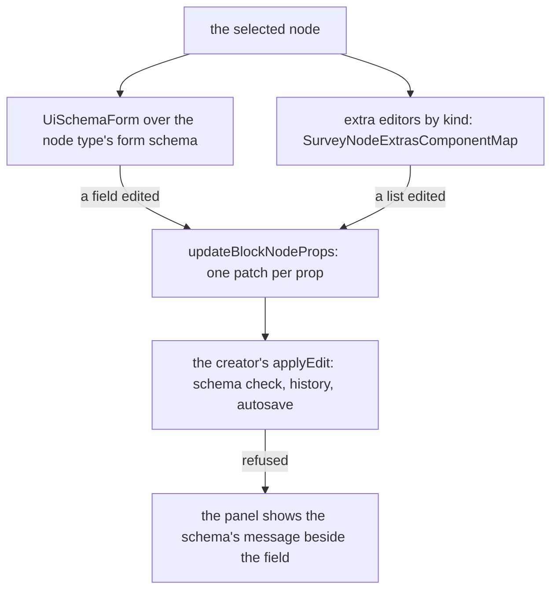

# Survey Properties

The right pane's Properties tab of the [Creator](../resource-survey-form-engine-creator/design.md): the selected element's settings, drawn from the same props schema the [document](../resource-survey-form-engine-document/design.md) checks.

## How it works



## Decisions

- **The form is the schema.** Each kind's form schema is drawn by the schema form, so a setting appears only if the kind's props schema has it. Snapshot tests of each form schema, as the [schema forms](../../specs/architecture/schema-forms/design.md) standard requires, keep the form and the schema from drifting.
- **The list editors are the panel's own.** A schema form cannot draw a reorderable list of objects with unique values, so the choice list, the matrix column table and the multiple text item list are components, mounted beside the form by a map keyed by kind. Each keyboard-reorders through the library's reorderable list, with its Alt+arrow moves.
- **A choice's value is unique within its list.** The editor refuses a duplicate with a message, because a response keys by value. Rejected: a refinement in the document schema, which would refuse a document an agent wrote with a harmless repeat the editor can simply flag.
- **Image editors are the theme-and-files part's.** Beside the map's entries for `imagepicker` and `image`, that part adds the upload editors; the map file is created here and edited there, and the later agent settles a conflict in its own lines.

## Key files

| File                                              | Role after the change                                  |
| ------------------------------------------------- | ------------------------------------------------------ |
| `apps/web/app/components/Ui/SchemaForm/Index.vue` | the schema form the panel draws a kind's settings with |
| `apps/web/app/components/Ui/TextField.vue`        | the field the list editors' text cells are drawn with  |

New files land here:

```text
apps/web/app/components/Resource/Survey/Creator/Properties.vue         the panel: form, then the kind's extras
apps/web/app/components/Resource/Survey/Creator/ChoiceListEditor.vue   value and text rows, add, remove, reorder, paste lines
apps/web/app/components/Resource/Survey/Creator/MatrixColumnsEditor.vue  name, title, cell type, choices, required
apps/web/app/components/Resource/Survey/Creator/MultipleTextItemsEditor.vue
apps/web/app/services/resource/survey/SurveyNodeExtrasComponentMap.ts   kind to its extra editors
```
