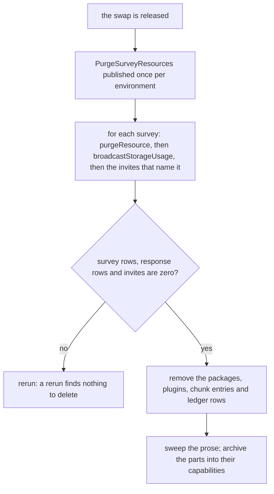

# Survey Removal

The last part of the [survey form engine program](../resource-survey-form-engine-program/design.md): it runs after the [respondent](../resource-survey-form-engine-respondent/design.md) part's swap, because the purge deletes what the old pages wrote and the removal deletes what they ran on.

## How it works

## Decisions

- **The purge is deletion only.** It runs the flowchart retirement's steps in their fixed order, the blob directory first and the row last, with the survey's response partition added before the storage ledger entries, and it converts nothing. A one-time job earns no test, so it carries guards inside it and its run output is the proof.
- **The purge exists already and is run by the owner.** Starting it is publishing one event to the application topic in each environment, which only the owner can do.
- **The removal waits for the purge.** The package removal and the picker's release both wait until each environment reports zero surveys, because a stored survey in the old shape is unreadable once the new schema is bound.

## Key files

| File                                                                   | Role after the change                                          |
| ---------------------------------------------------------------------- | -------------------------------------------------------------- |
| `apps/functions/src/services/resource/purgeSurveyResources.ts`         | the one-time purge, run once per environment                   |
| `apps/functions/src/services/resource/removeSurveyInviteReferences.ts` | removes the invites that name a deleted survey                 |
| `apps/web/app/services/survey/registerSurveyPlugin.ts`                 | removed with SurveyJS's runner plugin                          |
| `apps/web/app/services/survey/registerSurveyCreatorPlugin.ts`          | removed with SurveyJS's Creator plugin                         |
| `apps/web/shared/services/survey/parseSurveyModel.ts`                  | removed: nothing parses a string once the content is an object |
| `apps/web/app/services/survey/constants.ts`                            | the old theme key constant, removed with SurveyJS's theme      |
| `apps/web/configuration/build.ts`                                      | the Creator's chunk entry, removed                             |
| `apps/web/package.json`                                                | the four SurveyJS dependencies, removed                        |
| `pnpm-workspace.yaml`                                                  | the four SurveyJS catalog entries, removed                     |
| `.agents/ledgers/dependencies.md`                                      | the four SurveyJS rows, removed with their packages            |
| `openspec/specs/architecture/dependency-admission/design.md`           | the stop list's survey entry, edited with the owner's decision |
| `openspec/specs/architecture/agent-content-tools/design.md`            | the survey row of the schema-fidelity rule, updated            |
| `openspec/specs/resource/survey-resource/design.md`                    | the old survey capability, rewritten as built                  |
| `openspec/specs/resource/survey-response-controls/design.md`           | kept: the controls are unchanged                               |
| `openspec/specs/resource/survey-response-summary/design.md`            | the summary capability, rewritten as built                     |
| `openspec/specs/math-expression-compiler/language/design.md`           | its pointer to the survey's condition language, re-pointed     |
| `openspec/changes/resource-roadmap/tasks.md`                           | carries the program as an open item, which closes with it      |

## Notes

- The folders the program's first plan listed for removal (`survey-response-controls`, `-management`, `-modes`, `-summary` and `webpage-survey-invite-blocks`) describe behaviour that survives, so they are kept and corrected, not removed.
