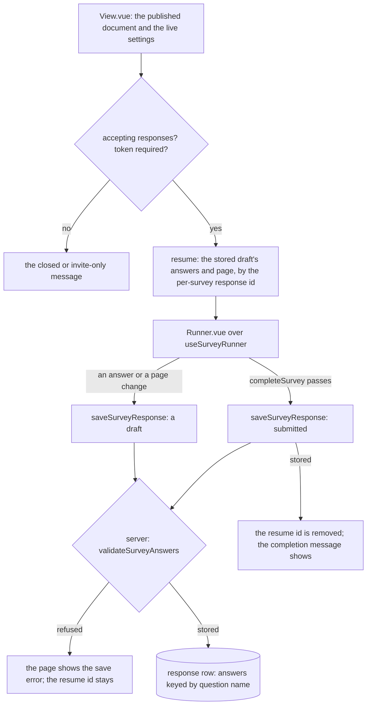

# Survey Respondent

The public respondent page, its resume and submit, and the binding of the survey's stored content to the typed document. It is the swap: the part after which nothing in the survey reads SurveyJS's string, built on the [runner](../resource-survey-form-engine-runner/design.md) and the [fields](../resource-survey-form-engine-fields/design.md), and the Creator the [Editor blade](../resource-survey-form-engine-creator/design.md) swaps to in the same change.

## How it works

The behaviour the [survey resource](../../specs/resource/survey-resource/design.md) states today is kept: resume on the same device by a per-survey response id scoped by the participant token, the submitted row that a shared device cannot reopen, the sanitised completion message, and the closed and invite-only states read live from the settings.

## Decisions

- **The binding is one change.** The resource's content schema, the store, the router, the readers of the old string (the live-content merge, the live read, the creation default, the agent content tools) and the two pages move together. Rejected: binding the schema first, which leaves SurveyJS saving a string the schema refuses.
- **The server runs the runner's validation.** `validateSurveyAnswers` takes the published document and the answers, a draft checking each present answer and a submit also the visible required ones. Rejected: trusting the browser, since the response procedures are public and rate limited and the answers are the only unauthenticated write.
- **The server validates against the published snapshot, the document the page served.** A name the document does not hold is refused, so a response record can hold only a question's answers. A republish that removes a question is met on the client: resuming a draft drops the answers whose names the document no longer holds, so the next write is not refused. Rejected: recording the content version on each response and reading the snapshot of that version, which adds an entity field and a read by version for a case the resume already handles.
- **Answers keep their record shape.** The answer record stays a flat object keyed by question name, so the response summary, the Responses blade and the dataset read it as they do now.

## Key files

| File                                                            | Role after the change                                                   |
| --------------------------------------------------------------- | ----------------------------------------------------------------------- |
| `apps/web/shared/models/resource/survey/SurveyResource.ts`      | the content schema, now `{ document, settings }`                        |
| `apps/web/app/store/survey/index.ts`                            | the save path taking the document; `saveModel` becomes `saveDocument`   |
| `apps/web/app/components/Resource/Survey/View.vue`              | the respondent page, rendering the runner                               |
| `apps/web/app/composables/survey/useSurveyResponse.ts`          | resume and submit over the runner's state                               |
| `apps/web/app/components/Resource/Survey/Editor.vue`            | the Editor blade, swapped to the Creator in the same change             |
| `apps/web/server/trpc/routers/survey.ts`                        | the resource factory and response procedures, saving the typed document |
| `apps/web/server/services/survey/resolveSurveyResponseWrite.ts` | the write path that gains the answer validation                         |
| `apps/web/server/services/survey/reapplySurveyLiveContent.ts`   | the live settings merged over a snapshot, over the new content shape    |
| `apps/web/server/services/survey/readLiveSurvey.ts`             | the live read of the survey's content                                   |
| `apps/web/shared/services/survey/parseSurveyModel.ts`           | removed: nothing parses a string once the content is an object          |
| `apps/web/shared/models/db/survey/SurveyResponseModel.ts`       | the answer record's shape, unchanged                                    |

## Notes

- The respondent page's theme, from the [theme and files](../resource-survey-form-engine-theme-files/design.md) part, is applied by the renderer, so this page only mounts it.
