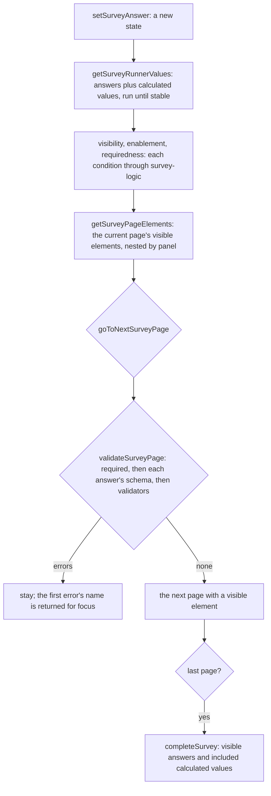

# Survey Runner

The state a respondent's session moves through, as plain functions in the `survey-engine` package with no DOM and no framework, over the [typed document](../resource-survey-form-engine-document/design.md) and the [expression language](../resource-survey-form-engine-logic/design.md). The respondent's browser, the Creator's preview and the server's check of a written response call the same functions, so the three refuse the same answer for the same reason.

## How it works



## State and functions

The state is `{ answers, pageIndex, isCompleted }`, answers keyed by question name. Every function takes the document and the state and returns a new state or a derived value; none mutates.

- `createSurveyRunnerState(document, answers, pageIndex)`: a state, with the page clamped to the document.
- `getSurveyRunnerValues(document, answers, clock)`: the answers plus every calculated value and expression question, evaluated in order and repeated until stable, at most five passes, so a value that reads an earlier one settles.
- `checkSurveyNodeVisible`, `checkSurveyNodeEnabled`, `checkSurveyNodeRequired`: a node's condition over the values. No condition is visible, enabled and as required as the node's `isRequired`. A condition that fails to evaluate counts as not holding for `visibleIf` and `enableIf`, and as not required for `requiredIf`.
- `getSurveyVisiblePageIndexes` and `getSurveyPageElements`: the visible pages, and the current page's elements as a tree of `{ node, pointer, isEnabled, isRequired, children }`, a hidden panel hiding its children.
- `setSurveyAnswer`: the new state, with an empty answer removed from the record.
- `validateSurveyPage`: a list of `{ name, pointer, message }` for the current page's visible questions, in document order.
- `goToNextSurveyPage` and `goToPreviousSurveyPage`: the new state, or the errors that blocked the move, skipping pages with nothing visible. Moving back never validates.
- `completeSurvey`: validates every visible page, drops the answers of questions that are not visible, adds the included calculated values, and returns the answers or the errors.
- `getSurveyProgress`: the position among the visible pages.

## Answers

`SurveyAnswerValue` is a string, number, boolean, a list of those or a record from a name to one, bounded in depth and length. Each kind's answer is the value its row in the document's table states.

`createSurveyAnswerSchema(node)` returns the zod schema of one question's answer from its props: a text answer's length, pattern and input type; a choice answer that is one of the choices, or any string when the question has an other option; a list's minimum and maximum selected; a rating inside its scale; a slider inside its range and step; a matrix answer whose rows and columns are the question's; a dynamic matrix or panel inside its row or panel bounds with each cell checked by its column or template question. A pattern runs on the RE2 engine the app already uses, so a respondent's text cannot stall the check.

`validateSurveyAnswers(document, answers, isSubmitting)` checks a whole record against the document, for the server's write: a draft checks each present answer, and a submit also checks required questions that are visible. It returns the same messages the runner shows.

## Decisions

- **Plain functions, not a class.** The app's reactive wrapper holds the state in a ref and calls the functions, and the server calls them on a record. Rejected: a stateful class, which the server would construct per request to use one method and the preview would have to reset between runs.
- **Invisible answers are kept until completion.** An answer to a question that becomes hidden stays in the state, so a respondent who changes an earlier answer back finds theirs, and completion drops it. SurveyJS clears invisible values on complete by default and the runner matches it.
- **A condition that fails reads as not holding.** A survey that passed the save check cannot hold a malformed expression, so a failure here is an evaluation fault such as a function given a wrong argument, and the safe reading shows the question rather than hiding a required one.
- **The clock is a parameter.** Tests and the preview fix it; the app passes the current time.

## Key files

| File                                                             | Role after the change                                                                 |
| ---------------------------------------------------------------- | ------------------------------------------------------------------------------------- |
| `apps/web/shared/models/resource/survey/SurveyResponseRecord.ts` | the flattened record the readers read, unchanged                                      |
| `packages/survey-engine/package.json`                            | the package the runner's functions are written in                                     |
| `apps/web/app/composables/survey/useSurveyResponse.ts`           | the respondent's resume and submit, rewritten in the respondent part over this runner |

New files land here:

```text
packages/survey-engine/src/models/                   SurveyAnswerValue, SurveyRunnerState, SurveyElementView, SurveyPageError
packages/survey-engine/src/services/runner/          the functions above, one module each, and createSurveyAnswerSchema
apps/web/app/composables/survey/useSurveyRunner.ts   the reactive wrapper over the state
```

## Notes

- The messages the runner returns are constants in the runner's folder, so the fields and the server show one wording.
