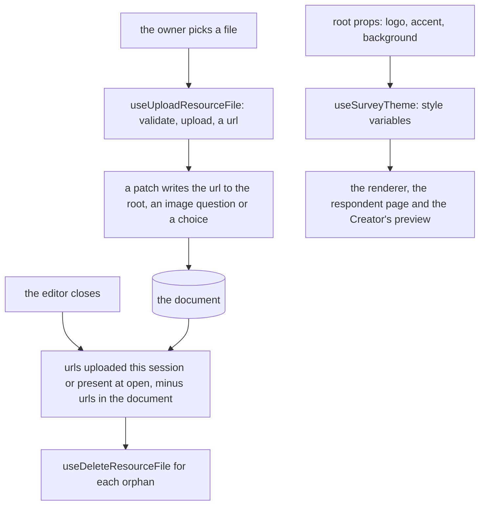

# Survey Theme And Files

The identity a survey carries, over the [document](../resource-survey-form-engine-document/design.md)'s root props, and the files its images are. It reuses the resource's [file assets](../../specs/resource/resource-file-assets/design.md) rather than a store of its own.

## How it works



## Decisions

- **The theme is a subset on the root.** Logo, accent colour (`#rrggbb`), background colour (`#rrggbb`), progress bar position and question numbering are root props the [Theme tab](../resource-survey-form-engine-creator/design.md) edits, so the theme is part of the document the readers and agents see. With no accent or background, the survey uses the design style's own tokens, which keeps one look across the app's styles.
- **Deletion waits for the editor to close.** A removal can be undone, and a file deleted at the edit would leave an undone image broken. Rejected: deleting at the edit as SurveyJS's hooks did, which breaks undo; rejected: deleting at each save, which breaks undo across a save. The sweep is best effort: a tab closed without unmounting skips it.
- **An upload is validated first.** The existing file validation runs before the upload, as it does for every resource.
- **A choice's image is a url string.** The document stores the url the upload returned, as the image kinds' props state.

## Key files

| File                                                  | Role after the change                                |
| ----------------------------------------------------- | ---------------------------------------------------- |
| `apps/web/app/composables/survey/useSurveyCreator.ts` | the Creator's state, which mounts the sweep on close |
| `apps/web/app/components/Ui/ColorField.vue`           | the colour field the accent and background use       |
| `apps/web/app/components/Ui/FileField.vue`            | the file field the logo and image uploads use        |

New files land here:

```text
apps/web/app/composables/survey/useSurveyTheme.ts                   root props to style variables
apps/web/app/composables/survey/useSurveyFiles.ts                   upload, collect the urls a document references, sweep the orphans
apps/web/app/components/Resource/Survey/Creator/Theme.vue           the Theme tab
apps/web/app/components/Resource/Survey/Creator/ImageChoicesEditor.vue   an image picker's choices with their uploads
apps/web/app/components/Resource/Survey/Creator/ImageUpload.vue    one image's upload, for the image question
```
