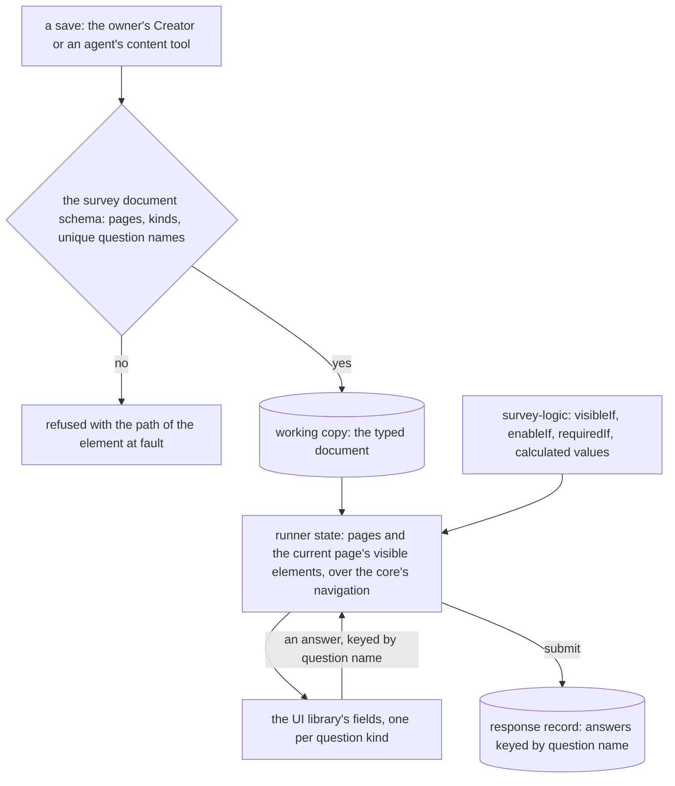

# Survey Form Engine

The survey is rebuilt as a typed document of our own, validated on every save, answered by a runner and authored in a Creator both built on the headless block editor core and the UI library. SurveyJS is removed in the same change, and the stored data of the old survey type is deleted, after the owner has confirmed the counts recorded below.

## How it works

A survey is stored as one typed object: its settings, a theme subset and its pages. Every write passes the schema before it is stored, from the owner's editor and from an agent's content tool. The readers (the runner, the response summary and the dataset) read the same typed object.

The schema is the one check. The runner evaluates conditions through the expression package and validates each answer with the question's own schema, so the server and the respondent's browser refuse the same answer for the same reason.

## The typed document

The document follows the shape the [headless block editor core](../../specs/headless-block-editor/editor-core/design.md) already checks: a root holding pages, pages and panels holding elements, and questions holding no children. The root declares its content, so the core's schema checks the tree and its ids, and the survey adds two rules.

- **Question names are unique across the whole survey**, because responses are keyed by name and a shared name would merge two questions' answers.
- **Each question's props are a Zod schema for its kind**: choices for the choice kinds, rows and columns for a matrix, the template of a dynamic panel. A question is a discriminated union on `type`, one variant per kind, and each variant's props are their own schema. The same schema drives the Creator's property grid and the runner's validation.

The theme is a subset: a logo, an accent and a background, held as the app's own tokens. Every model is an interface-first Zod schema with `satisfies z.ZodType`, one model per file, in `apps/web/shared/models/resource/survey/`.

## The expression package

Conditions, calculated values and required rules are written in an expression language over answers. It is a grammar of its own: `{name}` references bound to answers, a value model of strings, booleans and arrays, `=` as equality, `contains` and the list operators, and the functions the scan finds in use. It is a workspace package, since a grammar and an interpreter is an engine of its own and every package would otherwise import it through shared. The math expression compiler is numeric by design and stays out of this, since the survey's value model is different.

While the replacement is built, SurveyJS's own evaluation of each expression on a set of answers is the reference for the package's fixtures. The fixtures are kept as the package's tests once SurveyJS is removed.

## The runner

The runner is headless. Its state is page flow, each element's visibility, enablement and requiredness, per-answer validation and completion, built on the core's navigation and the expression package, with no DOM. A thin Vue renderer draws each question kind with the UI library's fields, so each field keeps the library's keyboard and ARIA contract, and each renderer has a component test of that contract once per style.

The respondent page keeps the behaviour the [survey resource](../../specs/resource/survey-resource/design.md) states today: resume on the same device by a per-survey response id, the submitted-row rule for a shared device, and the sanitised completion message. The answer record keeps its shape, answers keyed by question name, so the response summary and the dataset read it as they do now.

## The Creator

The Creator is built on the core's tree editing, which offers insert, move, move into the previous sibling, remove, duplicate and paste with checked slots, and on the core's undo history.

- **Canvas and layers** over the core's tree, with keyboard reorder and a pointer drag whose keyboard alternative is the same command.
- **Palette** of question kinds, inserted through the core's accepted-type check.
- **Property grid**, one `UiSchemaForm` per kind from its props schema, with the choice list and matrix editors as the Creator's own components, since a form cannot draw them.
- **Logic builder** over the expression package, writing an expression from an answer, an operator and a value, with the raw expression beside it and the package's errors shown.
- **Theme** over the subset, through the UI library's tokens.
- **Files** for the logo, image questions and image choices, through the FileAssets capability and its delete hooks.
- **Preview** is the runner. Import, export and clear are kept.

## Gap analysis

Each row is a feature SurveyJS provides today, or one the app relies on, with the replacement's plan and a verdict. **Match** means the replacement does what SurveyJS does for the app. **Beat** means it does it better, with the reason stated. **Drop** means the replacement does not build it, and the owner decides the drop before the change ships. A row whose verdict is not met blocks the change.

| Feature                                                            | SurveyJS today                                               | Replacement                                                            | Verdict                                |
| ------------------------------------------------------------------ | ------------------------------------------------------------ | ---------------------------------------------------------------------- | -------------------------------------- |
| Page flow, progress and navigation                                 | Runner pages                                                 | Headless runner over the core's navigation                             | Match                                  |
| Visibility, enablement and requiredness conditions                 | Expression language                                          | `survey-logic`, same operators and functions the scan finds            | Match                                  |
| Expression syntax checked on save                                  | Not checked; a malformed expression fails in the runner      | Checked on save, refused with the element's path                       | Beat                                   |
| Calculated values and expression validators                        | Supported                                                    | Supported over `survey-logic`                                          | Match                                  |
| Required checks, messages and focus on the first error             | Supported                                                    | Supported through each answer's schema                                 | Match                                  |
| Text, number and date inputs                                       | Text with input type                                         | Typed kinds, numbers and dates by schema                               | Match                                  |
| Boolean, radio, dropdown, checkbox, tag box                        | Supported                                                    | One field per kind on the UI library                                   | Match                                  |
| Rating and ranking                                                 | Supported                                                    | Supported                                                              | Match                                  |
| Matrix, dynamic matrix, dynamic panel                              | Supported                                                    | Supported where the scan finds them used; otherwise decided            | Drop until the owner decides           |
| Multiple text, slider, button group, image picker, signature, file | Supported                                                    | Supported where the scan finds them used; otherwise decided            | Drop until the owner decides           |
| Presentational html and image elements                             | Supported                                                    | Supported as read-only blocks                                          | Match                                  |
| Completion message                                                 | Sanitised html                                               | Sanitised html                                                         | Match                                  |
| Resume on the same device, shared-device rule                      | Per-survey local id                                          | Same rule, same spec scenarios                                         | Match                                  |
| Autosave of answers and of the Creator                             | Autosave                                                     | Autosave through the store's save path                                 | Match                                  |
| Keyboard and ARIA behaviour of every field                         | Library's own                                                | Each field meets the UI library's contract, tested per style           | Match, owner checks screen readers     |
| Look and theme                                                     | SurveyJS theme, its own colours and fonts                    | Follows the app's design styles; logo, accent and background as tokens | Beat: one look across the app's styles |
| Theme editor's full range                                          | Colours, fonts, backgrounds, backgrounds per page            | Logo, accent and background only                                       | Drop until the owner decides           |
| Logic tab (condition builder)                                      | Builder beside the raw expression                            | Builder beside the raw expression                                      | Match                                  |
| Designer: add, move, delete, duplicate, rename                     | Supported                                                    | Core's tree commands                                                   | Match                                  |
| Drag reorder                                                       | Pointer drag only                                            | Pointer drag with the same command on the keyboard                     | Beat                                   |
| Undo and redo                                                      | Supported                                                    | The core's history                                                     | Match                                  |
| Choice and matrix editors                                          | Supported                                                    | Own components                                                         | Match                                  |
| Logo, image question and image choice uploads                      | Supported with delete hooks                                  | Through FileAssets with the same delete hooks                          | Match                                  |
| Preview                                                            | Creator's preview                                            | The runner itself                                                      | Match                                  |
| JSON import, export and clear                                      | Supported                                                    | Supported                                                              | Match                                  |
| JSON editor tab                                                    | Edits the raw JSON                                           | Not built; import and export cover the need                            | Drop until the owner decides           |
| Translation tab and multi-language surveys                         | Supported                                                    | Not built unless the scan finds a survey in more than one language     | Drop until the owner decides           |
| Stored data shape                                                  | JSON string, checked as an object                            | Typed document, checked on every save                                  | Beat                                   |
| Client weight                                                      | Two engines loaded on the survey routes                      | Our own code only                                                      | Beat                                   |
| Licence                                                            | Creator commercially licensed under an open-source exception | None                                                                   | Beat                                   |
| Response record and summary cards                                  | As stated by the response summary spec                       | Same record shape and cards, rewritten over the typed kinds            | Match                                  |
| Dataset columns and column types                                   | Read from SurveyJS's JSON                                    | Read from the typed document                                           | Match                                  |

The drop rows are the owner's decisions. The scan of stored surveys in task 1.1 sets which kinds, functions and languages are used, so each "until the owner decides" row carries its count as a fact before the owner decides.

## Removal of the old survey type

The change removes SurveyJS and the old survey type's stored data in one step, so nothing of the old survey survives and nothing is converted. The migration deletes, for every survey resource of the old type:

- the resource's working copy, its published snapshots and its retained versions, with their content and file assets;
- every response row written under the survey, in Azure Table, keyed by the survey's id.

It also reports every reference to a deleted survey from the rest of the app, the survey invite blocks in webpages and emails, and from programs bound to a survey, so the owner knows what will show as empty or broken.

### Owner confirmation

The migration does not run until the owner has confirmed the counts below for each environment. The counts are read before the migration, by a read-only script, and recorded here. A row without a confirmed count blocks the migration in that environment.

| Environment                    | Survey resources | Response rows | Asset files  | Invite references | Confirmed by the owner |
| ------------------------------ | ---------------- | ------------- | ------------ | ----------------- | ---------------------- |
| Production                     | not yet read     | not yet read  | not yet read | not yet read      | no                     |
| Any other deployed environment | not yet read     | not yet read  | not yet read | not yet read      | no                     |

The rows are filled from the read, never estimated. A count that changes between the read and the migration is read again.

## Options considered

| Option                                              | Verdict    | Why                                                                                                                                                                                                                |
| --------------------------------------------------- | ---------- | ------------------------------------------------------------------------------------------------------------------------------------------------------------------------------------------------------------------ |
| Keep SurveyJS and check its document on save        | Rejected   | The owner rules out a third-party engine for the survey, and the Creator's licence exception ends with paid tiers. See its [rejected folder](../../rejected/resource/survey-keep-and-type-the-document/design.md). |
| Convert stored surveys to the new document          | Not chosen | The owner decided against a migration of stored survey data.                                                                                                                                                       |
| Keep stored surveys read-only beside the new survey | Not chosen | The owner decided to delete the old survey type's data.                                                                                                                                                            |
| An open-source form library                         | Rejected   | A second form engine beside the app's schema forms, with its own JSON and styling, and a third-party dependency the owner has ruled out.                                                                           |
| Our own typed model, runner and Creator             | Chosen     | No third-party dependency for the survey, one form model, and the core and schema forms the app already has.                                                                                                       |

The dependency admission test would keep SurveyJS as an engine, since its stop list names survey runtimes among the engines that stay whatever their size. The owner's decision overrides that entry, which is edited in this change with the reason recorded there.

## Key files

| File                                                                               | Role after the change                                                     |
| ---------------------------------------------------------------------------------- | ------------------------------------------------------------------------- |
| `apps/web/shared/models/resource/survey/SurveyResource.ts`                         | the survey resource schema, now the typed document checked on every save  |
| `apps/web/shared/models/resource/survey/SurveyResource.test.ts`                    | the schema's accepted and refused documents                               |
| `apps/web/shared/models/db/survey/SurveyResponseModel.ts`                          | the answer record's shape, unchanged, keyed by question name              |
| `apps/web/shared/services/survey/parseSurveyModel.ts`                              | removed: nothing parses a string once the document is an object           |
| `apps/web/shared/services/survey/constants.ts`                                     | the old theme key constant, removed with SurveyJS's theme                 |
| `apps/web/shared/models/pageBuilder/SurveyInviteNode.ts`                           | the invite block, whose survey references the migration reports           |
| `apps/web/server/trpc/routers/survey.ts`                                           | the resource factory and response procedures, saving the typed document   |
| `apps/web/server/models/dataset/surveyResponses/SurveyModelElement.ts`             | removed: replaced by the typed question union                             |
| `apps/web/server/services/dataset/surveyResponses/getSurveyModelDatasetColumns.ts` | the dataset's columns, read from the typed document                       |
| `apps/web/app/store/survey/index.ts`                                               | the save path, taking the typed object                                    |
| `apps/web/app/composables/survey/useSurveyCreator.ts`                              | rewritten: the Creator's state over the core's tree and history           |
| `apps/web/app/composables/survey/useSurveyResponse.ts`                             | the respondent's resume and submit, over the runner's state               |
| `apps/web/app/components/Resource/Survey/Editor.vue`                               | the Editor blade, rendering the new Creator                               |
| `apps/web/app/components/Resource/Survey/View.vue`                                 | the respondent page, rendering the new runner                             |
| `apps/web/app/components/Resource/Survey/Responses.vue`                            | the Responses blade, unchanged                                            |
| `apps/web/app/services/survey/getActions.ts`                                       | rewritten to the Creator's import, export and clear                       |
| `apps/web/app/services/survey/registerSurveyPlugin.ts`                             | removed with SurveyJS's runner plugin                                     |
| `apps/web/app/services/survey/registerSurveyCreatorPlugin.ts`                      | removed with SurveyJS's Creator plugin                                    |
| `apps/web/app/services/resource/survey/getSurveyResponseSummaryCards.ts`           | the summary's cards, read from the typed document                         |
| `apps/web/app/services/survey/summary/getSurveySummaryCards.ts`                    | the cards, keyed by the typed kinds in place of SurveyJS's classes        |
| `apps/web/app/services/survey/summary/getSurveySummaryCards.test.ts`               | the cards' tests, rewritten over the typed kinds                          |
| `apps/web/configuration/vite.ts`                                                   | the survey packages' optimise entries, removed                            |
| `apps/web/configuration/build.ts`                                                  | the Creator's chunk entry, removed                                        |
| `apps/web/package.json`                                                            | the four SurveyJS dependencies, removed                                   |
| `pnpm-workspace.yaml`                                                              | the four SurveyJS catalog entries, removed                                |
| `packages/headless-block-editor`                                                   | the core the runner and Creator are built on                              |
| `.agents/ledgers/dependencies.md`                                                  | the four SurveyJS rows, removed with their packages                       |
| `openspec/specs/architecture/dependency-admission/design.md`                       | the stop list's survey entry, edited with the owner's decision            |
| `openspec/specs/resource/survey-resource/design.md`                                | the old survey capability, removed at archive and rewritten as built      |
| `openspec/specs/resource/survey-response-controls/design.md`                       | the old controls capability, removed at archive                           |
| `openspec/specs/resource/survey-response-management/design.md`                     | the old management capability, removed at archive                         |
| `openspec/specs/resource/survey-response-modes/design.md`                          | the old modes capability, removed at archive                              |
| `openspec/specs/resource/survey-response-summary/design.md`                        | the old summary capability, removed at archive                            |
| `openspec/specs/resource/webpage-survey-invite-blocks/design.md`                   | the old invite capability, removed at archive                             |
| `openspec/specs/architecture/agent-content-tools/design.md`                        | the survey row of the schema-fidelity rule, updated                       |
| `openspec/changes/architecture-ai-native-resources-program/design.md`              | the Survey audit row, updated                                             |
| `openspec/specs/math-expression-compiler/language/design.md`                       | its pointer to the survey's condition language, re-pointed to this change |
| `openspec/changes/resource-roadmap/tasks.md`                                       | carries this change as an open item                                       |

New files are the expression package and the schema, runner and Creator modules in the survey's shared and app folders. They are named by the file-organisation and naming rules when each is written.

## Notes

- The core is built, and its first editor consumer, the page builder, is not shipped. This survey is the first consumer of a typed document root, so a gap in the core is fixed in the core in its own commit.
- Accessibility is the largest risk the owner takes on. The runner and Creator meet the UI library's contracts component by component, and the owner checks labelled fields and screen-reader behaviour by hand.
- A program bound to a survey reads that survey's responses, so its funnel empties when the rows are deleted. The owner count and the report list those bindings.
- A survey invite block in a webpage or email links a deleted survey's public page after the migration. The migration reports each block so the owner can remove it.

## Sources

- [SurveyJS licensing](https://surveyjs.io/licensing) and its [licensing FAQ](https://surveyjs.io/faq/licensing), which state the Creator's commercial licence and the open-source exception the app relies on.
- [SurveyJS conditional logic](https://surveyjs.io/form-library/documentation/design-survey/conditional-logic), read for the condition language the expression package must cover.
