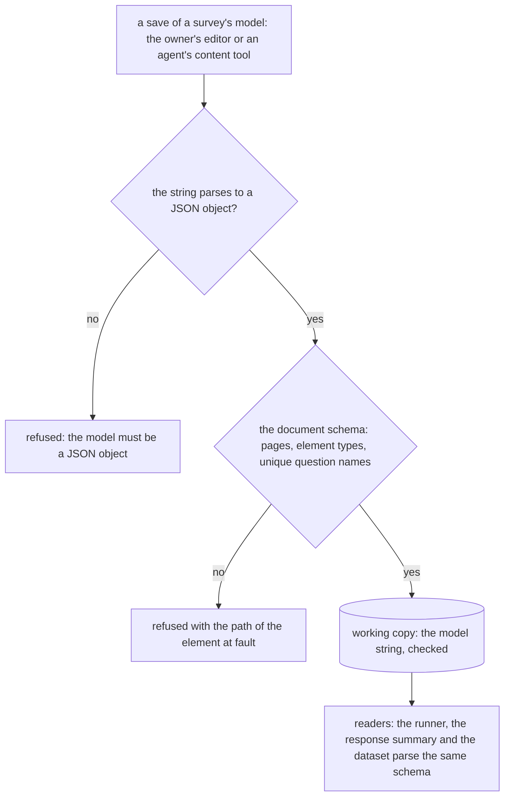

# Survey Form Engine

A survey's questions are stored as SurveyJS JSON in one string, and this design keeps SurveyJS as the engine while making the document it stores checked on every save, by the same schema the server and the agent tools share.

## How it works

Every write of a survey's model passes one check before it is stored. The check has three gates, in order: the string must parse to a JSON object, the object must satisfy the document schema, and only then does the survey's working copy take the string. The readers (the runner, the response summary and the dataset) keep parsing the same string, now known to satisfy the schema.

The schema checks what the server reads and nothing SurveyJS owns. A survey's theme, its styling, its localisation and its expression language stay in the JSON, untouched, and SurveyJS keeps interpreting them. What the server can say for certain is structural: every element has a name and a type the engine knows, a panel holds elements, and no two questions share a name, because responses are keyed by question name and a shared name would merge two questions' answers.

## The options

Each option is judged by the admission test in the [dependency admission design](../../specs/architecture/dependency-admission/design.md). A survey engine is on that page's stop list: an engine stays a package whatever its size, so the question is whether the engine costs us a behaviour we cannot change, a version we do not control, or a second way to do something we already do, not whether it is large.

### Keep SurveyJS (chosen)

The runner is `survey-core` with `survey-vue3-ui`, both MIT. The Creator is `survey-creator-core` with `survey-creator-vue`, which SurveyJS licenses commercially and the repository runs under the open-source exception recorded in the [rejected licence proposal](../../rejected/resource/survey-creator-licence/design.md). Both are loaded only on the routes that author or answer a survey, through [the runner's plugin](../../../apps/web/app/services/survey/registerSurveyPlugin.ts) and [the Creator's](../../../apps/web/app/services/survey/registerSurveyCreatorPlugin.ts), so no page pays for them at startup.

- **Weight.** Measured from the installed packages, `survey-core` and `survey-creator-core` are each a few hundred kilobytes gzipped; the Creator's Vue wrapper is tens of kilobytes. The score command reads the client's real bytes and is the figure of record.
- **Question types.** The Creator's toolbox offers about two dozen question types, enumerated from `survey-core`'s question factory, plus a panel. The repository's readers handle the subset they need: the summary's cards cover boolean, radio group, dropdown, checkbox, tag box, rating and text, and the dataset maps boolean, rating, number, date and text, with every other kind a string column and the presentation kinds (html and image) left out.
- **Logic.** Conditions, calculated values and validators are SurveyJS's expression language, which includes `iif`, `sum`, `contains`, `anyof`, `allof`, `age`, the date functions and a set of aggregates. Nothing on the server evaluates it. A malformed expression is a runner error, not a refused save.
- **Responses and export.** Answers are one JSON property per response in Azure Table, keyed by question name, and the owner reads them through the Responses blade and the dataset. Export goes through the dataset, not through SurveyJS.
- **Agent access.** An agent replaces the model whole through the content tools, and today the server accepts any JSON object. The schema in this change is what gives the agent a check it can read.
- **Behaviour.** The one charge the admission test finds is the look: the runner and the Creator draw their own theme, carried in the model under `THEME_KEY`, beside the app's style system. Accepted while owners need the engine's editor and runner, and it is the reason the replacement options below stay on the table.

### Own survey model on the ui-library and schema forms

This is the rebuild the [deferred survey editor core design](../../deferred/resource/survey-on-editor-core/design.md) describes: a survey as a typed document of pages, panels and questions over the headless block editor, a runner drawn with the UI library and a logic language of our own.

- **Licence.** None to buy. The cost is that the owner writes an engine: the logic language is a parser and evaluator over strings, booleans and arrays, a runner with about two dozen question components, and a creator.
- **What the app already has.** `UiSchemaForm` draws a form from a Zod schema and validates it, so each question type's properties form and the runner's per-question check can reuse it. It does not cover what a survey needs beyond a form: JSON Forms' rules are not used, so conditional visibility and calculated values have no home there, and the pages and their flow are new.
- **Migration.** Every stored survey is converted, and the responses keep working only where the converter keeps each question's name. The deferred design calls the work large, and it is deferred for that reason and because the page builder, its first consumer, is not yet on the core.

### Open-source form library

Candidates include Form.io (MIT, with a builder and a renderer), Formily (Apache-2.0, schema-driven, with linkage between fields) and FormKit (MIT, Vue-native). Their licences are as their repositories state them and are read again from the package manifest when the admission gate runs.

- **It is a second form engine.** Each candidate brings its own schema format, its own renderer and its own styling, and the app already draws forms from Zod. The admission test's third charge applies directly: two ways to draw a form.
- **Logic and pages.** Each has conditional logic and multi-step layout, in a model that is its own JSON, so the survey's JSON becomes a different JSON and the question names of every stored survey are mapped into the new keys.
- **Creator.** Form.io ships a builder. Formily's and FormKit's authoring surfaces are not a survey creator, so a creator would be ours to write, as in the second option.
- **Migration.** Like the second option, every stored survey is converted, with the same name-preservation risk for responses, and with the library's own styling replacing the theme.

## Comparison

| Option                            | Licence                                             | Weight                                                                | Question types and logic                                    | Agent access                                      | Migration of stored surveys                                 |
| --------------------------------- | --------------------------------------------------- | --------------------------------------------------------------------- | ----------------------------------------------------------- | ------------------------------------------------- | ----------------------------------------------------------- |
| Keep SurveyJS, check the document | MIT runner; Creator under the open-source exception | A few hundred kilobytes gzipped per engine, on the survey routes only | About two dozen types and SurveyJS's expressions, unchanged | A schema the agent's writes are checked against   | None: stored strings are checked, not rewritten             |
| Own model on the UI library       | None; our code                                      | Our code, plus the runner's components                                | What we write; a logic language of our own                  | Our typed document, read and written by the agent | Every survey converted; responses kept where names are kept |
| Open-source form library          | Per candidate; MIT or Apache-2.0                    | Per candidate, unmeasured                                             | Per candidate, in its own JSON                              | Its own JSON schema, a second form model          | Every survey converted, with a new JSON                     |

## Decision

Keep SurveyJS as the engine of the runner and the Creator, and check the document it stores on every save. Replacing the engine is not justified yet: the behaviour charge is real but no owner has asked for the engine's look to change, the replacement is large, and the licence cost is only due once paid tiers ship, which is a decision of its own. Adopting an open-source library is rejected for now, because it adds a second form engine beside the app's schema forms and converts every stored survey to a third JSON without removing the engine's weight.

The licence question is not closed by this change. It becomes due when [paid storage tiers](../resource-paid-storage-tiers/design.md) ship, and the roadmap carries it as an open item until the owner chooses between buying a Creator licence and building the Creator on the deferred core.

## Scope

- **Works today:** a survey saved with any JSON object is stored; an agent's write of a survey with a duplicate question name or an unknown type is stored as well.
- **This change adds:** the document schema, its check on every save, the typed element used by the dataset reader, the roadmap item for the licence, and the scan that sets the schema's rules before they are written.
- **Failure and retry:** a refused save changes nothing, so the owner keeps the editor's last valid state and the agent's write is retried after it fixes the element named in the refusal. Nothing runs in the background, so there is no retry queue.

## Migration

The scan (task 1) counts, across the working copies and the published snapshots, every question type, every expression function, nesting depth, model size and any survey whose question names repeat. The schema's rules are set to accept every survey the scan finds. A survey that would fail is repaired by its owner in the editor; it is never reset, since its responses are keyed by its question names and a reset would orphan them.

The model stays a string in storage. Changing it to an object would change every retained version's content address in the version store, rewriting the version store and the snapshot listing, and the persisted-data standard forbids reading both shapes. That cost is an open choice for the owner (below), not something this change pays.

## Open choices for the owner

- **Store the document as an object** instead of a string. The recommendation is no: the version store's content addresses would all change, and the gain is only the removal of a parse, which the schema already performs.
- **Check the document with SurveyJS's own model on the server**, which would parse expressions and catch malformed ones at save time, at the cost of adding `survey-core` to the server build. The recommendation is the schema alone, with expressions left to the runner.
- **Refuse a survey with a question type the installed engine does not know**, or accept types the schema lists. The recommendation is the schema's list, followed by the dependency-updates skill when the engine is bumped.
- **Licence path when paid tiers ship:** buy the Creator licence, or revive the deferred survey editor core. The recommendation is to buy while the Creator is the only authoring surface, and to revisit only if the look must change.

## Key files

| File                                                                               | Role after the change                                                                         |
| ---------------------------------------------------------------------------------- | --------------------------------------------------------------------------------------------- |
| `apps/web/shared/models/resource/survey/SurveyResource.ts`                         | the model check gains the document schema after the object check                              |
| `apps/web/shared/models/resource/survey/SurveyResource.test.ts`                    | the check's accepted stored shapes and refused documents                                      |
| `apps/web/shared/services/survey/parseSurveyModel.ts`                              | the one parse every reader uses, unchanged, now of a checked string                           |
| `apps/web/server/models/dataset/surveyResponses/SurveyModelElement.ts`             | the loose element type, replaced by the document's element type                               |
| `apps/web/server/services/dataset/surveyResponses/getSurveyModelDatasetColumns.ts` | the dataset's columns, read from the typed elements                                           |
| `apps/web/app/composables/survey/useSurveyCreator.ts`                              | the editor's autosave, whose refusal reaches the owner through the shared save                |
| `apps/web/app/components/Resource/Survey/View.vue`                                 | the runner, unchanged, reading a checked model                                                |
| `apps/web/app/services/resource/survey/getSurveyResponseSummaryCards.ts`           | the summary, unchanged, reading the same model                                                |
| `apps/web/app/services/survey/registerSurveyCreatorPlugin.ts`                      | the Creator's load on its routes, unchanged                                                   |
| `openspec/specs/resource/survey-resource/design.md`                                | the as-built data model, updated when the change ships                                        |
| `openspec/specs/architecture/agent-content-tools/design.md`                        | the survey row of the schema-fidelity rule, updated when the change ships                     |
| `openspec/changes/architecture-ai-native-resources-program/design.md`              | the audit row stating that SurveyJS constraints stay unchecked, updated when the change ships |
| `openspec/changes/resource-roadmap/tasks.md`                                       | carries the licence decision as an open item                                                  |

A new file for the document schema is not listed, since the schema is a new module in the survey's shared models folder, named by the file-organization rules when it is written.

## Notes

- The check covers the structure the server reads. A survey's expressions, its theme and its localised text are not validated on save, so a broken expression is still a runner error and not a refused save.
- The set of question types comes from the installed engine. An engine upgrade that adds a type makes a new survey using it refused until the schema's list follows, which is why the list is named in one place.
- A rename of a question changes its responses' column, and the check does not address it: names are unique, not stable.
- The check does not change how responses are stored. Answers stay one JSON property keyed by question name in Azure Table.

## Sources

- [SurveyJS licensing](https://surveyjs.io/licensing) and its [licensing FAQ](https://surveyjs.io/faq/licensing) — the Creator's commercial licence and the open-source exception that the decision relies on.
- [SurveyJS conditional logic](https://surveyjs.io/form-library/documentation/design-survey/conditional-logic) — the expression language the runner keeps interpreting.
- [Form.io](https://github.com/formio/formio), [Formily](https://github.com/alibaba/formily) and [FormKit](https://github.com/formkit/formkit) — the candidate open-source libraries; their licences and question sets are re-read from their manifests and documentation when the admission gate runs.
