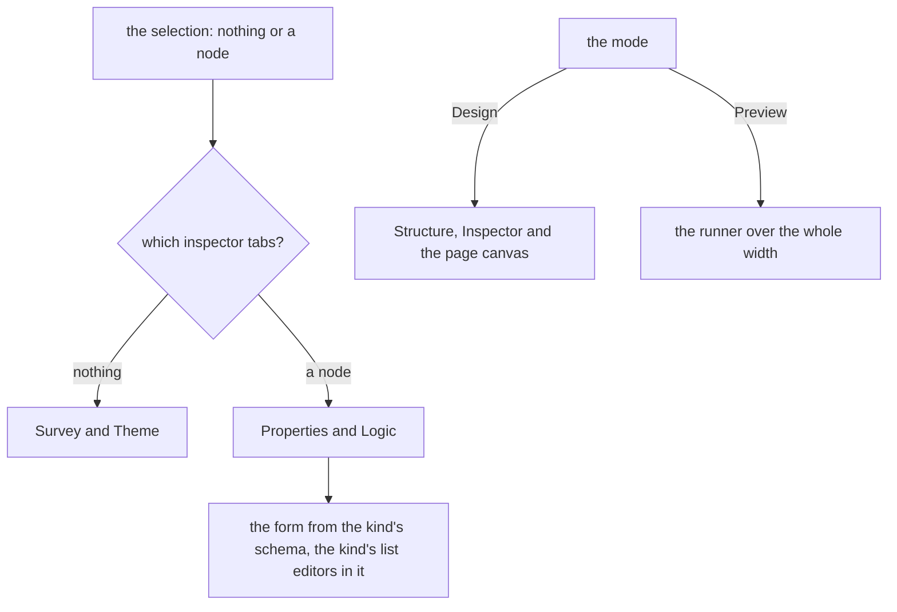

# Survey layout

The survey creator is the program's guided pole. A survey is a structured document, so the layout puts its structure first, shows only the settings that apply to what is selected, and leaves the mistakes to the [guardrails](../resource-editor-guardrails/design.md). It is a part of the [editor layout program](../resource-editor-layout-program/design.md), drawn by the [editor shell](../resource-editor-shell/design.md), and it changes the creator's arrangement and not its document, store, commands or check, which the [survey creator design](../../specs/resource/survey-creator/design.md) holds.

## How it works

The creator declares a layout of four regions and a registry of panel content, in two modes.

| Region    | Edge        | Opens        | Modes  | Holds                                                          |
| :-------- | :---------- | :----------- | :----- | :------------------------------------------------------------- |
| Bar       | top, docked | always       | both   | undo, redo, Add page, the mode switch and the problems surface |
| Structure | start       | on demand    | Design | tabs Outline and Add: the layers tree and the palette          |
| Inspector | end         | with content | Design | the selection's tabs, below                                    |
| Canvas    | the rest    | always       | both   | the page canvas in Design, the runner in Preview               |

Structure and Inspector are docked and resizable on an expanded window, and sheets on a medium or a compact one. Preview removes both, so the runner has the width a respondent has.

**The inspector's tabs follow the selection.** What is selected decides which tabs exist, so no tab is ever offered that has nothing to show. A page holds a visibility condition as an element does, so it takes the Logic tab too, and the calculated values, which belong to the survey, are in the Logic tab only while nothing is selected.

| Selection | Tabs                 | What each holds                                                                                              |
| :-------- | :------------------- | :----------------------------------------------------------------------------------------------------------- |
| Nothing   | Survey, Logic, Theme | the survey's own texts; the survey's calculated values; the theme, the logo and the files the survey carries |
| A node    | Properties, Logic    | a page's or an element's settings, drawn from its kind's schema; the conditions the node holds               |

The selection kinds the layout names are therefore two: nothing and a node, a page being a node with its own kind. A node's settings differ by its kind, and the existing registry of each kind's list editors keeps choosing them, inside the Properties tab, so the layout does not grow a selection kind per question type.

**The structure region has two tabs.** Outline is the layers tree the creator has, its keyboard surface and its drag and move commands unchanged. Add is the palette shell with its groups and search. A question can also be added where the reader is looking: the insertion menu the [guardrails](../resource-editor-guardrails/design.md) define opens at the end of a page and after a selected element, listing the kinds that slot accepts.

**The bar's controls are by use.** Undo, redo and Add page are every-edit actions and are pinned. The mode switch and the problems surface are always shown. Import, Export and Clear are occasional, and fold into the bar's overflow menu at every width, which keeps the bar one row on a phone with no second bar of buttons.

**A compact window.** The canvas keeps the window. Two buttons the shell places, Structure and Inspector, open the two regions as sheets from their own edges. The inspector's button is shown while something is selected, and the structure's is always shown. This replaces the one-pane-at-a-time tabs of the current narrow layout, which swap the canvas away to show a pane, so a reader who selects a question no longer loses sight of it to see its settings.

## Decisions

- **One inspector with tabs by selection.** Tabs shared by every selection gave a reader the ones that did nothing for what they had selected. Rejected: all tabs always, and a tab per selection kind, which grows with every question type. The tabs are chosen by two selection kinds and the node's own form is chosen inside one tab.
- **Logic stays with the element it edits.** The logic builder edits the conditions an element holds, so it is a tab of the element's inspector. Rejected: a Logic mode that replaces the canvas, as SurveyJS has, since these conditions belong to one element and the builder shows one element's rows. A map of the jumps across the survey is a different surface for a different question, and a later idea.
- **Preview is a mode that removes the editing regions.** A respondent sees no structure or inspector, and a preview that kept them is a preview of the wrong thing. Rejected: a preview in the canvas beside the editing panes, which narrows the runner to a column it is never shown in.
- **Theme is the survey's tab, not a mode.** The theme is a setting of the survey, shown with nothing selected, which is where the survey's own settings are. Rejected: a Theme mode, which would take the reader out of the canvas to change a colour and show them a preview of one already.
- **A compact window keeps the canvas and opens panes as sheets.** The reader selects on the canvas and wants to see what they selected. Rejected: the current one pane at a time, which makes selecting and seeing the settings two screens.
- **Occasional commands fold into the overflow menu at every width.** It is the responsive ladder's third rung, and the only rung a phone and a desktop can share. Rejected: a second bar of buttons on a narrow window.
- **The creator keeps its canvas width cap.** A question is read at a measure a form is read at, as the compact chrome settled. Nothing here changes it.
- **A tabbed region draws a tab per panel, titled by a map keyed by panel id.** A region holding several present panels needs one tab for each, and the shell drew only the active panel. The title is kept beside the layout, as a region's name is kept by region id, so the layout holds no words and a panel's stored tab survives a retitle. Rejected: a title on the panel, which the layout package leaves to its editor, and the panel id as the title, which would make a word the reader's stored choice is keyed by.
- **Medium is a sheet, as the page's drawers are.** Between the small breakpoint and the mobile one, a docked structure and inspector leave the canvas a few hundred pixels, narrower than a question is read at, and the page's own drawers are sheets over that band. Rejected: docked on medium, which narrows the canvas below a readable measure.
- **Import, Export and Clear are held in the overflow menu by a flag.** Folding by width alone puts an occasional command in the bar on a wide window, where the menu is meant to hold it. The toolbar takes an item flagged to stay in its menu at every width, and does not measure it, since the bar never draws it.
- **An import's refusal is an alert.** The bar is one row of a fixed height, with no room for the line of text the refusal was drawn as beneath it. Rejected: a line beneath the bar, which pushes the canvas down on the one action that is rare.

## Not in this change

- **A graph view of the logic.** See the decision above.
- **New survey kinds, conditions or checks.** The document and its rules are as they are.
- **A change to the logic builder's rows.** It is the Logic tab's content, unchanged.

## Key files

| File                                                          | Role                                                                                       |
| :------------------------------------------------------------ | :----------------------------------------------------------------------------------------- |
| `apps/web/app/components/Resource/Survey/Creator/Shell.vue`   | the layout, registry and context the creator hands the editor shell, in place of its panes |
| `apps/web/app/components/Resource/Survey/Creator/Toolbar.vue` | the bar, drawn by the editor's toolbar and problems components                             |
| `apps/web/app/services/resource/survey/SurveyEditorLayout.ts` | the regions, panels and the content each panel shows for each selection kind               |
| `apps/web/app/components/Resource/Survey/Creator/Layers.vue`  | the outline, unchanged and registered as the Outline tab                                   |
| `apps/web/app/components/Resource/Survey/Creator/Palette.vue` | the palette, registered as the Add tab                                                     |
| `apps/web/app/components/Resource/Survey/Creator/Canvas.vue`  | the page canvas                                                                            |
| `apps/web/app/components/Resource/Survey/Runner.vue`          | the runner Preview draws                                                                   |
| `apps/web/app/store/survey/creator.ts`                        | the document, history, preview flag and selection, from which the context is read          |
| `apps/web/app/composables/survey/useSurveyCreatorCommands.ts` | the commands the bar and the menus call                                                    |
| `openspec/specs/resource/survey-creator/design.md`            | the creator's design, whose Shell and Toolbar sentences this supersedes                    |
| `openspec/specs/resource/survey-logic-builder/design.md`      | the Logic tab's content, unchanged                                                         |
| `openspec/specs/resource/survey-properties/design.md`         | the Properties tab's content, unchanged                                                    |

## Sources

- [SurveyJS Creator's user interface](https://surveyjs.io/survey-creator/documentation/end-user-guide/user-interface): the Designer, Preview and Themes tabs as modes, and a property grid scoped to a question, a page or the survey. The inspector's scopes.
- [Typeform's logic map](https://help.typeform.com/hc/en-us/articles/5514792640916-Use-the-Logic-Map-to-add-Logic-to-your-forms): the logic paths of a form drawn in its Workflow tab, where dragging from one question to another opens that question's own rule editor, so the map is a second way into the same per-question rules and holds no other model of logic. Outcome and score logic cannot be edited from it. This change leaves such a map for later, and the Logic tab stays one element's rows.
- [Tally's create a form](https://tally.so/help/create-a-form): a block inserted where the reader is, by a slash, which the insertion menu follows.
- [Google Forms' question settings](https://support.google.com/docs/answer/2839737?hl=en): settings reached from the question itself.
