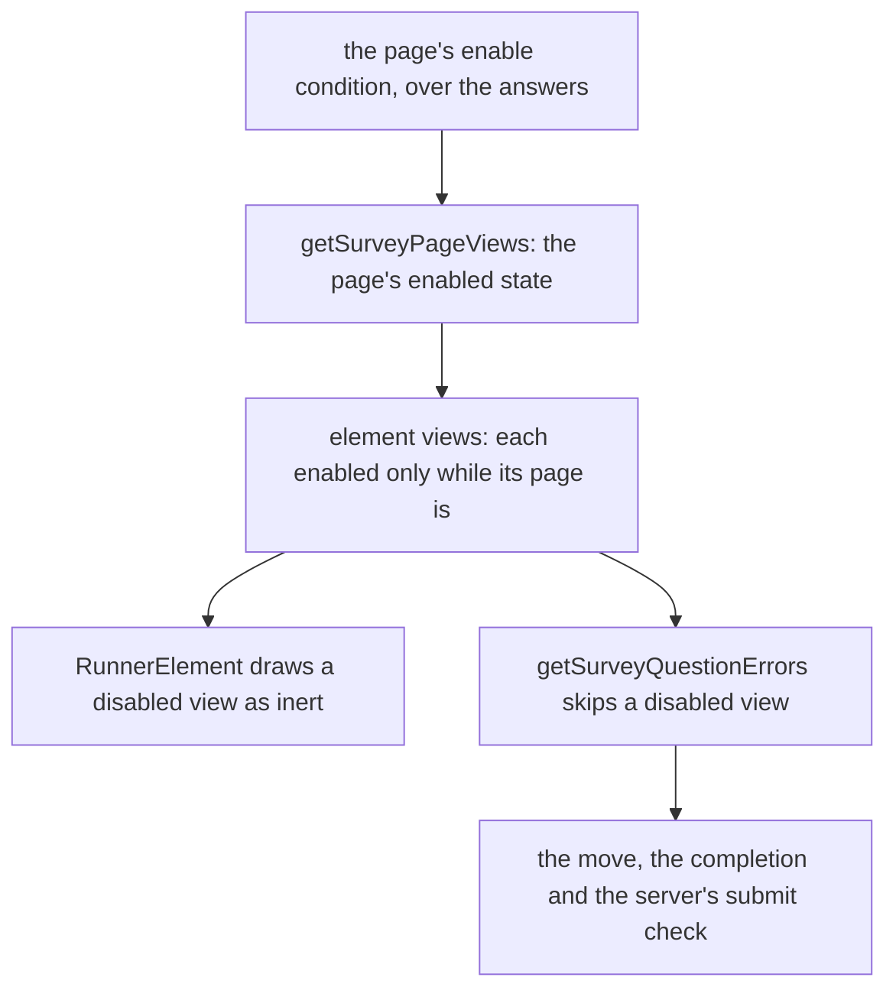

# Survey Logic Page Enable

## Context

A panel holds an enable condition in its props (`packages/vue-survey-engine-headless/src/models/SurveyPanelNodeProps.ts`), and its element views take the panel's enabled state as their parent state (`packages/vue-survey-engine-headless/src/services/runner/getSurveyElementViews.ts`). A page's props hold no enable condition (`packages/vue-survey-engine-headless/src/models/SurveyPageNodeProps.ts`), and `getSurveyPageViews.ts` passes `true` as the parent state, so the questions of a page are always enabled.

The enabled check already lets a page through to its `enableIf` (`packages/vue-survey-engine-headless/src/services/runner/checkSurveyNodeEnabled.ts`), and the Logic tab draws its Enabled if section for any node that holds the prop (`apps/web/app/services/resource/survey/constants.ts`). So a page needs its prop, its save check and its parent state, and the rest already reads the views.

A disabled question is skipped by the runner's question errors (`packages/vue-survey-engine-headless/src/services/runner/getSurveyQuestionErrors.ts`), so a move, a completion and the server's submit check all skip a disabled question without a rule of their own. The audit row this closes is the page row of the survey audit, "Enable or disable a page".

## Gap analysis

| Feature                                 | Verdict                                                                         |
| --------------------------------------- | ------------------------------------------------------------------------------- |
| Enable or disable a page                | Built here: a page's enable condition disables its questions, as a panel's does |
| Complete survey and other logic actions | Not in this change: they wait on the logic-actions design                       |

## Decisions

- **A page's condition is an enable condition held as a prop, as a panel's is.** Rejected: a page-level switch that the owner sets by hand, which would not follow the answers a condition reads.
- **The page's enabled state becomes the parent state of its element views.** Every caller that checks the survey reads the views from the same page function, so the runner's move, its completion and the server's submit cannot disagree about which questions a page checks. Rejected: copying the page's condition into each question's enable condition on save. That keeps a second copy of each condition for an agent to keep in step, the reason the logic builder reads its rows from the saved text. Rejected also: checking the page's condition in each caller, which lets them drift apart.
- **A disabled page stays shown.** Rejected: hiding it. Hiding is the visibility condition's job, and a hidden page's required questions would be skipped with the respondent given no sign of why the survey moved on. A disabled page's questions are still shown, drawn inert.
- **Answers a disabled question holds are kept in the result.** The question is still shown, so its answer is part of what the respondent saw. A hidden question's answer is dropped, since it is no longer part of that. Rejected: dropping a disabled question's answer on completion, which would make a stored result depend on which conditions held at the moment of completion.

## Flow

## Notes

- The design surface draws every question disabled whatever its condition, as it does a panel's, so a page's condition shows in the preview and on the respondent page, not on the surface.
- A survey saved before this change reads each page's enable condition as the empty text, which holds always, so no backfill is needed.

## Risks

- A condition that never holds leaves its page's required questions unchecked for every respondent. The Logic tab shows the condition beside the page, and the preview shows the page drawn disabled, so the owner can see it before publishing.

## Key files

| File                                                                                 | Role                                                                                             |
| ------------------------------------------------------------------------------------ | ------------------------------------------------------------------------------------------------ |
| `packages/vue-survey-engine-headless/src/models/SurveyPageNodeProps.ts`              | the page's props: gains its enable condition beside its visibility condition                     |
| `packages/vue-survey-engine-headless/src/services/surveyPageNodeType.ts`             | the page's node type; its form draws its props schema, so the condition is drawn as a panel's is |
| `packages/vue-survey-engine-headless/src/services/checkSurveyNodes.ts`               | the save check: a page's enable condition must parse, as a panel's does                          |
| `packages/vue-survey-engine-headless/src/services/runner/getSurveyPageViews.ts`      | the page's views: passes the page's enabled state to its elements in place of a constant true    |
| `packages/vue-survey-engine-headless/src/services/runner/checkSurveyNodeEnabled.ts`  | the enabled check: already reads any node's enable condition, so it needs no change              |
| `packages/vue-survey-engine-headless/src/services/runner/getSurveyQuestionErrors.ts` | skips a question whose view is disabled, on a move, a completion and a submit                    |
| `packages/vue-survey-engine-headless/src/services/runner/completeSurvey.ts`          | keeps the answers of every shown question, disabled ones included                                |
| `packages/vue-survey-engine-headless/src/services/runner/validateSurveyAnswers.ts`   | the server's check of a submit, which reads the same page views                                  |
| `apps/web/app/services/resource/survey/constants.ts`                                 | the condition sections the Logic tab draws, including Enabled if                                 |
| `apps/web/app/components/Resource/Survey/Creator/LogicBuilder.vue`                   | draws the conditions the selected node holds, a page included                                    |
| `apps/web/app/components/Resource/Survey/RunnerElement.vue`                          | draws a view disabled when the view is not enabled                                               |
