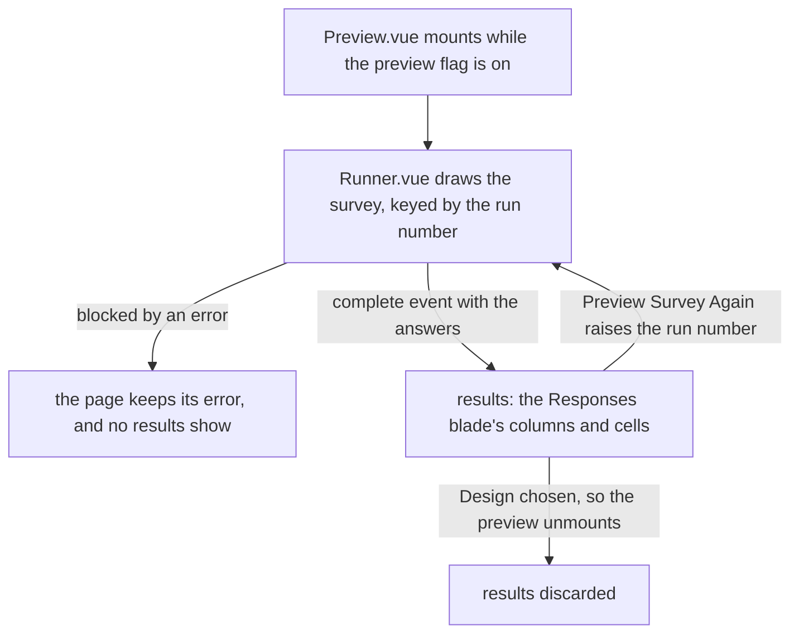

# Survey Preview Completion

## Context

The Creator's preview draws the runner on the current document, and passes it a completion listener that does nothing (`apps/web/app/components/Resource/Survey/Creator/Shell.vue`). The runner's completion is its `complete` event, which `Runner.vue` emits with the answers of a passing completion. `completeSurvey` also sets the state's `isCompleted` flag, but no template reads it. A completed preview therefore stays on its last page with its Complete button, and the owner has no view of the outcome.

**The defect.** The listener is a no-op and the completed flag has no reader, so a completed preview shows no end state. The public page differs: `View.vue` draws its end state only after the save succeeds, and shows the submit error when the save fails.

The answers a completion passes are the payload a save stores, so the preview can show exactly what the Responses blade will later read. The Responses blade's cells come from three builders under `apps/web/server/services/dataset/surveyResponses/`. Two import only shared code and the headless package. `toSurveyResponseDatasetRow.ts` imports the third through the server alias, so the move re-points that one import.

## Gap analysis

| Feature                                            | Verdict                                                                                          |
| -------------------------------------------------- | ------------------------------------------------------------------------------------------------ |
| Results after completing a preview (table or JSON) | Built here: the completion's answers in the Responses blade's cells, as a table with a JSON view |
| Preview Survey Again button                        | Built here: clears the answers and remounts the runner at its first page                         |

## Decisions

- **The end state reads the completion event.** The runner emits the answers of a passing completion, and that event is the preview's end state. Rejected: drawing the end state inside the runner from its completed flag. The public page's end state waits on a save that can fail, so a runner-drawn end state would show a completion the page has not stored, and the preview would need a second flag to tell the two apart.
- **The shared column list gains the calculated values flagged for the result.** The Responses blade's columns come from the content questions alone today, so a calculated value flagged for the result has no column in either place. The list moved into shared code takes a column for each, built by the same cell builder, and the Responses blade shows them too. Rejected: a result-only column in the preview, which is the second copy of the rules that the next decision refuses.
- **Results are read through the Responses blade's cells.** The completed answers are the payload a save stores, so the preview reads them with the dataset's column list and cell builders, moved from the server folder into shared code. Rejected: a formatter written for the preview. It would hold a second copy of the rules for checkbox answers, record answers and calculated values, and could show an owner a result the Responses blade does not then show.
- **Restart remounts the runner.** `Preview.vue` keys the runner by a run number, and a restart raises it. The new mount starts with no answers, on the first page and with a new choice-order seed, as the runner already does each time Preview is shown. Rejected: a restart method exposed by the runner, which would be a second reset path beside the mount's own state.
- **The results live in the preview component.** `Preview.vue` is mounted only while the preview flag is on, so leaving the preview discards its results. Rejected: the creator store holding the results, which outlives the flag and would need clearing on every toggle.
- **Completion saves nothing.** The completion handler holds the answers in the component and nothing more. Rejected: saving the run as a test response, which would put preview answers into the Responses blade, its counts and the survey's dataset.

## Rejected

- A results route beside the Creator. The preview is a mode of the Creator's canvas, and a route would take the owner away from the editor they are testing from.

## Flow



## Risks

- The moved builders are imported by the Responses blade's server reads. The builders' tests move with them, so the import paths are tested from both ends.
- The results table is one row of cells, so a long survey's results scroll inside the preview. The preview adds no layout of its own.

## Open questions

- Task 2.5's 'Completing a preview saves no response' scenario already holds: the preview passes a no-op completion listener and no save path is wired to it, so a test of that scenario passes before the change. It stays as a test that pins it, written first and seen passing, beside the other scenario of that task, which is the one seen failing.

## Key files

| File                                                                                  | Role                                                                                  |
| ------------------------------------------------------------------------------------- | ------------------------------------------------------------------------------------- |
| `apps/web/app/components/Resource/Survey/Creator/Shell.vue`                           | mounts the preview in place of the canvas, and replaces the no-op completion listener |
| `apps/web/app/components/Resource/Survey/Runner.vue`                                  | the runner the preview draws; it emits the completion the results read, unchanged     |
| `apps/web/server/services/dataset/surveyResponses/getSurveyDocumentDatasetColumns.ts` | the dataset's columns from a document; moves to shared code for the preview           |
| `apps/web/server/services/dataset/surveyResponses/toDatasetColumnValue.ts`            | a stored answer as a cell; moves to shared code                                       |
| `apps/web/server/services/dataset/surveyResponses/toSurveyResponseDatasetRow.ts`      | an answers record as a row of the columns; moves to shared code                       |

New paths, and the moved builders' new home:

```text
apps/web/app/components/Resource/Survey/Creator/Preview.vue       the preview: the runner keyed by run number, the results and the restart
apps/web/shared/services/dataset/surveyResponses/                 the three builders above and their tests, moved here
```
