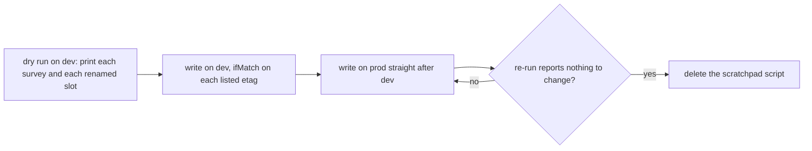

# Survey stored-shape backfill

The one-off run that brings stored survey working copies to the shape the survey document schema reads today. It is the migration the [latest-shape-only rule](../../specs/architecture/persisted-data-latest-shape-only/design.md) names for a renamed field in a stored content schema, and it follows the `backfills` skill's run.

## How it works

The run is ordered so that no store is written before its dry run has been read, and dev is done before prod.

A slot is rewritten by the shape of the object holding it: the root's `props` object, and each node whose `props` carries a `showValue` key. A value is carried across, so `showValue: false` becomes `isValueVisible: false`, and a root `showQuestionNumbers` carries its value into `isQuestionNumbersVisible`. A key whose value is not a boolean is reported and left for a person to read, never guessed.

Each document is uploaded with `ifMatch` on the etag it was read at, so a save landing mid-run wins and the survey is retried on the next run. Stored blobs keep their zstd encoding, as the persisted-data design requires.

## Scope

- Stored working copies in `resource-assets`, at `{resourceId}/content.json`, for surveys only.
- Not rewritten: version snapshots under `{resourceId}/objects/`. They are named by their hash and listed in Postgres, which is not reachable from a session.
- Not held for compatibility with the code still deployed: prod is backfilled as soon as dev is.

## Key files

| File                                                         | Role                                                                                  |
| ------------------------------------------------------------ | ------------------------------------------------------------------------------------- |
| `packages/survey-engine/src/models/SurveyRootProps.ts`       | the root props schema the backfill's output must satisfy (`isQuestionNumbersVisible`) |
| `packages/survey-engine/src/models/SurveySliderNodeProps.ts` | the slider props schema the backfill's output must satisfy (`isValueVisible`)         |
| `.agents/skills/backfills/references/the-run.md`             | the run this change follows: script, dry run, dev then prod, re-run, delete           |
| `.agents/skills/backfills/references/persisted-stores.md`    | where the survey working copy blob is held and what writes it                         |

## Notes

- Whether any stored survey holds an old key is not settled by the repository. The dry run on dev and prod answers it, and a run that reports zero documents closes the task with that count.
- The run needs the storage connection string from the Azure CLI for each account, which the session that runs it must hold.
