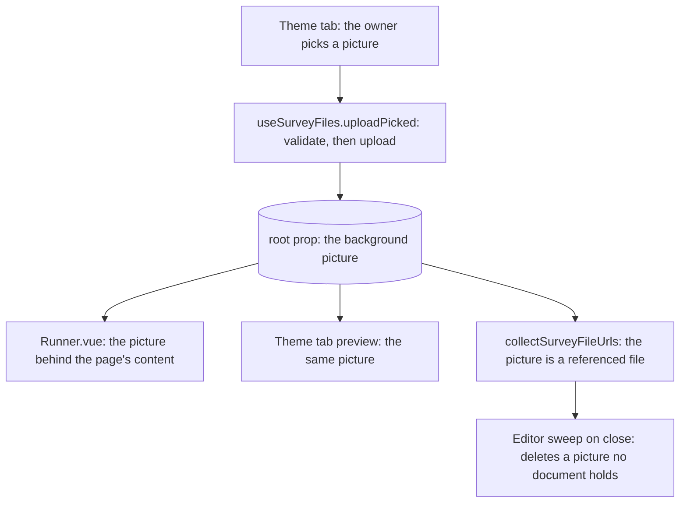

# Survey Theme Background

## Context

The Theme tab offers a logo, an accent colour, a background colour, the progress bar and question numbers (`apps/web/app/components/Resource/Survey/Creator/Theme.vue`). The survey-resource spec says a survey "SHALL accept uploaded images for its image questions, logos and theme backgrounds" (`openspec/specs/resource/survey-resource/spec.md`). Its scenario and the code cover only image questions and the logo, so the Theme tab offers no picture behind the survey.

The theme-files design keeps the theme to a subset of root props, and names the full theme editor as rejected (`openspec/specs/resource/survey-theme-files/design.md`). Its subset lists the logo, the two colours, the progress bar and question numbering, with no picture. So the spec requires a background upload that the design's subset does not list. The deferred theme-editor record defers only "a typeface" and "a per-page background" (`openspec/deferred/resource/survey-theme-editor/design.md`), so neither record excludes a picture for the whole survey.

## Gap analysis

| Feature                   | Verdict                                                                                  |
| ------------------------- | ---------------------------------------------------------------------------------------- |
| Background image          | Built here: one survey-wide picture, uploaded on the Theme tab and drawn behind the page |
| Per-page background       | Not in this change: stays in the survey-theme-editor record                              |
| Typeface and font choices | Not in this change: stays in the survey-theme-editor record                              |

## Decisions

- **The background picture joins the subset, as the logo does.** The survey-resource requirement already names theme backgrounds, and the deferred record defers only a typeface and a per-page background. A picture for the whole survey is an identity element like the logo, so it is one more root prop, and the theme subset gains it. Rejected: keeping the subset as written and narrowing the survey-resource requirement to image questions and logos. That makes the requirement true by removing a commitment the deferred record never dropped, and it would record the background picture as rejected for a reason no record gives.
- **One picture for the whole survey, drawn behind the page.** Rejected: a picture per page. That is the per-page background the deferred record names as its revisit trigger, and it needs a page prop and a per-page upload the subset does not hold.
- **The picture is a url on the root, uploaded and swept as the logo is.** Rejected: a separate map of background files, which would be a second list of referenced files for the sweep to keep in step with the document.
- **The picture draws as an image layer, not as a background-image style.** The url is the owner's text, and a style binding would need it quoted and escaped. An image layer takes the url as an attribute, as the logo is drawn.

## Rejected

- A picture set with its own fit and position controls. A fit and a position are look settings the theme-files design leaves out, so the picture covers the page and no other setting is offered.

## Flow

## Notes

- A survey saved before this change reads its background picture as the empty text, which draws no picture, so no backfill is needed.
- The survey-document design's root props and the theme-files design's subset are rewritten as built when the change is archived.

## Risks

- A busy picture behind the questions lowers their contrast. The owner chooses the picture, and the Theme tab preview draws it before the survey is published.
- A picture still uploading when the owner closes the editor is handled by the existing sweep, since the picture is one more file the survey references.

## Key files

| File                                                                | Role                                                                          |
| ------------------------------------------------------------------- | ----------------------------------------------------------------------------- |
| `packages/vue-survey-engine-headless/src/models/SurveyRootProps.ts` | the root props: gains the background picture beside the logo                  |
| `apps/web/app/services/resource/survey/collectSurveyFileUrls.ts`    | the referenced files: the background picture joins the logo                   |
| `apps/web/app/components/Resource/Survey/Creator/Theme.vue`         | the Theme tab: the picture's upload and remove, and the preview that draws it |
| `apps/web/app/components/Resource/Survey/Creator/Properties.vue`    | the root form: omits the picture, as it omits the logo                        |
| `apps/web/app/components/Resource/Survey/Runner.vue`                | draws the picture behind the page's content, over the background colour       |
| `apps/web/app/composables/survey/useSurveyFiles.ts`                 | the upload every picked picture runs through, validation first                |
| `apps/web/app/components/Resource/Survey/Editor.vue`                | the sweep on unmount, which deletes a picture the document no longer holds    |
| `apps/web/app/components/Ui/FileField.vue`                          | the file field the picture's upload uses, as the logo's does                  |
