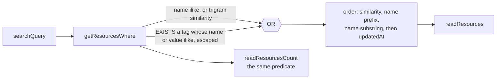

# Tag Search in Global Search

Global search matches a tag's name and value as well as a resource's name, on the same predicate and the same ranking, so the palette, the See all list and the count keep agreeing. The tags are already on the row, so the match adds no table and no index.

## How it works

- **The match is a substring over each tag's name and value.** The tags are expanded with `jsonb_each_text` inside an `EXISTS`, and each side is matched with `ILIKE` against the escaped query, as the name match already is. The alternatives lost for these reasons. Key existence alone (`jsonb_exists`) cannot match a value, and an owner who remembers `production` and not its key would still not find the resource. Matching the JSON text (`tags::text ILIKE`) matches the quotes and colons around every pair, so a query of `"` or `:` would match every tagged resource.
- **No index.** The GIN index on `tags` serves containment and key existence, and neither answers a substring. The scan runs over the owner's rows, which the owner filter already bounds, and each row's tags are capped at the tag count limit. A trigram index over the expanded tag text is the next step if a measured search is slow, and it is not built now.
- **A tier of its own in the ordering.** The ladder gains a name-substring key after the name-prefix key, so a row matched only by a tag sorts below every name match. Without the tier, a tag-only row ties every name match that shares no trigram with the query on the similarity key, and newest-first would decide, putting a recent tag hit above an older name hit. That is the ordering the tier prevents.
- **No Tags group in the palette.** A fourth group would be a second result set beside the Resources group, and global search keeps one result set for every scope ([global search](../../specs/resource/global-search/design.md)).
- **The row's caption stays the type.** Naming the matched tag on the row needs `readResources` to return the matched pair, a new response field for a cue the owner sees on the resource's Essentials tags once it opens.

## Key files

| File                                                     | Role                                                   |
| -------------------------------------------------------- | ------------------------------------------------------ |
| `apps/web/server/services/resource/getResourcesWhere.ts` | the search predicate gains the tag arm                 |
| `apps/web/server/trpc/routers/resource.ts`               | `readResources` ordering gains the name-substring tier |
| `apps/web/server/trpc/routers/resource.test.ts`          | the tag search and relevance tests                     |

## Notes

- The name trigram index and the tags GIN index are unchanged. Neither serves this arm, and nothing about them needs to.
- Azure AI Search stays [deferred](../../deferred/resource/azure-ai-search/design.md). A tag match is the same cheap substring scan as a name match, not a search service.
