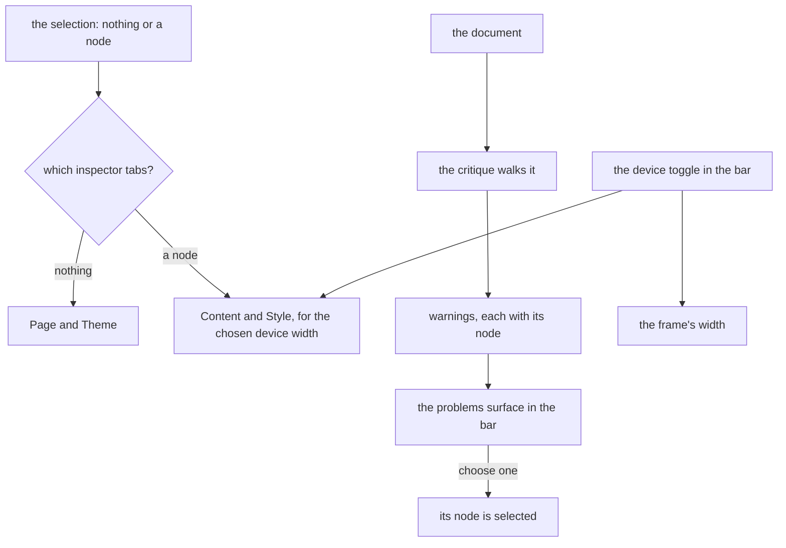

# Webpage layout

The webpage editor on the [editor shell](../resource-editor-shell/design.md), the program's middle case. It is a part of the [editor layout program](../resource-editor-layout-program/design.md) and it changes the arrangement of the page builder's webpage editor, not its [canvas](../../specs/resource/page-builder/canvas/design.md), its [style panel](../../specs/resource/page-builder/style-panel/design.md) or its [critique](../../specs/resource/page-builder/critique/design.md).

A webpage is guided by its block tree, where each slot accepts some kinds, and free within it, since a page has no mail client to satisfy. Its findings, a low contrast or a fixed width, tell the author what to improve and never stop a save. So the layout is the email's shape without a compile to wait for, and with a theme.

## How it works

| Region    | Edge        | Opens        | Holds                                                                   |
| :-------- | :---------- | :----------- | :---------------------------------------------------------------------- |
| Bar       | top, docked | always       | the device toggle and the problems surface                              |
| Blocks    | start       | on demand    | tabs Blocks and Layers: the palette and the layers tree                 |
| Inspector | end         | with content | the selection's tabs, below                                             |
| Canvas    | the rest    | always       | the frame that draws the page, with the node toolbar over the selection |

With nothing selected the inspector shows two tabs, Page and Theme: the page's own settings and the theme's tokens. With a node selected it shows Content and Style, where Style edits the node's values for the device width the toggle has chosen. The critique's findings are listed in the problems surface as warnings, each naming its node, and choosing one selects the node. The Check tab is removed, since its content is the problems surface's.

**The device toggle is in the bar.** It chooses the width the frame draws at and the breakpoint the Style tab edits, so it governs two regions and belongs above both, not floating on the canvas. Its three widths are the ones the style panel already edits.

**A compact window** keeps the canvas and opens Blocks and the inspector as sheets from their buttons.

## Decisions

- **The inspector's tabs follow the selection.** A page-wide theme next to a paragraph's content invites editing the wrong thing. Rejected: four tabs for every selection.
- **The Check tab becomes the problems surface.** A count in the bar is seen without opening anything, and one place lists findings across editors. Rejected: a tab seen only when opened, which an author must remember to open.
- **Findings stay warnings.** The critique reports what to improve before publishing, and it computes from the document, so it is advisory. A warning never refuses a save. Rejected: gating a save on contrast, which turns a design judgement into a rule the author cannot override.
- **The device toggle governs the bar, not the canvas.** It sets the frame's width and the Style tab's breakpoint. Rejected: the toggle over the canvas, which hid that it also sets which values the Style tab edits.
- **Layers keeps its tab.** The tree is the keyboard path to every move, as the canvas design settles, and a webpage nests deeper than an email.

## Not in this change

- **New critique rules and a publish gate.** The critique's rules and the publish flow are as they are.
- **A different canvas.** The same-origin frame, its overlays and its node toolbar are unchanged.

## Key files

| File                                                             | Role                                                             |
| :--------------------------------------------------------------- | :--------------------------------------------------------------- |
| `apps/web/app/components/PageBuilder/Editor.vue`                 | the arrangement, replaced by a layout for the webpage            |
| `apps/web/app/components/PageBuilder/Palette.vue`                | the palette, registered as the Blocks tab                        |
| `apps/web/app/components/PageBuilder/Layers.vue`                 | the layers tree, registered as the Layers tab                    |
| `apps/web/app/components/PageBuilder/Canvas/DeviceToggle.vue`    | the device toggle, which moves into the bar                      |
| `apps/web/app/composables/pageBuilder/usePageBuilderCritique.ts` | the critique's findings, mapped to the problems surface          |
| `openspec/specs/resource/page-builder/canvas/design.md`          | the canvas design, whose device toggle placement this supersedes |
| `openspec/specs/resource/page-builder/critique/design.md`        | the critique design, whose Check panel sentences this supersedes |

## Sources

- [Webflow's navigator](https://help.webflow.com/glossary/navigator) (excerpt) and [Wix Studio's layers panel](https://support.wix.com/en/article/studio-editor-using-the-layers-panel) (excerpt): a tree of the page's elements beside the canvas, which the Layers tab is.
- [GrapesJS's layer manager](https://grapesjs.com/docs/modules/Layers.html): the page's component tree as its own panel.
- [Puck's overrides](https://next.puckeditor.com/docs/api-reference/overrides) (experimental): an outline and a fields panel as separate replaceable parts, with the fields following the selected item.
