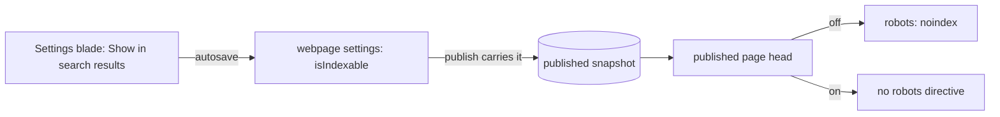

## Context

The Settings blade holds a webpage's description and share image, which the published page writes into its head as SEO and Open Graph meta. The site's route rules already keep the app's own pages out of search by path, but the published views sit outside them, so every published webpage is listed by default.

## How it works

The directive comes from the published snapshot, so an unpublished change to the switch does not reach the public page until the owner publishes, as the description and the share image already behave.

## Gap analysis

| Feature                                      | Verdict                                                                                                            |
| -------------------------------------------- | ------------------------------------------------------------------------------------------------------------------ |
| Exclude a page from search results           | Built as the switch.                                                                                               |
| Sitemap, favicon, 404 page, global canonical | Rejected as site-level settings: [webpage site settings](../../rejected/resource/webpage-site-settings/design.md). |

## Decisions

- **On by default.** A page published to be found is the common case and is how every published webpage behaves today, so the default changes nothing.
- **Only a webpage.** It is the one published type made to be found. A survey or a dashboard is reached through a link its owner sends, and its views stay as they are.
- **Read from the snapshot.** The public page is what was published, so its head is too.

## Key files

| File                                                         | Role                                                |
| ------------------------------------------------------------ | --------------------------------------------------- |
| `apps/web/shared/models/webpageEditor/data/WebpageEditor.ts` | the settings model, which gains the switch          |
| `apps/web/app/components/Resource/Webpage/Settings.vue`      | the switch in the Settings blade                    |
| `apps/web/app/components/Resource/Webpage/View.vue`          | writes the robots directive into the published head |

## Sources

- [Webflow University — SEO checklist](https://university.webflow.com/resources/checklists/seo-checklist) — crawling is controlled with noindex tags per page, folder or site.
