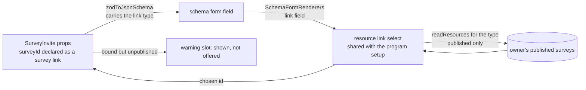

# Webpage survey picker

The survey invite's field is drawn as the program setup's binding select, and any schema-form field declared as a resource link is drawn as that select over the owner's resources of the declared type.

## Scope

Today the invite's `surveyId` is a plain id field: its schema declares a survey link, and the schema form draws it as a text field, since no renderer reads the link. The program setup already binds its survey through a select over the owner's surveys, and that select already reports a binding whose resource is gone. The change moves that select to a shared place, teaches the schema form to draw link fields with it, and gives it a publication filter. It does not change the stored id, the link index or the invite's render.

## Decisions

- **The renderer is keyed on the declaration, not on the invite.** `createResourceLinkSchema` already writes the link into a registry the schema reads. Zod's JSON output carries the page layout hint but not that registry's entry, so the JSON schema gains the link type beside the layout, and a renderer tests for it. The alternative, a picker the invite's node names, would be a second picker for the next link field and would never cover the email node without a copy.
- **The program's select is the one component.** The alternative is a new survey picker beside it. Two pickers over the same list would disagree on the first answer that changes, such as whether an unpublished survey is offered. The program keeps its own offer of every survey, so the filter is an input and not a fork of the component.
- **The list is published only, and the filter runs in the database.** A survey that is not published answers its invite with not-found, so offering it would hand the owner a link that fails. The filter sits in the `readResources` where clause, not in the client, because the client's list is capped at a read limit and a client-side filter would drop published surveys past the cap.
- **A bound unpublished survey stays bound and is flagged.** Clearing the binding would make toggling a survey's publication destroy the owner's page. The select shows the survey, marked as unpublished in the warning slot the select already has, and the picker does not offer it again.
- **The picker reads the survey resource, not its model.** The picker needs a survey's id, title and publication, which the resource layer holds. It never reads the questions, so it is written against the typed survey model of the [survey form engine](../resource-survey-form-engine/design.md) without depending on its content, and it does not read SurveyJS's model at all.
- **The email invite uses the same renderer.** `emailSurveyInviteNodeSchema` takes the webpage's props under the email tag, so its `surveyId` carries the same link declaration and the schema form draws it the same way.

## How it works



- **The offer.** The select lists the owner's surveys that are published, with the program's missing-binding rule unchanged: a survey that is gone reports as missing.
- **The binding.** Choosing a survey writes its id to `surveyId`, which the page's save then indexes as a link, so deleting the survey later names the page as its delete-reference warning already does.
- **Empty.** With no published survey, the select shows an empty state that says a survey must be published before it can be offered, and it does not write a blank id.

## Ordering

The engine's one-time purge runs in each environment before this picker ships. The purge deletes every stored survey and removes each invite that names one, so a picker released earlier could bind a survey the purge then removes.

## Key files

| File                                                                        | Role                                                                       |
| --------------------------------------------------------------------------- | -------------------------------------------------------------------------- |
| `apps/web/shared/services/resource/link/createResourceLinkSchema.ts`        | the declaration the renderer reads, unchanged                              |
| `apps/web/shared/services/resource/link/resourceLinkRegistry.ts`            | the registry the link type is read from, unchanged                         |
| `apps/web/app/services/jsonSchema/zodToJsonSchema.ts`                       | gains the link type in the JSON schema, beside the layout hint             |
| `apps/web/app/services/ui/schemaForm/SchemaFormRenderers.ts`                | gains the link renderer entry, ranked above the text field                 |
| `apps/web/app/components/Ui/SchemaForm/Text.vue`                            | the text renderer a link field no longer reaches, unchanged                |
| `apps/web/app/components/Resource/Link/Select.vue`                          | the select, moved out of the program folder and given the publication flag |
| `apps/web/app/components/Resource/Program/Setup.vue`                        | the program setup, which imports the moved select                          |
| `apps/web/app/services/resource/getMissingResourceMessage.ts`               | the missing-binding wording both uses share                                |
| `apps/web/server/trpc/procedure/resource/createResourceProcedures.ts`       | `readResources`, which gains the publication filter in its where clause    |
| `apps/web/shared/models/db/resource/ReadResourcesInput.ts`                  | the list input, which gains the filter                                     |
| `apps/web/shared/services/pageBuilder/surveyInviteNodeType.ts`              | the webpage node, whose `surveyId` takes the renderer, unchanged           |
| `apps/web/shared/services/pageBuilder/email/emailSurveyInviteNodeSchema.ts` | the email node, which shares the webpage's props                           |

New files, laid out as the design template's tree:

```text
apps/web/app/components/Resource/Link/Select.vue   the shared select, the moved BindingSelect under the name it has everywhere
apps/web/app/components/Ui/SchemaForm/ResourceLink.vue   the schema-form renderer that draws a link field with the shared select
apps/web/server/services/resource/getPublicationWhere.ts   the publication row check, shared by the resource list's filter and the published read
apps/web/app/models/resource/link/ResourceLinkSource.ts   the shape of a link type's source: its router, mark, empty message and unbound id
apps/web/app/services/resource/link/ResourceLinkTypeSourceMap.ts   each link type's source, the survey's list published alone
apps/web/app/services/resource/link/getResourceLinkSource.ts   the source a schema field's link type is listed from, read off its JSON Schema
apps/web/app/services/resource/getUnpublishedResourceMessage.ts   the wording a bound survey that is no longer published is flagged with
```

## Notes

- The stored shape of an invite does not change, so no page needs rewriting and no link index row moves.
- The program's own survey select still lists every survey, since a program may bind a survey whose publication comes later. Its list is capped at the read limit as it was, which is a separate question this change does not reopen.
- A bound survey that is later deleted is handled by the delete-reference warning, as it is today. The unpublished state is a separate, quieter one: the survey still exists and the invite simply does not open.
