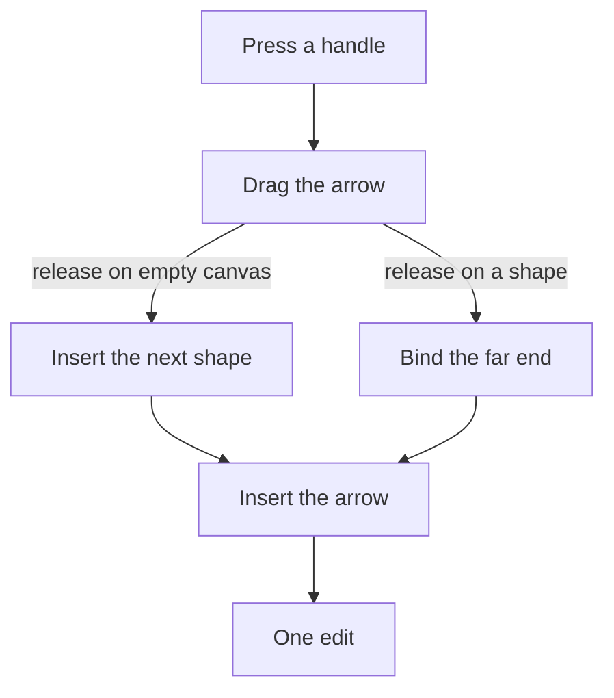

## Context

An arrow's end holds its point, its binding when it is bound, and one flag for a filled triangle. The arrow's panel sets that flag with a checkbox at each end. A free end moves only as part of the whole arrow, since the move command moves each free end of a selection and leaves a bound end to its shape. A shape has four connection points, and an arrow binds to the nearest one where a press or a release lands. The positioned model already holds the commands a flowchart step needs: insert an arrow, bind an end and insert a shape of a kind.

## Gap analysis

Each row is a feature of Excalidraw, the reference product, with the verdict this change gives it.

| Feature                                                            | Verdict                                                                                      |
| ------------------------------------------------------------------ | -------------------------------------------------------------------------------------------- |
| Arrowheads: type and start/end choice                              | Built here: five head kinds, one chosen for each end                                         |
| Drag an arrow's free end                                           | Built here: a handle on each free end, which binds the end when it is released on a shape    |
| Flowchart helper (drag from a shape to add a connected next shape) | Built here: a handle at each connection point of a selected shape, adding or joining a shape |

## Decisions

- **Four head kinds, each one filled shape, held as an enum.** The kinds are a triangle, a diamond, a circle and a bar, and an end with no head holds no value, since an enum takes no member for absence. The triangle is the head an end draws today, so it stays the head of an end's default. Rejected: the open chevron, which is a stroked path and not a filled shape, so the export would need a second way to draw one head; and the outline variant of each head, which doubles the set for a difference that is only the fill.
- **A head is a value for each end, in place of the flag.** Each end holds its head kind, and the flag is deleted rather than kept beside it, so there is one way to say whether an end has a head. Rejected: a second field for the new kinds beside the flag, which would leave two ways to say the same thing.
- **The stored flags are rewritten once.** Removing the flag makes every stored arrow fail its parse until it is rewritten, so a one-time rewrite maps each flag to a head kind: true to the triangle and false to no head. Rejected: a default on the new field, which would let an arrow parse without the rewrite and would keep the old form readable beside the new one.
- **A dragged free end binds by the rule drawing uses.** Released on a shape, the end binds to the connection point nearest the release; released on empty canvas, it stays free. Rejected: a dragged end that never binds, which would make the same end bind when it is drawn and not when it is moved.
- **A bound end has no handle.** Its point is the connection point its binding names, so a drag would move a point the model derives. Rejected: a handle on a bound end that unbinds it on drag, since the detach control already unbinds an end as one step.
- **The flowchart helper is built from the arrow's own commands.** The new shape is inserted at the release point with the default size and fill of a placed shape of its kind, and the arrow is inserted and bound at each end in one edit, so one undo step removes both. Rejected: a next shape at a fixed offset in the handle's direction, which needs a gap and an alignment rule the model does not hold; and a second gesture after the arrow, which would split one step into two.
- **A handle is shown only on a single selected shape.** A press on an unselected shape still moves it, so the edge midpoints of an unselected shape are not flowchart gestures. Rejected: a handle on every shape, which would take the move away from the edges of every shape on the canvas.
- **A release on another shape joins it and adds nothing.** The arrow's far end binds there, as drawing does. Rejected: adding a shape over the other one, which would stack two shapes on one place.
- **An annotation shows no handle.** It takes no connection, so there is no point to drag from.

## Rejected

- Keeping the flag and adding the new head kinds beside it.
- A drag of a bound end that unbinds it.

## Risks and trade-offs

- The stored arrows are brought to the new shape by a backfill, as the `backfills` skill sets out: a throwaway script, run on dev and then on prod, that leaves no trace in the tree. Until it reaches a whiteboard, a save of that whiteboard fails its parse, so it is re-run until it reports no flag left.
- The helper copies the kind of the shape it starts from. A flowchart step of another kind takes one change in the panel.
- The helper places its shape where the pointer is released, at the default size, so a release close to the source can place the new shape over it.

## How it works

A press on a handle of the selected shape starts a connection gesture. Its release on empty canvas adds a shape and an arrow, and its release on another shape adds the arrow alone. Both paths are one edit.



## Key files

| File                                                                                 | Role                                                                                          |
| :----------------------------------------------------------------------------------- | :-------------------------------------------------------------------------------------------- |
| `packages/vue-block-editor-headless/src/models/ArrowEnd.ts`                          | one end of an arrow: its point, its binding when bound, and its head, which replaces the flag |
| `packages/vue-block-editor-headless/src/models/PositionedElementProperty.ts`         | the property a command sets: a fill, a route, or an end's head                                |
| `packages/vue-block-editor-headless/src/services/updatePositionedElementProperty.ts` | replaces one property, the head among them                                                    |
| `packages/vue-block-editor-headless/src/services/export/getArrowheads.ts`            | the head of each end that has one, placed along the route                                     |
| `packages/vue-block-editor-headless/src/services/export/getArrowheadPoints.ts`       | the corners of a filled head at its tip                                                       |
| `apps/web/app/components/Resource/Whiteboard/EditorPropertiesArrow.vue`              | the arrow's panel: the route, the head at each end, and the detach of each bound end          |
| `apps/web/app/components/Resource/Whiteboard/ElementArrow.vue`                       | draws an arrow along its route with the head at each end                                      |
| `apps/web/app/components/Resource/Whiteboard/EditorSelection.vue`                    | draws the selection frame, where the handles are drawn                                        |
| `apps/web/app/services/whiteboard/gesture/startWhiteboardGesture.ts`                 | takes a press on a handle before a press on an element                                        |
| `apps/web/app/services/whiteboard/gesture/getArrowEnd.ts`                            | the end a point lands on: bound to the nearest connection point, or free                      |
| `apps/web/app/services/whiteboard/gesture/getArrowOperations.ts`                     | inserts an arrow and binds each end that has a binding, the helper's arrow among them         |
| `apps/web/app/services/whiteboard/gesture/reduceArrowGesture.ts`                     | the arrow a press draws, whose release the helper's release follows                           |
| `apps/web/app/services/whiteboard/edit/getDuplicateArrowEnd.ts`                      | copies an end with its head, and rebinds it to the copy of its shape                          |
| `apps/web/app/services/whiteboard/arrow/constants.ts`                                | the route items the panel offers, and the head items beside them                              |
| `apps/web/app/models/whiteboard/GestureTool.ts`                                      | the tools the gesture reads, which the connection handle is shown for on the select tool      |

New files, created by the change:

```text
packages/vue-block-editor-headless/src/models/ArrowheadKind.ts        the four head kinds, held by an end as an optional value
apps/web/app/services/whiteboard/gesture/getFreeEndHandle.ts          the free end a press on an arrow's handle takes
apps/web/app/services/whiteboard/gesture/getConnectionHandle.ts       the connection point a press on a shape's handle takes
apps/web/app/services/whiteboard/gesture/reduceEndGesture.ts          drags a free end, and binds it where it is released
apps/web/app/services/whiteboard/gesture/reduceConnectGesture.ts      drags a connection handle, adding a shape or joining one
```

## Sources

- [Excalidraw](https://github.com/excalidraw/excalidraw): the reference for the head choices and for the drag of a linear element's point. Taken: the arrowhead choices, read in packages/excalidraw/actions/actionProperties.tsx by their labels, and the drag of a point of a linear element, in packages/element/src/linearElementEditor.ts. The flowchart helper's file, packages/excalidraw/components/App.flowchart.ts, was only named, so the helper's behaviour here is the verdict's and not that file's.
