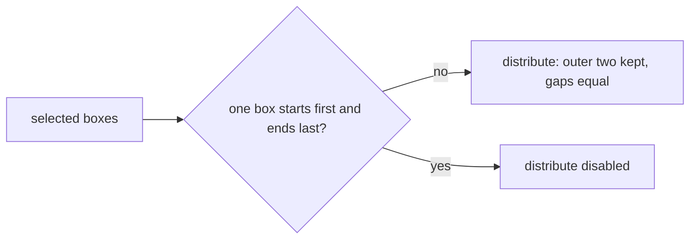

## Context

The distribute keeps the boxes that start first and end last in place, and spaces the boxes between them so every gap is equal. The box that ends furthest is taken as the last box even when another starts after it. When one box starts before all the others and ends after all of them, the same box would be both the first and the last, so there is no outer pair to keep in place and no equal-gap placement that keeps the spanning box's edges.

## How it works

## Gap analysis

| Feature                                       | Verdict                                                                                               |
| --------------------------------------------- | ----------------------------------------------------------------------------------------------------- |
| Distribute of a selection with a spanning box | Recorded here: disabled, as the control is below three boxes.                                         |
| Distribute keeping the spanning box in place  | Not built: a box in the middle of the selection would then be placed inside the span, which overlaps. |
| Distribute of the other selections            | Unchanged.                                                                                            |

## Decisions

- **Disable the control for a spanning box, not move the boxes.** A box that spans the rest has no outer pair, so any move places a box inside its span. The control already disables when it cannot act, so the case joins that rule. Rejected: keeping the spanning box in place and spacing the others, which overlaps them; and moving the spanning box, which the reader did not ask for.
- **The check reads the box that starts first and the box that ends last.** When they are the same box, the control is disabled. A selection with no such box is unaffected.

## Key files

| File                                                                      | Role                                                                                         |
| ------------------------------------------------------------------------- | -------------------------------------------------------------------------------------------- |
| `apps/web/app/services/whiteboard/arrange/getDistributeOperations.ts`     | the moves that space a selection's boxes with equal gaps; returns no move for a spanning box |
| `apps/web/app/components/Resource/Whiteboard/EditorPropertiesArrange.vue` | the distribute control, disabled for a spanning box                                          |
