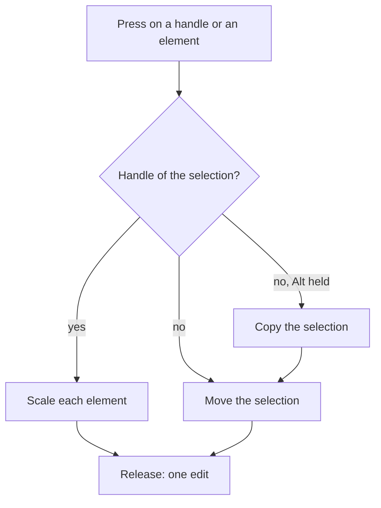

## Context

A selected element is framed by a dashed box that nothing grabs. The resize reads a press on one of two corners of a single selected element that takes a size, and returns no handle for a selection of several. A press on an element moves the selection, and a drag that starts with the Alt key held is read as a move too. Each gesture is a preview of one list of operations that the release commits as one edit, so a new handle or a new copy is another list of the same kind. The Duplicate key and the footer button copy the selection with an offset, and the copies take the selection.

## Gap analysis

Each row is a feature of Excalidraw, the reference product, with the verdict this change gives it.

| Feature                 | Verdict                                                                                                        |
| ----------------------- | -------------------------------------------------------------------------------------------------------------- |
| Resize handles          | Built here: a drawn handle on each edge, beside the two corners, each resizing along its edge or corner        |
| Resize several elements | Built here: the same six handles around the selection's box, scaling each element of the selection in one edit |
| Duplicate (Alt-drag)    | Built here: a drag with Alt held copies the selection at its originals and moves the copies with the pointer   |

## Decisions

- **Edge handles are drawn beside the two corners.** Each resizable element and each selection of several shows its handles, so the reader sees where to grab. An edge handle resizes along one axis only. Rejected: edge hit zones with nothing drawn, which leave the grab points to be found by trial, the fault the verdict names.
- **A group scales about the side opposite the handle.** The side the reader did not grab holds still, and each element keeps its place relative to it. Rejected: scaling each element about its own centre, which moves the group's outer edge away from the handle the reader dragged.
- **An axis of no extent takes no scale.** A selection whose box has no height has no ratio to scale by, so it shows no top or bottom handle. Rejected: a fixed scale on an empty axis, which would stretch a line out of nothing.
- **The smallest boxed element sets the limit.** The scale on each axis stops where the smallest boxed element reaches the minimum size, so no element of the group shrinks below it. Rejected: each element clamping on its own, which would break the proportions between elements the reader sized together.
- **Arrows and strokes in a group scale with it.** A free arrow end and each stroke point scale about the same side, and a bound end follows its shape through the reroute the resize already makes. Rejected: leaving arrows and strokes in place, which would split them from the boxes they describe.
- **Alt-drag copies at the originals.** The copies start where the originals are, so each moves under the pointer by the drag. Rejected: the offset copy the Duplicate key makes, which would leave the copy a fixed distance from the pointer.
- **The copies are made when the drag starts.** The copy identifiers are fixed at the press, and each move previews the same operations over the original document. Rejected: copying on every move, which would add a copy for each pointer event.
- **Alt is read at the press.** A release of Alt during the drag does not change what the drag is. Rejected: reading Alt on each move, which would turn one drag into a copy and then a move.

## Rejected

- A resize handle on a single arrow or stroke. An arrow's box is its route, and its ends already have their own handles.

## Risks and trade-offs

- The top-right and bottom-left corners have no handle. The verdict names the edges only, so a reader who wants a corner from that side drags an edge in two steps.
- In a small element at a low zoom, a corner handle and an edge handle can fall within the hit tolerance of each other. The corner is tested first, so it wins.

## How it works

A press chooses its gesture from what it lands on, and the release commits one edit.



## Key files

| File                                                                               | Role                                                                                      |
| :--------------------------------------------------------------------------------- | :---------------------------------------------------------------------------------------- |
| `apps/web/app/components/Resource/Whiteboard/EditorSelection.vue`                  | draws the selection frame, where the handles are drawn                                    |
| `apps/web/app/components/Resource/Whiteboard/EditorCanvas.vue`                     | sends each pointer event with its modifier keys, Alt among them                           |
| `apps/web/app/services/whiteboard/gesture/getResizeHandle.ts`                      | the handle a press takes, of one selected element today                                   |
| `apps/web/app/services/whiteboard/gesture/getResizeOperations.ts`                  | the resize of one element by a delta from its handle, down to the minimum size            |
| `apps/web/app/services/whiteboard/gesture/reduceResizingGesture.ts`                | the resize's preview and release                                                          |
| `apps/web/app/services/whiteboard/gesture/startWhiteboardGesture.ts`               | takes the press on a handle, an element or the canvas                                     |
| `apps/web/app/services/whiteboard/gesture/reducePressedGesture.ts`                 | starts the move, the resize or the marquee once the press travels the drag start distance |
| `apps/web/app/services/whiteboard/gesture/reduceMovingGesture.ts`                  | the move's preview and release                                                            |
| `apps/web/app/services/whiteboard/gesture/getMoveOperations.ts`                    | the move of each element of a selection by one delta                                      |
| `apps/web/app/services/whiteboard/gesture/constants.ts`                            | the minimum element size a resize stops at                                                |
| `apps/web/app/services/whiteboard/edit/duplicateWhiteboardElements.ts`             | copies a selection on top of the list                                                     |
| `apps/web/app/services/whiteboard/edit/getDuplicateElement.ts`                     | the copy's offset, and the arrow ends rebound to the copies of their shapes               |
| `apps/web/app/models/whiteboard/ResizeHandle.ts`                                   | the handles a resize takes                                                                |
| `apps/web/app/models/whiteboard/GestureMoving.ts`                                  | the fields of the move gesture, which carry the copies of an Alt-drag                     |
| `apps/web/app/models/whiteboard/GesturePointerEvent.ts`                            | the modifier keys a pointer event carries                                                 |
| `packages/vue-block-editor-headless/src/services/resizePositionedElement.ts`       | resizes a box and reroutes the arrows bound to it                                         |
| `packages/vue-block-editor-headless/src/services/resizePositionedElementBounds.ts` | sets a box's start and size in one step                                                   |

New files, created by the change:

```text
apps/web/app/services/whiteboard/gesture/getSelectionBounds.ts   the box a selection of several covers, and the point of each handle on it
apps/web/app/services/whiteboard/gesture/getScaleOperations.ts   the operations that scale each element of a selection about the side opposite a handle
```

## Sources

- [Excalidraw](https://github.com/excalidraw/excalidraw): the reference for the transform handles and for the Alt-drag copy. Taken: the eight directional handles, named in packages/element/src/transformHandles.ts, of which the edges and corners here are the four edges and two corners the verdict names; and the Alt-drag copy, named in packages/excalidraw/actions/actionDuplicateSelection.tsx. The scaling rules are this design's.
