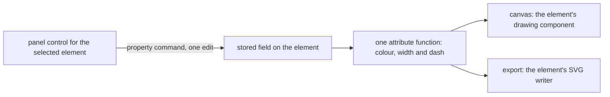

## Context

The whiteboard draws every outline, arrow route, arrowhead and label in the page's text colour, and every outline and arrow at one fixed width. The export sets the same widths from its own constants, and a freehand stroke takes the width the gesture gives it. A stroke already stores its width on the element, so the gesture's value is the only thing that sets it. No element has a dash pattern.

A new shape takes its fill from the palette constants, which is white. The label on a shape draws in the page's text colour, so on a dark page a white box hides its own text. The panel holds the fill for a shape or a sticky note, and the arrow panel holds the route and the heads. Each value the panel sets goes through one property command, which the store commits as one edit. The freehand row of the audit names width as part of this work, so a freehand stroke takes the same width control.

## How it works

The panel sets one value on the one selected element through the property command, which commits it as one edit. The canvas and the export read the stored values through one function that returns the colour, width and dash attributes of an element, so an outline, a route, a stroke or a label draws the same in both. An element with nothing stored reads the defaults it draws at today.



## Gap analysis

The stroke and fill rows of the whiteboard audit, with the verdict this change gives each.

| Feature                                 | Verdict                                                                                                                           |
| --------------------------------------- | --------------------------------------------------------------------------------------------------------------------------------- |
| Stroke colour                           | Built: a colour on the shape, sticky note, arrow, text box and freehand stroke. Empty is the page text colour.                    |
| Background (fill) colour                | Built: a new shape starts with no fill and its fill can be cleared. Sticky notes keep their fill.                                 |
| Stroke width (thin 1, medium 2, bold 4) | Built on the shape, sticky note, arrow and freehand stroke. Medium is the width each draws at today.                              |
| Stroke style (solid, dashed, dotted)    | Built on the outline of a shape or a sticky note and the route of an arrow. A freehand stroke stays solid, as no row asks for it. |

## Decisions

- **An empty colour is the page text colour.** An element with no colour stored draws in the page text colour, so the page's light and dark mode still switches it. Empty is the absent value of a string under the absent-values rule. The alternative was the reference's default dark colour, which is close to invisible on a dark page, while the interface's colours are tokens that follow the selected theme ([design language](../../specs/architecture/design-language/design.md)).
- **A new shape starts with no fill, and empty is no fill.** A shape's fill is a hex colour today. An empty value stands for no fill, which the absent-values rule allows for a string. The alternative was a word for none, a second spelling of empty, or a null value, which the repository bans.
- **A stored shape keeps the fill it has.** Only a shape placed after this change starts with no fill. A stored white cannot be told from a white the owner chose, so a rewrite that empties every stored white would undo choices. The alternative was a backfill, which this change does not write.
- **A sticky note keeps its yellow fill.** The audit's reason is a white default hiding light text on a shape. A sticky note is a coloured card whose fill is its colour, so only shapes start empty. The alternative was an empty fill on sticky notes, which would make a sticky note a plain box.
- **Width takes three steps, and medium is today's width.** Medium is the width each outline, arrow and stroke already draws at, so the default changes no drawing. A stored stroke keeps the width it has. The alternative was a free number: the stored width accepts any positive value today, so a patch could draw a hairline, and the reference offers three steps.
- **A dash pattern draws on the outline and the route.** The audit names the outline and the route paths, and no row asks for dashes on freehand strokes. The alternative was a dash pattern on every element, which is a look the verdict does not name.
- **The label takes its element's colour, and there is no separate text colour.** The label is the element's text, so one colour on the element colours both, as the reference does. The alternative was a second text colour on the same element, which no row asks for.
- **Each value is a member of the property type.** Colour, width and dash join the fill and the arrow's route as members of the one property type the command sets, so each command sets one value and the store commits it as one edit. The alternative was a style object that the command replaces whole, which would rewrite the colour when the owner changes only the width.
- **A stored element reads each new field's default.** A colour or a fill is a string whose empty value is its absence, under the absent-values rule, so an element with no colour draws the page text colour and a shape with no fill draws none. A width and a dash pattern are enums, and an enum takes no absent member, so each reads the value it draws at today: medium and solid. The alternative was an optional field, which the absent-values rule keeps for an absence that differs from every value, and an empty colour is not one.
- **The panel edits one selected element.** A selection of several keeps the fill it shares, and its Mixed value. The alternative was applying every control to a selection, which needs a Mixed value for each control and a rework of the several panel that is not designed yet.
- **The export draws the chosen values and keeps its own default.** The export's background is white, and its default line colour stays dark, because the export is drawn from the model and not from the theme. The alternative was the page's text colour in the export, which would put light lines on a white file for a dark page.

## Rejected

- A style preset menu of named looks. The audit asks for per-element controls, and a preset menu would be a second place to choose the same values.
- A canvas-level default for the stroke or the fill. The whiteboard has no document setting ([whiteboard layout](../../specs/resource/whiteboard-layout/design.md)), so a default lives in the code and not on the board.
- Dashes on freehand strokes. See the decision on the dash pattern.

## Risks and trade-offs

- The element panel gains controls beside its stacking and footer. Each control is its own component, so the panel composes by kind and each piece stays small.
- A shape placed before this change keeps its white fill, so an older board on a dark page still shows white boxes until the owner clears them one by one. This is accepted, since the stored white cannot be told from a choice.
- The colour control accepts any colour, so the owner can choose one that is hard to read on the page. The owner's choice stands.
- A stored element that lacks a new field reads that field's default, which is the look it draws today. A document gains a field's value only when the owner chooses one, and the agent reads each new field's description from the shared element schema.

## Sources

- [Excalidraw](https://excalidraw.com/): the reference for the stroke colour, the three stroke widths, the three dash styles and the transparent default background. The whiteboard takes the behaviour and none of its code or packages.

## Key files

Existing files this change touches, with the role each plays after it.

| File                                                                                 | Role after the change                                                               |
| :----------------------------------------------------------------------------------- | :---------------------------------------------------------------------------------- |
| `packages/vue-block-editor-headless/src/models/ShapeElement.ts`                      | the shape's optional colour, width and dash pattern, and an empty fill              |
| `packages/vue-block-editor-headless/src/models/ArrowElement.ts`                      | the arrow's optional colour, width and dash pattern                                 |
| `packages/vue-block-editor-headless/src/models/StickyNoteElement.ts`                 | the sticky note's optional colour, width and dash pattern                           |
| `packages/vue-block-editor-headless/src/models/StrokeElement.ts`                     | the freehand stroke's optional colour, with the width it already stores             |
| `packages/vue-block-editor-headless/src/models/TextElement.ts`                       | the text box's optional colour                                                      |
| `packages/vue-block-editor-headless/src/models/PositionedElementProperty.ts`         | the property type the command sets, with a member for each new value                |
| `packages/vue-block-editor-headless/src/services/updatePositionedElementProperty.ts` | sets each new value on the element as one edit                                      |
| `packages/vue-block-editor-headless/src/services/export/constants.ts`                | the export's default line colour and width, which an element with no value draws at |
| `packages/vue-block-editor-headless/src/services/export/toShapeSvg.ts`               | draws a shape's outline from the attribute function                                 |
| `packages/vue-block-editor-headless/src/services/export/toArrowSvg.ts`               | draws an arrow's route and heads from the attribute function                        |
| `packages/vue-block-editor-headless/src/services/export/toStickyNoteSvg.ts`          | draws a sticky note's box from the attribute function                               |
| `packages/vue-block-editor-headless/src/services/export/toStrokeSvg.ts`              | draws a freehand stroke in its colour                                               |
| `packages/vue-block-editor-headless/src/services/export/toTextSvg.ts`                | fills a text with its element's colour                                              |
| `apps/web/shared/models/resource/whiteboard/WhiteboardElement.ts`                    | the element schema an agent reads, which describes each new field                   |
| `apps/web/app/components/Resource/Whiteboard/ElementShape.vue`                       | draws a shape's outline and its label in the element's attributes                   |
| `apps/web/app/components/Resource/Whiteboard/ElementArrow.vue`                       | draws an arrow's route, heads and label in the element's attributes                 |
| `apps/web/app/components/Resource/Whiteboard/ElementStroke.vue`                      | draws a freehand stroke in its colour                                               |
| `apps/web/app/components/Resource/Whiteboard/ElementStickyNote.vue`                  | draws a sticky note's box in the element's attributes                               |
| `apps/web/app/components/Resource/Whiteboard/Label.vue`                              | draws a label in its element's colour                                               |
| `apps/web/app/components/Resource/Whiteboard/EditorPropertiesPanel.vue`              | composes the controls of one selected shape, sticky note, text box or stroke        |
| `apps/web/app/components/Resource/Whiteboard/EditorPropertiesFill.vue`               | sets a shape's fill and clears it back to no fill                                   |
| `apps/web/app/components/Resource/Whiteboard/EditorPropertiesArrowPanel.vue`         | composes the arrow's colour, width and dash controls beside its route and heads     |
| `apps/web/app/services/whiteboard/palette/constants.ts`                              | the fill a placed shape starts with, which becomes empty                            |
| `apps/web/app/services/whiteboard/gesture/constants.ts`                              | the width a new freehand stroke takes, which is medium                              |

New files, in a tree:

```text
packages/vue-block-editor-headless/src/services/export/getStrokeAttributes.ts   the colour, width and dash attributes of an element
apps/web/app/components/Resource/Whiteboard/EditorPropertiesStroke.vue          the colour, width and dash controls of one element
```
