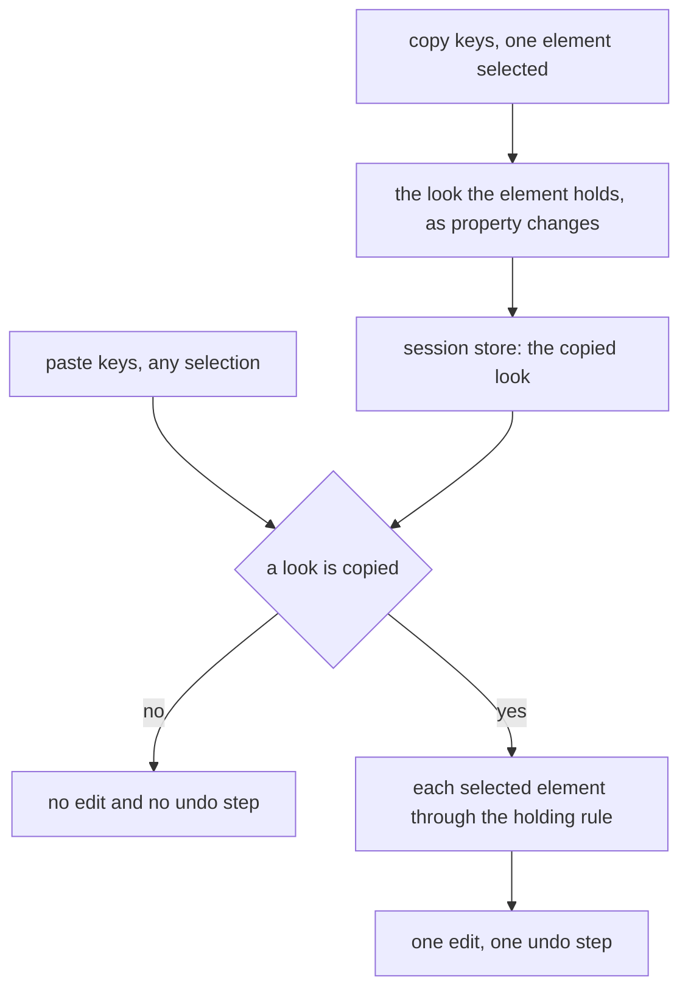

# Whiteboard style copy and paste

A key pair copies one element's look and pastes it onto the selection, as the page builder copies a node's style and pastes it onto another node.

## Context

A whiteboard element holds its look as fields: an outline's colour, width and dash pattern, a shape's or sticky note's fill, a sketch level, a shape's corners, a text's size and its alignments, and an arrow's two arrowheads. The Properties panel sets each one through the whiteboard store's property update, so matching a second element to a first means setting every field again on it. The [positioned elements](../../specs/vue-block-editor-headless/positioned-elements/design.md) model already holds a rule for which kind takes which field, and the [page builder's style panel](../../specs/resource/page-builder/style-panel/design.md) already copies a node's style and pastes it onto another node through a pair of commands. This change gives the whiteboard the same pair, over the rule it already has.

## How it works



The copy reads the one selected element into the session store, and writes nothing to the document. The paste is a gate: with no look copied it changes nothing. With one, every selected element receives the copied fields through the holding rule, and the operations of all of them are committed as one edit.

## Decisions

- **The look is the set of fields a copy carries.** A copy carries the outline colour, the outline width, the dash pattern, the sketch level, the fill, the corners, the text size, the horizontal and vertical alignments, and an arrow's arrowhead at each end. It leaves out an image's alt text, which describes the image and does not show it, a text box's wrap, which sets the width of an unwrapped box, and an arrow's route kind, which is the shape of that arrow and is drawn per arrow. Rejected: copying every field, which would carry an image's alt text onto another image and a text box's wrap onto a box it would resize.
- **An alignment the source never set is not carried.** A text's alignment is absent until one is chosen, and a change can only set an alignment, not remove one, so the target keeps its own. Rejected: clearing the target's alignment, which would need a removal the change does not have.
- **The holding rule is read by the copy and the paste alike.** The rule that decides which fields a kind holds already lives in the headless block editor's property update, and a paste applies it to each target. The copy reads the source through the same rule, so an ellipse carries no corners and an image carries no colour. This change exports the rule from that module. Rejected: a second table in the app of which kind holds which field, which would drift from the rule a paste applies.
- **The copied look is held in a session store, not the system clipboard.** The store is app-wide, so a look copied on one whiteboard pastes onto another in the same session. Rejected: the system clipboard, since a copy of elements already writes there and a copy of style would overwrite the elements the owner may paste next.
- **A copy takes one element, and a paste takes any selection.** A selection of several has no one look to copy, and the selected elements are read in document order, so taking the first of several would make the source a rule the owner cannot see. The copy keys are bound only while exactly one element is selected. Rejected: copying from the first of several.
- **A paste is one edit over every selected element.** The operations of all the selected elements are committed through one edit, as the stacking keys commit a selection, so one undo reverts the paste. Rejected: one edit per element, which an undo would have to reverse one element at a time.
- **The keys are Excalidraw's chords, Ctrl or Cmd with Alt and C for the copy and with Alt and V for the paste.** Excalidraw lists copy styles and paste styles on these chords in its help dialog. The chords do not collide with the whiteboard's Ctrl or Cmd keys, since a shortcut matches its Alt modifier exactly. Rejected: Ctrl or Cmd with Shift and C or V, since Shift with C opens the browser's element inspector on Windows and Linux and Shift with V pastes plain text in a browser.

## Notes

- **The chord matches the letter the key produces.** Vuetify 0 matches a shortcut by the key's produced letter, and on macOS the Option key changes the letter a key produces, so the pair is checked in a driven browser on macOS before it ships.

## Key files

| File                                                                                 | Role                                                                                                                      |
| ------------------------------------------------------------------------------------ | ------------------------------------------------------------------------------------------------------------------------- |
| `apps/web/app/components/Resource/Whiteboard/Editor/Index.vue`                       | mounts the style keys beside the stacking keys, over the same edit state and selection                                    |
| `packages/vue-block-editor-headless/src/services/updatePositionedElementProperty.ts` | exports its holding rule, so the copy reads a source's fields by the rule a paste applies to a target                     |
| `apps/web/app/services/whiteboard/getSelectedElements.ts`                            | reused: the selected elements in document order, the source of a copy and the targets of a paste                          |
| `apps/web/app/services/whiteboard/edit/applyWhiteboardEdit.ts`                       | reused: commits a paste's operations as one undo step                                                                     |
| `packages/vue-block-editor-headless/src/models/PositionedElementProperty.ts`         | reused: the change each copied field is held as, one per field                                                            |
| `apps/web/app/composables/whiteboard/useWhiteboardArrangeKeyboard.ts`                | reused as the pattern: a keys composable bound only while there is a selection and not while the delete confirmation asks |
| `apps/web/app/services/whiteboard/keyboard/constants.ts`                             | reused: the Whiteboard command group the keys are listed under                                                            |
| `apps/web/app/composables/ui/useCommands.ts`                                         | reused: registers the commands and binds each chord for as long as its command is registered                              |
| `apps/web/app/composables/pageBuilder/usePageBuilderStyle.ts`                        | reused as the pattern: a copied style held in a store, which a paste applies as one edit                                  |
| `apps/web/app/store/pageBuilder/styleClipboard.ts`                                   | reused as the pattern: the session store that holds the copied style across every open resource                           |

New code lands here:

```text
apps/web/app/store/resource/whiteboard/styleClipboard.ts              the copied look, held for the session
apps/web/app/services/whiteboard/style/constants.ts                   the copy and paste chords
apps/web/app/services/whiteboard/style/getWhiteboardStyle.ts          the look an element holds, as property changes
apps/web/app/services/whiteboard/style/getWhiteboardStyleOperations.ts the paste's operations over the selection
apps/web/app/composables/whiteboard/useWhiteboardStyleKeyboard.ts     registers the two commands
```

## Sources

- [Excalidraw — HelpDialog.tsx](https://github.com/excalidraw/excalidraw/blob/master/packages/excalidraw/components/HelpDialog.tsx) — lists Copy styles on Ctrl or Cmd with Alt and C, and Paste styles on Ctrl or Cmd with Alt and V, the chords this change takes.
