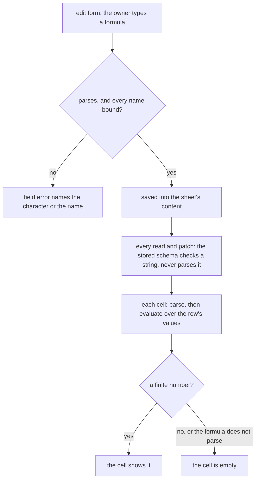

# Math Expression

A sheet's math column holds a formula such as `col0 * (1 - col1)`, with each `colN` bound to a source column, and shows its value in every row. This change replaces mathjs, the engine that parses and evaluates the formula today, with a parser and evaluator of our own in `@esposter/shared`. It reads every formula the way mathjs reads it, over plain JavaScript numbers, so no formula a sheet holds changes its value except where mathjs's own answer is a defect.

## Why not keep the engine

mathjs is on the [dependency admission](../../specs/architecture/dependency-admission/design.md) stop list as an engine, and that verdict holds for the engine's product: units, matrices, complex numbers, big numbers, fractions and symbolic algebra. The column uses none of it. It evaluates a formula over numbers, and any value that is not a finite number becomes an empty cell. A recursive descent parser over mathjs's numeric syntax, with a table of its numeric functions, is static code with nothing in it to maintain against a moving platform. The engine it replaces is one of the heaviest packages the browser loads, because the column's schema is shared with the client and imports the parser. Loading it later was the other way to pay less, and it lost: the sheet editor would still fetch the whole engine on its first math column, to use its arithmetic.

## The bar

**Every formula mathjs evaluates to a finite number, given numbers for its variables, keeps its value.** mathjs's own parser source, `lib/esm/expression/parse.js` in the installed package, is the reference for each rule, and it is read before the rule is written. The proof outlives the dependency: before mathjs leaves the catalog, a generator evaluates a corpus of formulas with it — every operator form, every precedence pair, every function over a spread of inputs — and commits the answers as `mathExpressionParity.snapshot.json` beside the evaluator. The parity test evaluates the same corpus with ours and requires the same answer, to the last bit for arithmetic and within a relative `1e-12` for the special functions, whose series are our own.

Three kinds of difference are allowed, and each is listed in the snapshot by the formula it applies to, never left to a tolerance:

- **A fix.** Where mathjs's answer is a defect — an issue on its tracker, or one the corpus finds — ours is the correct one, and the regression test names the issue.
- **Booleans become numbers.** A comparison or a logical operator yields `1` or `0`. mathjs yields a boolean, which the column turned into an empty cell, so a bare comparison showing a value is a fix too; inside arithmetic or a conditional, where mathjs converts the boolean, the value is the same.
- **Syntax that reaches a number only through a non-numeric value.** Strings, units, matrices, objects, property access, `null` and `undefined`, ranges, several statements and function definitions. Over numeric columns each one is an empty cell already, or needs a literal converted to the number the formula could hold directly, such as `number("12")`; reading them puts most of the engine back. A list in square brackets is the exception, read as the argument list of a function that takes one, so `sum([col0, col1])` keeps its value.

## The language

The precedence is mathjs's. From the loosest binding to the tightest:

| Operators                   | Meaning                                                                   |
| --------------------------- | ------------------------------------------------------------------------- |
| `=`                         | assignment: binds a name for the rest of the formula and yields the value |
| `? :`                       | conditional, right associative                                            |
| `or`, `xor`, `and`          | logical, in that order                                                    |
| `\|`, `^\|`, `&`            | bitwise or, exclusive or, and, in that order                              |
| `==` `!=` `<` `<=` `>` `>=` | comparison, chained                                                       |
| `<<` `>>` `>>>`             | shifts                                                                    |
| `+` `-`                     | add, subtract, and their percentage forms                                 |
| `*` `/` `%` `mod`           | multiply, divide, modulo                                                  |
| implicit multiplication     | `2 col0`, `(1 + 2)(3 + 4)`, with mathjs's division exception              |
| postfix `%`                 | percentage                                                                |
| unary `+` `-` `~` `not`     | sign, bitwise not, logical not                                            |
| `^`                         | power, right associative                                                  |
| `??`                        | nullish coalescing, which over numbers yields its left side               |
| postfix `!`                 | factorial                                                                 |
| `name(…)`, `( … )`, `[ … ]` | function call, grouping, a function's list argument                       |

- **A condition is truthy** when it is neither zero nor `NaN`. `and` and `or` evaluate their right side only when the left does not decide them, as mathjs does.
- **Power binds tighter than a sign**, so `-2 ^ 2` is `-4`, and its right operand may carry one, so `2 ^ -1` is `0.5`. Factorial binds tighter still, so `-3!` is `-6` and `2 ^ 3!` is `64`.
- **Modulo is floored**, taking the sign of the divisor: `-7 % 3` is `2`, where JavaScript's `%` gives `-1`.
- **`%` is a percentage** when no operand follows it: `8%` is `0.08`, `100 * 3%` is `3`, and `100 + 3%` and `100 - 3%` are `103` and `97`, a percentage of the left side, as mathjs reads them. Followed by an operand it is modulo, so `8 % 3` and `8% 3` are both `2`.
- **Implicit multiplication** binds tighter than `*` and `/`, except a division of the form `[sign]number / [sign]number` followed by a name or a parenthesis, which divides first: `1/2 col0` is `(1/2) * col0`. Two bare numbers side by side, `2 3`, are an error, as in mathjs. A parenthesis after a name is a call, never a product.
- **A chained comparison** `a < b < c` holds when each adjacent pair does.
- **Bitwise operators and shifts** take integers, as mathjs's do, and anything else is an error, which the cell shows as empty.
- **Factorial** of a non-integer is `gamma(n + 1)`, as in mathjs, and of a negative integer is an error.
- **A number** is digits with an optional fraction and an optional exponent, and a comment runs from `#` to the end of the line.
- **A name** is a letter, an underscore or a dollar sign followed by those and digits, as mathjs accepts. It resolves to an assigned name, then a column variable, then a constant: mathjs's `pi`, `e`, `tau`, `phi`, `LN2`, `LN10`, `LOG2E`, `LOG10E`, `SQRT1_2`, `SQRT2`, `Infinity`, `NaN`, `true` and `false`. A name is looked up only as an own entry of the scope or a table, so `constructor` or `__proto__` is an unknown name rather than a member of an object's prototype — the class of escape mathjs's own security advisories were about.
- **Functions** are every mathjs function that maps numbers to a number or a boolean at some arity — the arithmetic, bitwise, combinatorics, logical, probability, relational, special, statistics, trigonometry and utility functions among others — under mathjs's names and arities. The table is enumerated by probing the installed mathjs, every exported function called with numbers at each arity, rather than from its documentation, so no function a formula could have called is missed. `random`, `randomInt` and `pickRandom` are left out, because a computed cell must show the same value on every render and a seed is not a column concept.
- **`round` rounds half away from zero at its digit count**, corrected for binary representation, so `round(-2.5)` is `-3` and `round(1.005, 2)` is `1.01`, as mathjs gives. `Math.round` would give `-2` and `1`.
- **An unknown name evaluates to `NaN`**, which the column shows as an empty cell; the edit form names it before it is saved.

## Where the check runs

The stored content schema is applied to every read and every patch of a sheet (`readResourceContent.ts`, `applyResourceContentPatches.ts`). A parse check inside it makes a sheet holding any expression the parser refuses impossible to open, so the stored schema checks only that the expression is a string within the content limit. The parse moves to the column's edit form schema in `ColumnTransformationForm.ts`, which also refuses a name that is neither a declared variable, an assigned name nor a constant. A stored formula that does not parse leaves its column empty, and the edit form shows why when its owner opens it.

A parse is pure and returns a `Result`, with an error naming the position in mathjs's words: `Unexpected ")" (char 7)`, `Unexpected end of expression (char 6)`, `Unknown function "foo"`, `"round" takes 1 or 2 arguments`. Nesting deeper than `MAX_MATH_EXPRESSION_DEPTH` is a parse error rather than a stack overflow, since the expression is typed by a user and stored at any length the content limit allows.

The cell parses its formula each time, as mathjs's `evaluate` did, so the compute's cost is unchanged; a parse cache keyed by the formula is added only once a measurement of a large sheet shows the parse matters.

## What is deliberately not in it

- **The non-numeric syntax** under "The bar", for the reason given there.
- **Another expression library**, such as `expr-eval`, whose parser evaluates member access and has carried a prototype pollution advisory. A dependency for a parser this size puts back the package this change removes, with its own surface to keep pinned.
- **A typed result**, such as a boolean column from a comparison. The column's effective type is a number, and the filters, statistics and charts reading it expect one.

## Upstream

mathjs's tracker is triaged for the part this change rewrites: every issue labelled `category:expressions` and every issue labelled `bug` that touches parsing, a numeric function in the table, rounding or precedence, open and closed, found by reading the labelled lists and searching the tracker for each function's name. Each gets a verdict here, with the test that proves an in-scope defect, reproduced against mathjs before it leaves; an issue about a part of the engine the column never used is out of scope, with that part named.

## Key files

The new files sit in a `mathExpression` folder under `packages/shared/src/models` and `packages/shared/src/services`.

| Path                                                                                         | Role                                                                   |
| -------------------------------------------------------------------------------------------- | ---------------------------------------------------------------------- |
| `MathExpressionNode.ts`                                                                      | the parsed tree                                                        |
| `parseMathExpression.ts`                                                                     | the recursive descent parser, returning the tree or a positioned error |
| `evaluateMathExpression.ts`                                                                  | the evaluator over a scope of numbers                                  |
| `getMathExpressionNames.ts`                                                                  | the free names a tree uses, for the form's unbound-name check          |
| `MathExpressionFunctionMap.ts`                                                               | each function's arity and computation                                  |
| `MathExpressionConstantMap.ts`                                                               | the named constants                                                    |
| `mathExpressionParity.snapshot.json`                                                         | mathjs's answers over the corpus, recorded before it left              |
| `apps/web/shared/models/resource/sheet/column/transformation/MathTransformation.ts`          | the stored schema: a string within the content limit                   |
| `apps/web/app/models/resource/sheet/column/transformation/ColumnTransformationForm.ts`       | the edit form schema, where the parse and the name check run           |
| `apps/web/shared/services/resource/sheet/column/transformation/computeMathTransformation.ts` | a cell's value: parse, evaluate, a finite number or empty              |

## Sources

- [mathjs expression syntax](https://mathjs.org/docs/expressions/syntax.html) — the operator table, the precedence order and the implicit multiplication rules the language keeps.
