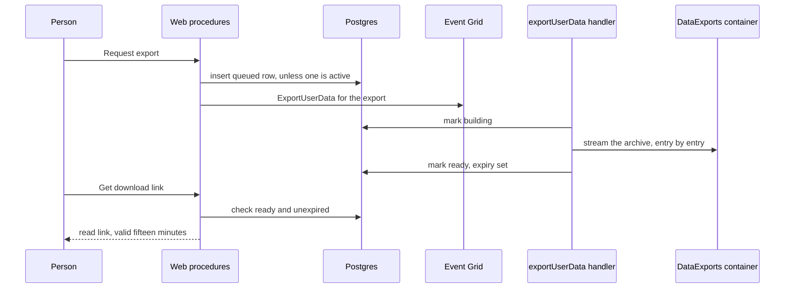

# Data export design

The stores this reads are the ones in the [user data inventory](../../specs/architecture/user-data-inventory/design.md). An export that lists a store the inventory does not is a bug in the inventory, fixed there.

## Decisions

**The request is queued, and the archive is built by a handler.** A large account's archive streams every attachment it owns. The request returns once the row is written and the event published, as the deletion does, and the person checks the row's status from the settings page.

**The archive streams into a blob; nothing holds it whole.** `fflate`'s streaming zip writes each entry as it is read, and the entry's bytes are read from Blob one stream at a time. The output is a block blob uploaded from the same stream. The memory a large export uses is bounded by one attachment, not by the account.

**The archive is one blob per request, named by its export id.** A retry of the same request overwrites its own blob, so a replayed handler cannot leave two archives. The row's status is the only pointer, and it moves to ready only after the upload commits.

**Links are short-lived and owner-only.** The download is a read-only SAS valid for fifteen minutes, minted on request for the owner of a ready, unexpired export. The archive itself is private, so a link is the only way in.

**Expiry is enforced twice.** The row carries an expiry seven days after it is ready, and the private container's lifecycle rule deletes the blob after the same period. A link is refused once the row has expired, even if the blob still exists.

**One export is active per person.** A second request while one is queued or building returns the first one's status. This bounds the work an account can start.

## What the archive holds

| Entry                                                      | Source                                                                                                                                                                                                     |
| :--------------------------------------------------------- | :--------------------------------------------------------------------------------------------------------------------------------------------------------------------------------------------------------- |
| `account.json`                                             | The user row without secrets, settings, statuses, friends, blocks, notifications, achievements and bookmarks. Sign-in providers by name, never their tokens. Push subscriptions by endpoint, without keys. |
| `rooms/{roomId}/messages.json` and `rooms/{roomId}/files/` | The person's own messages in rooms they are a member of, and the files those messages attach.                                                                                                              |
| `resources/{resourceId}/`                                  | The resource's record, its working copy and its working assets, for resources the person owns.                                                                                                             |
| `saves/{game}/save.json`                                   | The person's game saves, from the three game containers.                                                                                                                                                   |
| `images/`                                                  | The profile image and the call backgrounds.                                                                                                                                                                |
| `moderation.json`                                          | The moderation records that name the person as their target. A person has the right to see what was recorded about them.                                                                                   |

## Not included

Other people's messages and data, the shared character-pack files, sessions and every token, and messages in rooms the person has left. The last one is the same limit the deletion names: membership is the only index from a person to a room.

## Rejected

- **Building the archive in the request.** A large account would time out, and a timeout leaves no archive and no answer.
- **One archive per account, replaced on each request.** A download in progress would break when it was replaced.

## Sequence

A failed build marks the row failed with its reason and leaves the blob to the lifecycle rule. A replayed event rebuilds the same export id over its own blob.

## Key files

| Path                                                      | Role                                                            |
| :-------------------------------------------------------- | :-------------------------------------------------------------- |
| "packages/db-schema/src/schema/user/dataExportsInUser.ts" | New: the export row: status, blob name, ready and expiry times  |
| `apps/web/server/trpc/routers/user.ts`                    | Request, status and link procedures                             |
| "apps/web/server/services/user/getDataExportLink.ts"      | New: the short-lived read link, owner-only and expiry-checked   |
| "apps/functions/src/handlers/exportUserDataHandler.ts"    | New: the streamed archive build                                 |
| "apps/functions/src/functions/exportUserData.ts"          | New: the event registration                                     |
| `apps/infra/src/azure/resources/`                         | The private container, its lifecycle rule and the subscriptions |
| `apps/web/app/pages/user/settings.vue`                    | The Download my data flow                                       |
