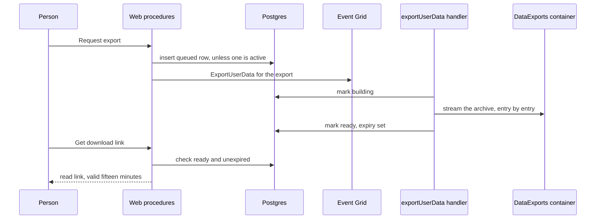

# Data export design

The stores this reads are the ones in the [user data inventory](../../specs/architecture/user-data-inventory/design.md). An export that lists a store the inventory does not is a bug in the inventory, fixed there.

## Decisions

**The request is queued, and the archive is built by a handler.** A large account's archive streams every attachment it owns. The request returns once the row is written and the event published, as the deletion does, and the person checks the row's status from the settings page.

**The archive streams into a blob; nothing holds it whole.** `fflate`'s streaming zip writes each entry as it is read, and the entry's bytes are read from Blob one stream at a time. The output is a block blob uploaded from the same stream. The memory a large export uses is bounded by one attachment, not by the account.

**The archive is one blob per request, named `{exportId}.zip`.** A retry of the same request overwrites its own blob, so a replayed handler cannot leave two archives. The row's status is the only pointer, and it moves to ready only after the upload commits.

**Links are short-lived and owner-only.** The download is a read-only SAS valid for fifteen minutes, minted on request for the owner of a ready, unexpired export. The archive itself is private, so a link is the only way in.

**Expiry is enforced twice.** The row carries an expiry seven days after it is ready, and the private container's lifecycle rule deletes the blob after the same period. A link is refused once the row has expired, even if the blob still exists.

**One export is active per person.** A second request while one is queued or building returns the first one's status. This bounds the work an account can start.

**The archive holds the person's own data, including what their activity left on the platform, and nobody else's.** Access and portability under the GDPR (Articles 15 and 20) cover the personal data concerning the person, which includes data observed from their activity, such as their likes, reactions and friend requests. Article 20(4) provides that the right to portability shall not adversely affect the rights and freedoms of others. So another person's content, counts and records are left out even where they sit beside the person's own, and the exclusions below name each one.

## What the archive holds

| Entry                                                      | Source                                                                                                                                                                                                                                                                                                                                                                                                     |
| :--------------------------------------------------------- | :--------------------------------------------------------------------------------------------------------------------------------------------------------------------------------------------------------------------------------------------------------------------------------------------------------------------------------------------------------------------------------------------------------- |
| `account.json`                                             | The user row without secrets, blocks, notifications, achievements, bookmarks, settings and statuses. Sign-in providers by name, never their tokens. Push subscriptions by endpoint, without keys.                                                                                                                                                                                                          |
| `friends.json`                                             | Friend requests the person sent and received, and their current friends. Each other party appears by user id and display name only. Requests and friendships carry no time, so none is written.                                                                                                                                                                                                            |
| `posts/{postId}.json`                                      | The person's own posts as their title, description, parent and depth. Like and comment counts and the ranking are other people's activity on the post, so they are left out. Posts carry no attachments today, so no `posts/{postId}/files/` entry is written; an attachment a post gains is written under that directory, following the messages entry.                                                   |
| `likes.json`                                               | The person's likes and dislikes of posts, each with its post id and value, and their emoji reactions in rooms they are a member of, each with its message id, room and emoji. No entry carries a time: the schema stores none for a post like, and a reaction row's time is its first reactor's, not the person's, so the archive does not write it as theirs. No counts, and no other person's reactions. |
| `rooms/{roomId}/messages.json` and `rooms/{roomId}/files/` | The person's own messages in rooms they are a member of, and the files those messages attach.                                                                                                                                                                                                                                                                                                              |
| `rooms/{roomId}/room.json`                                 | For each room the person owns, its name, topic, type, settings, and its emoji by id and name. Its members are other people's records, so they are not written. Rooms carry no creation time, so none is written.                                                                                                                                                                                           |
| `rooms/{roomId}/images/` and `rooms/{roomId}/emoji/`       | The images and emoji blobs of each room the person owns, as stored under the room's own prefixes.                                                                                                                                                                                                                                                                                                          |
| `resources/{resourceId}/`                                  | The resource's record, its working copy and its working assets, for resources the person owns.                                                                                                                                                                                                                                                                                                             |
| `saves/{game}/save.json`                                   | The person's game saves, from the three game containers.                                                                                                                                                                                                                                                                                                                                                   |
| `searches.json`                                            | The person's own search queries across rooms, each with the filters it ran with and the room it searched. A search stores no time, so none is written.                                                                                                                                                                                                                                                     |
| `images/`                                                  | The profile image and the call backgrounds.                                                                                                                                                                                                                                                                                                                                                                |
| `moderation.json`                                          | The moderation records that name the person as their target. A person has the right to see what was recorded about them.                                                                                                                                                                                                                                                                                   |

## Not included

- **Other people's content and counts.** Their messages and data, their posts and comments, the like and comment counts on the person's posts, and the ranking, which orders posts by others' activity. The rooms the person has left, whose messages and reactions are not indexed to them: membership is the only index from a person to a room, which is the same limit the deletion names.
- **Other people's records.** Another member's membership, roles and permissions in a room the person owns, and another person's reaction on a message the person also reacted to.
- **Resource version history.** Every saved version of a resource beyond its working copy, which is included. The resource's activity logs, which record other people's use of the resource.
- **Derived files.** Thumbnails, which are derived from the original attachment the archive holds.
- **Shared and staging data.** The shared character-pack files and the list of packs, which have no owner to attribute them to, the staging blobs of character packs not yet kept, and the storage ledger, which is accounting rather than the person's data.
- **Sessions and tokens.** Sessions, API keys and every token in `accounts`, which the deletion removes with the user row.

## Rejected

- **Building the archive in the request.** A large account would time out, and a timeout leaves no archive and no answer.
- **One archive per account, replaced on each request.** A download in progress would break when it was replaced.

## Sequence

A failed build marks the row failed with its reason and leaves the blob to the lifecycle rule. A replayed event rebuilds the same export id over its own blob.

## Key files

| Path                                                      | Role                                                            |
| :-------------------------------------------------------- | :-------------------------------------------------------------- |
| "packages/db-schema/src/schema/user/dataExportsInUser.ts" | New: the export row: status, blob name, ready and expiry times  |
| `apps/web/server/trpc/routers/user.ts`                    | Request, status and link procedures                             |
| "apps/web/server/services/user/getDataExportLink.ts"      | New: the short-lived read link, owner-only and expiry-checked   |
| "apps/functions/src/handlers/exportUserDataHandler.ts"    | New: the streamed archive build                                 |
| "apps/functions/src/functions/exportUserData.ts"          | New: the event registration                                     |
| `apps/infra/src/azure/resources/`                         | The private container, its lifecycle rule and the subscriptions |
| `apps/web/app/pages/user/settings.vue`                    | The Download my data flow                                       |
