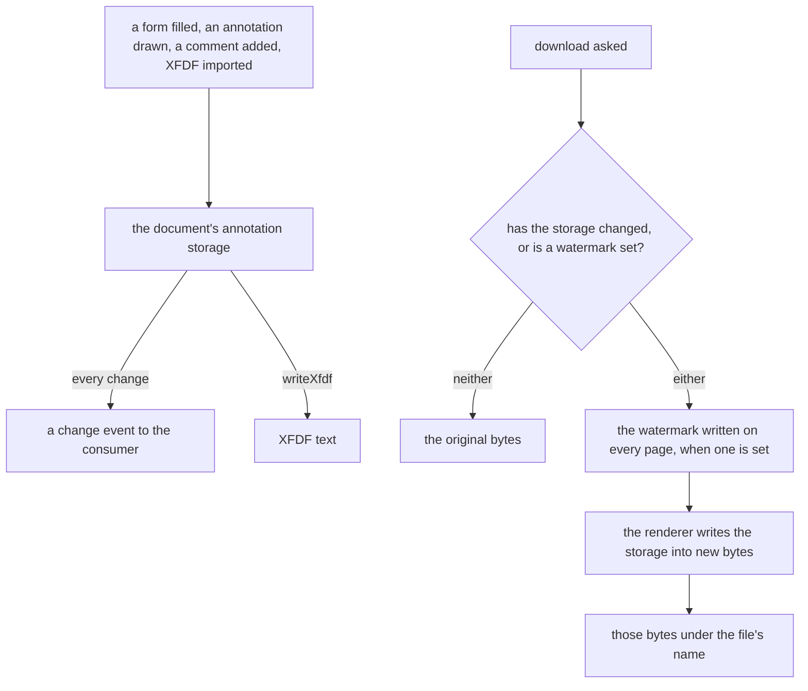

# PDF annotations in the headless package

[`vue-pdfjs-headless`](../../specs/vue-pdfjs-headless/README.md) gains what a document holds besides its pages: forms, annotations and comments. All three are the renderer's annotation storage, so one composable reads and writes that storage, and one save writes it into the bytes a download carries.

## Scope

Today the package's [viewer](../../specs/vue-pdfjs-headless/viewer/design.md) renders pages through the renderer's annotation layer with its default of forms enabled, as the app's viewer does. A document's existing annotations show and its fields take input, but a download carries none of what was typed, and nothing can be drawn or commented. After this change:

- **`usePdfAnnotations`** takes the viewer and the document `usePdfViewer` and `usePdfDocument` return. It sets the editor mode, reports changes, lists and adds comments, and saves.
- **`vue-pdfjs-headless/xfdf`** holds `readXfdf` and `writeXfdf`, which map XFDF to the storage's entries and back, with no framework and no renderer. It is a second build entry beside `index`, declared the way `packages/genshin-engine/tsdown.config.ts` declares its worker.
- **The download** that `usePdfViewer` returns saves new bytes once the storage holds a change or a watermark is set: the renderer's own `PDFDocumentProxy.saveDocument` writes the storage into them, and the package's download service hands them to the browser as it hands the original bytes today.

## How it works



- **Forms** already take input where the page draws them. A filled value lands in the storage like any other change, so the save carries it.
- **Editing** sets the renderer's annotation editor mode: none, free text, ink, highlight or stamp. The storage's modified callback becomes the change event, carrying the page and the kind of annotation.
- **A comment** is a PDF text annotation, the sticky note every PDF reader shows. Listing reads each page's annotations of that kind. Adding writes one at a point in the page's own coordinates, which the page's viewport converts from the screen.
- **XFDF** is plain XML over the storage. `writeXfdf` writes one element per annotation with its page, rectangle and contents. `readXfdf` parses the text and returns entries for the storage, or an error naming what it could not read, so a malformed file changes nothing.
- **The watermark** is a free-text annotation written on every page just before the save, so the downloaded file carries it and the document on screen does not.

## Decisions

- **The storage over a model of the package's own.** Keeping comments, fields and drawings in package state would need syncing back into the renderer on every save. Rejected, since the storage is already what the renderer's save writes.
- **XFDF read and written by the package.** The renderer has no XFDF. Depending on a PDF writing library for it was rejected: the storage is already the model both directions map to, and XFDF is plain XML over it.
- **The watermark is written at save, not drawn on screen.** Drawing it into the page canvas was rejected: the mark would never reach the downloaded file, which is where a watermark is for.
- **An annotation kind the renderer cannot write on save is recorded, not worked around.** Writing such kinds with a second PDF library was rejected, for the same reason as XFDF. The task that builds a kind checks the save first and records any kind that does not survive it on the package's page.

## Key files

The package's annotation files, created by this change:

```text
packages/vue-pdfjs-headless/src/composables/usePdfAnnotations.ts  editor mode, change events, comments, save
packages/vue-pdfjs-headless/src/xfdf/                             readXfdf and writeXfdf, framework-free
packages/vue-pdfjs-headless/src/models/                           PdfComment, PdfAnnotationChange
```

| File                                                            | Role                                                                          |
| :-------------------------------------------------------------- | :---------------------------------------------------------------------------- |
| `packages/vue-pdfjs-headless/src/composables/usePdfViewer.ts`   | the download, saving new bytes once the storage changed or a watermark is set |
| `packages/vue-pdfjs-headless/src/composables/usePdfDocument.ts` | the document whose annotation storage `usePdfAnnotations` reads and writes    |
| `packages/vue-pdfjs-headless/tsdown.config.ts`                  | the `xfdf` entry beside `index`                                               |
| `openspec/specs/architecture/pdf-viewer/design.md`              | The app's PDF viewer, which draws none of these controls                      |

## Sources

- [mozilla/pdf.js — `src/display/api.js`](https://github.com/mozilla/pdf.js/blob/master/src/display/api.js): the document's `annotationStorage` and `saveDocument`.
- [mozilla/pdf.js — `web/pdf_viewer.js`](https://github.com/mozilla/pdf.js/blob/master/web/pdf_viewer.js): the viewer's annotation mode, forms included, and its annotation editor modes.
- [ISO 19444-1, XML Forms Data Format](https://www.iso.org/standard/74272.html): the XML format for a PDF's annotations and form data.
