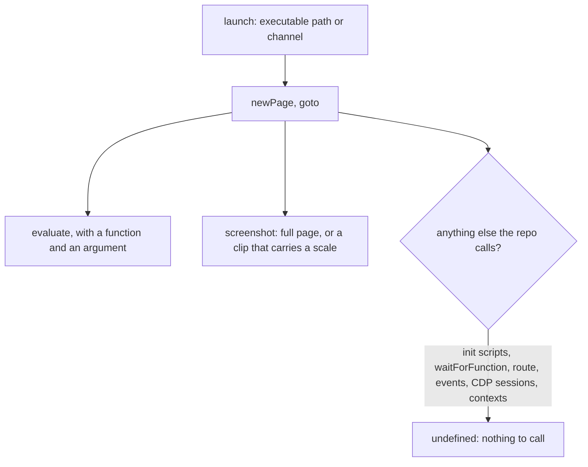

# Rustwright

Rustwright is Skyvern's Chromium automation engine written in Rust. It speaks the DevTools protocol in-process and keeps Playwright's API, so a script changes its import and nothing else, within the part of the API it covers. It is alpha, Chromium only, MIT licensed, and ships Python and Node bindings. Its Node binding is the one this repo could use, and it is the weaker of the two.

Two things in the repo drive a browser, and both are Playwright's:

- **The parity tooling** in `scripts` opens the parity page in the machine's Edge, shoots frames, reads the page's own measurements and profiles it (`scripts/src/services/genshinParity/shared/openParityPage.ts`). It holds the `playwright` dependency and about forty modules import it.
- **Vitest's browser mode** runs every `*.browser.test.ts` suite through `@vitest/browser-playwright`, which `packages/configuration/src/services/getVitestBrowserConfiguration.ts` configures once for the Genshin packages.

A full replacement has to cover both, so the smaller consumer, the parity tooling, sets the order and the larger one, the Vitest provider, sets the cost.

## What the Node binding covers

A trial installed the released Node binding in an empty directory and called it against the machine's Chrome and Edge.

What worked: launching the machine's Edge by `channel: "msedge"` and by executable path, headless, in about a second and a half; `evaluate` with a function and an argument; a full-page screenshot; and a clipped screenshot with a `scale`.

What did not:

- **The surface the repo calls is not bridged.** On a page, `waitForFunction`, `addInitScript`, `route`, `on`, `exposeFunction`, `evaluateHandle`, `setViewportSize`, `locator`, `setContent`, `mouse` and `keyboard` were all undefined, and so was the CDP session on the browser and on a context. `connectOverCDP` is undefined too. The parity tooling needs the CDP session for its CPU profile (`scripts/src/services/genshinParity/shared/startCpuProfile.ts`), the init script and the route for its page setup (`openParityPage.ts`), and `waitForFunction` for its settle waits (`scripts/src/services/genshinParity/shared/measureStalls.ts`, `scripts/src/services/genshinParity/page/crossScreen.ts`).
- **A context isolates nothing.** `newContext` exists as a compatibility shim over one process, so the per-run context the parity page opens would share its storage with every other.
- **A clip without a scale fails.** `screenshot` with `clip` set and no `scale` answers `Page.captureScreenshot: Invalid parameters` every time, and with `scale: 1` it succeeds. Playwright fills the scale in, and the typings mark it optional, so a script that clips for the parity frames breaks on the swap.

## What Vitest's browser mode needs

Vitest's `BrowserProvider` interface is public: a provider names itself, opens a page for a session, hands back the commands a test may call, optionally returns a CDP session, and closes. A provider for another driver is therefore possible in principle, and there is nothing to ask Vitest for.

What stands in the way is the provider's body. `@vitest/browser-playwright` implements every browser command a test calls (clicks, typing, frame locators, screenshots of an element, tracing, request routing) as calls on Playwright's frames, contexts, mouse and keyboard. A Rustwright provider would be a package of our own that implements all of that over a binding which bridges none of it. It is built after the binding gains a context, a frame and an input model, and it is maintained against Vitest's provider interface for as long as the repo runs it.

## Why not now

The reported gain is 2.55 times faster and 70 percent less memory, from the project's own diagnostics on its own workload. A parity run spends its time rendering a WebGPU page and reading its pixels, and a browser test spends it in the browser, so the driver's share of either is likely small and unmeasured here. The cost is two consumers rewritten against an alpha binding that bridges, of everything they call beyond launching and evaluating, only the screenshot, plus a provider package. The trade is the wrong way round until the binding catches up.

## Revisit when

A Rustwright release whose Node typings declare the surface the parity tooling calls: a CDP session, an init script, `waitForFunction`, request routing, page events, a real context and `connectOverCDP`. The open request to bring the Node binding to the Python binding's coverage tracks exactly this gap (Skyvern-AI/rustwright, the issue titled "Expand Node.js Bindings to Match Python Coverage").

A revival goes in two steps, each its own change:

1. **The parity tooling.** Swap the driver in `scripts` only, and require every parity command's committed output to match what Playwright wrote for the same references, then time a `compare` run and its memory against Playwright's before keeping the swap.
2. **The Vitest provider.** Write it only once the binding has frames and input, and only if step 1 showed a gain worth a package. Until then `@vitest/browser-playwright` stays.

Playwright keeps both jobs meanwhile; there is no interim to build.

## Key files

| File                                                                   | Role                                                                          |
| :--------------------------------------------------------------------- | :---------------------------------------------------------------------------- |
| `scripts/package.json`                                                 | holds the `playwright` dependency the parity tooling imports                  |
| `packages/configuration/package.json`                                  | holds `playwright` and `@vitest/browser-playwright` for the browser suites    |
| `packages/configuration/src/services/getVitestBrowserConfiguration.ts` | the one place the browser suites choose their provider                        |
| `scripts/src/services/genshinParity/shared/openParityPage.ts`          | launches Edge by channel, opens a context, and sets the init script and route |
| `scripts/src/services/genshinParity/shared/startCpuProfile.ts`         | profiles the page over a CDP session                                          |
| `scripts/src/services/genshinParity/shared/measureStalls.ts`           | waits on page functions and opens its own context                             |
| `scripts/src/services/genshinParity/page/crossScreen.ts`               | waits on page functions between screens                                       |
| `.agents/skills/run-app/references/driven-browser.md`                  | the driven-browser recipe, which is a Playwright script                       |

## Sources

- The Rustwright repository's README, its limitations page and its parity page state the alpha status, the Chromium-only scope, the Node binding's short list of bridged methods, and the 96 percent method coverage of the Python binding that the Node binding lacks.
- The trial results above come from calling the released Node binding against the machine's Chrome and Edge.
