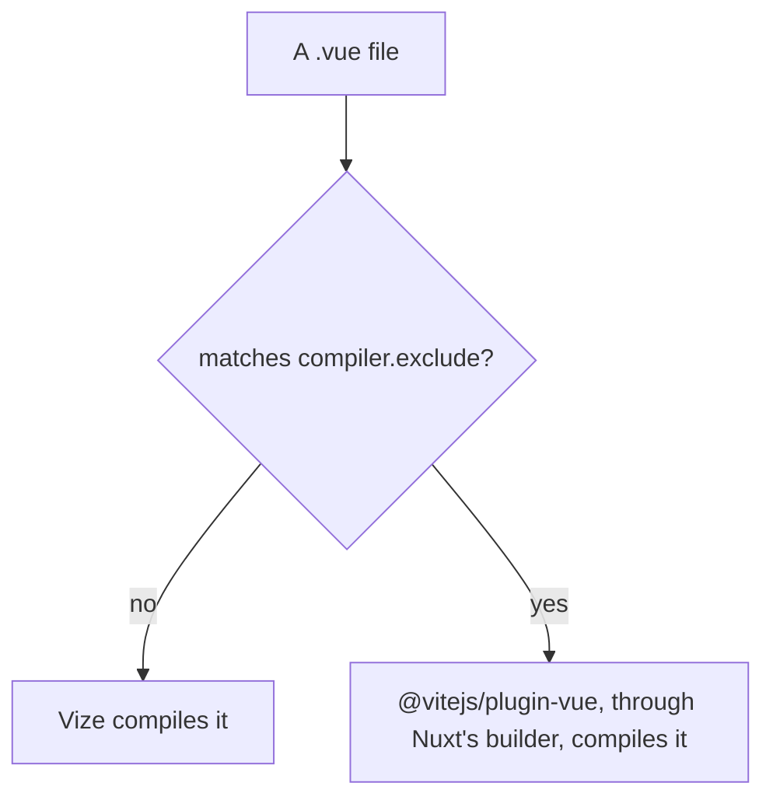

# Vize compiler

Vize compiles Vue single-file components in Rust. The library builds and Vitest already compile through it ([build pipeline](../../../specs/architecture/build-pipeline/design.md), "Vue components compile through Vize"). The app does not: Nuxt compiles it through `@vitejs/plugin-vue`. `@vizejs/nuxt` is the Nuxt module that would take that role. This page sets out its shape under the Vize and Nuxt versions the catalog pins, and what stands between the app and adopting it.

## How the module compiles

With the module registered, Vize compiles every `.vue` file that `compiler.exclude` does not name. The module hands an excluded file back to the host Vue plugin Nuxt's builder installed, so an excluded component keeps Vue's own compiler.



## Blockers

### An inline template's `new` compiles to the wrong call

In the production build, Vize compiles a template expression `new Vector3(0, 0.75, 0)` on an imported binding to `new _unref(Vector3)(0, 0.75, 0)`. The `new` binds to the unwrap call, so the constructor's arguments are applied to the instance that comes back. Vue's compiler emits `new (_unref(Vector3))(0, 0.75, 0)`. Dev mode compiles the expression as `new $setup.Vector3(...)` and runs, so the defect appears only in the production client.

The one-file reduction, compiled with `inlineTemplate: true` as the production build does:

```vue
<script setup>
import { Vector3 } from "three";
</script>

<template>
  <Cam :look-at="new Vector3(0, 0.75, 0)" />
</template>
```

The app reaches the form through `Visual/Gem/Index.vue`. The production client throws `Class constructor z cannot be invoked without 'new'` during hydration of `/about`, which the server HTML cannot show. The report is [ubugeeei-prod/vize#11915](https://github.com/ubugeeei-prod/vize/issues/11915); the compiler's identifier collector wraps the identifier alone, and its newer writer already parenthesises a constructor. The fix is merged upstream ([ubugeeei-prod/vize#11963](https://github.com/ubugeeei-prod/vize/pull/11963)) and is in no release yet: the native compiler of the pinned release still compiles the reduction above to `new _unref(Vector3)(0, 0.75, 0)`.

### The server HTML differs from Vue's compiler on two routes

Compared with the baseline's server HTML, with attribute order, class order, nonces, integrity hashes and hashed asset names normalised, `/clicker` lacks the fragment-marker comment pairs (`<!--[-->` and `<!--]-->`) that Vue's compiler writes around fragments, and its drawer dialogs carry a second `data-v` scope attribute. `/about` renders `<!--placeholder-->` where the baseline renders an empty `<span>` carrying the canvas's attributes. The missing markers come from the server renderer: a `<template v-if>` whose only child is text or an interpolation is written without them, which Vue's compiler wraps, and a Vize server with a Vize client then reports a hydration node mismatch for it ([ubugeeei-prod/vize#11920](https://github.com/ubugeeei-prod/vize/issues/11920)). The placeholder comes from the module's component registry, which keeps the first registration of a name: `TresCanvas` is registered as a client file and a server file, the client file wins, and the module wraps it in a client-only wrapper that renders the placeholder on the server ([ubugeeei-prod/vize#11757](https://github.com/ubugeeei-prod/vize/issues/11757)). The second `data-v` attribute is the scope id Vize's server render passes as a prop on every component call, which a component that forwards `$attrs` hands to its child; Vue's compiler leaves the scope id to the runtime. It changes which scoped rules match and raises no hydration error ([ubugeeei-prod/vize#11921](https://github.com/ubugeeei-prod/vize/issues/11921)). Reports #11920 and #11921 are fixed upstream by the same merged change as the one above and wait for a release; #11757 is still open with no fix. The baseline already logs a hydration mismatch on both routes, so the module does not add that one.

### The module cannot resolve props types from packages without declarations

`defineProps<T>()` fails when `T` is imported from `@esposter/db-schema`. That package is private and its build emits no `.d.ts`, so its types resolve only through the tsconfig `source` condition, which Vize does not read. The production build fails with `Cannot resolve imported macro type ... from @esposter/db-schema` until the affected components are excluded with `compiler.exclude`. Those are the link-preview components under `apps/web/app/components/Message/Model/Message/LinkPreview/`, and Nuxt's compiler takes them. The dev server logs the same errors and keeps serving. The compile-side resolver reads a `paths` entry and a `types` target, not the `source` condition, so either one resolves the package. The report is [ubugeeei-prod/vize#11918](https://github.com/ubugeeei-prod/vize/issues/11918). It is fixed upstream by the same merged change and waits for a release: the dev server of the pinned release still logs `Cannot resolve imported macro type` for the three link-preview response types.

### Nuxt's builder keeps `@vitejs/plugin-vue`

`@nuxt/vite-builder` depends on `@vitejs/plugin-vue` unconditionally, and no Nuxt option turns it off. The module keeps that plugin for the components it excludes, such as nuxt-og-image's renderers, so the package stays in the lockfile until Nuxt drops the dependency.

## What passes

- With the module registered under the pinned release (the `vize` entry of `packages/genshin-world/package.json`), the dev server answers `/`, `/about`, `/clicker`, `/fluid-simulator` and `/login` with status 200 and no `NUXT_E1006`, and Chrome mounts each; `/about` logs no hydration error in dev, where the `new` form compiles to a member access. The first request after a cold start logs an outdated-optimised-dependency error until Vite re-optimises, as it does without the module.
- The production client mounts on every public route. No statically loaded chunk and no server entry graph imports a bare `vue` specifier. Server components that are loaded lazily import `vue` as the baseline does, from `node_modules`.
- The module's peer range covers the Nuxt the app runs, and the dev server logs no `NUXT_B9003`. The module's dev stylesheet plugin still imports `nitropack/runtime`, which the app's tree does not resolve, so the warning is silent rather than the import removed.
- The `/clicker` SVG group carries the `class` and `cursor` its component passes as `gAttrs`, and props typed through the `@/` alias resolve.
- The production build finishes faster than the baseline's, with one run each. The module run reused warm caches, so the gap is not a fair measure.

## The TresJS elements

The module takes its TresJS elements as `compiler.customElements`, the list the library builds already hand Vize (`tresCustomElements`). A `Tres*` pattern would also take `TresCanvas`, which must stay a component, so the list names each class that TresJS's own predicate keeps. `tresjs-nuxt` keeps its predicate for Nuxt's own compiler, which restates the same rule and has not moved onto the list.

## Revisit when

The first Vize release after the pinned one carries the merged change above (the release's notes or the reduction compiled with its native compiler show it). The module's production client hydrates `/about`, which needs the inline template to emit `new (_unref(Vector3))(...)` for the reduction above. The server HTML of `/clicker` and `/about` matches the baseline's after the normalisation named above. Props types imported from `@esposter/db-schema`, or from any package that ships no declarations, resolve without exclusions. Nuxt drops `@vitejs/plugin-vue` from its builder.

A re-trial builds the app with and without the module, serves each output, and compares the parsed server HTML of `/clicker` and `/about` after the normalisation above. It then loads every public route in Chromium and compares console errors and page errors. Bare `vue` specifiers are counted in the chunks the client entry loads by walking its static imports, since a directory count also includes chunks of other builds. Both builds must run against a database. In a sandbox that cannot reach the font providers, `@nuxt/fonts` is left out of both builds.

## Key files

| File                                                            | Role                                                                       |
| :-------------------------------------------------------------- | :------------------------------------------------------------------------- |
| `apps/web/configuration/modules.ts`                             | the Nuxt module list, where the Vize module registers                      |
| `apps/web/app/components/Visual/Gem/Index.vue`                  | the component whose inline template reaches the `new` defect               |
| `packages/genshin-world/scripts/tres/tresCustomElements.ts`     | the element names the library builds hand Vize, which the module takes too |
| `packages/tresjs-nuxt/src/services/checkIsTresCustomElement.ts` | the TresJS predicate the Nuxt module sets for Nuxt's own compiler          |
| `packages/db-schema/package.json`                               | the private package whose types the compiler cannot read                   |
| `pnpm-workspace.yaml`                                           | the `vize` and `@vizejs/*` catalog entries                                 |

## Sources

- [Vize repository](https://github.com/ubugeeei-prod/vize) — the repository of `@vizejs/nuxt`; the peer range comes from its npm metadata.
- [Vize issue 11793](https://github.com/ubugeeei-prod/vize/issues/11793) — bare `vue` imports in the Nuxt 5 client, which the client check depends on. Closed as completed.
- [Vize issue 11794](https://github.com/ubugeeei-prod/vize/issues/11794) — `defineProps` through a tsconfig alias, which the `/clicker` SVG group depends on. Closed as completed.
- [Vize issue 11795](https://github.com/ubugeeei-prod/vize/issues/11795) — the `nitropack/runtime` import behind `NUXT_B9003`, and the peer range. Closed as completed.
