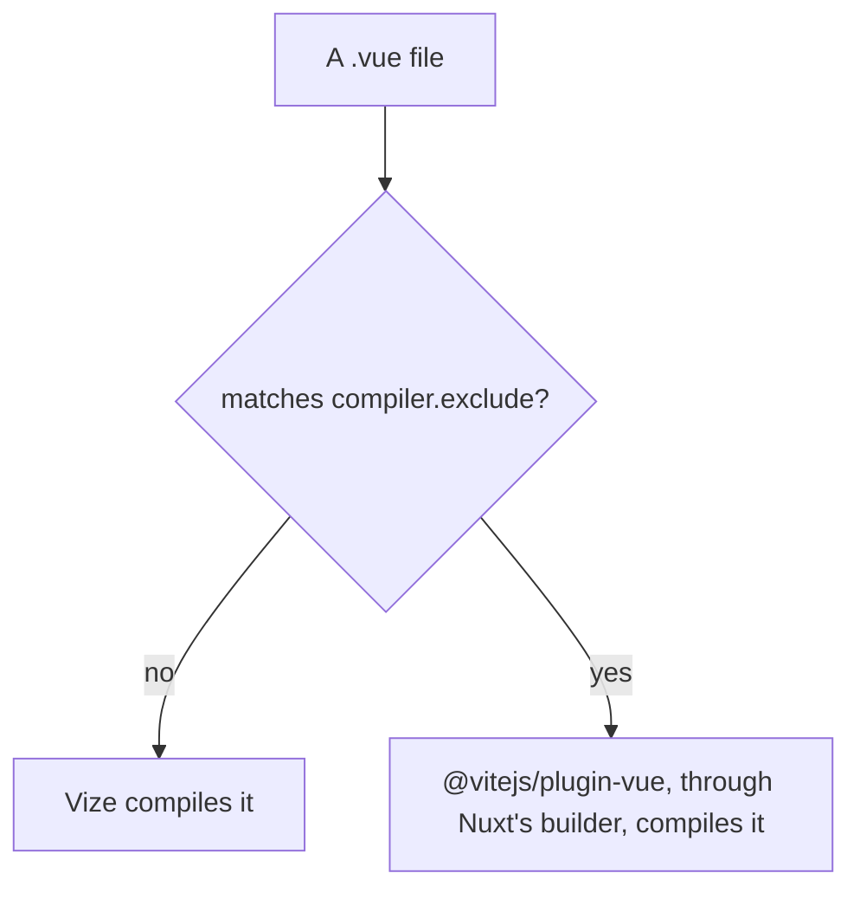

# Vize compiler

Vize compiles Vue single-file components in Rust. The library builds and Vitest already compile through it ([build pipeline](../../../specs/architecture/build-pipeline/design.md), "Vue components compile through Vize"). The app does not: Nuxt compiles it through `@vitejs/plugin-vue`. `@vizejs/nuxt` is the Nuxt module that would take that role. This page sets out its shape under the Vize release the last re-trial ran, which the catalog does not yet take, and what stands between the app and adopting it.

## How the module compiles

With the module registered, Vize compiles every `.vue` file that `compiler.exclude` does not name. The module hands an excluded file back to the host Vue plugin Nuxt's builder installed, so an excluded component keeps Vue's own compiler.

## Blockers

### The release that carries the compiler fixes ships a declaration the library builds cannot bundle

The Vize release that carries the compiler repairs the module needs also ships `virtual-ts-emits.d.ts`, which imports `$ConstructorEmitPropsFactory` from `virtual-ts.js`. `virtual-ts.d.ts` declares that type without exporting it, so the import names nothing. The declaration build of a package whose components declare emits fails in rolldown with `MISSING_EXPORT` on that import: `genshin-interface` and `vue-phaserjs` fail this way and every other library build passes. The same two files are on Vize's main branch.

The four packages the `vize` rule in `renovate.json` groups pin each other's version, so the module cannot move to the release alone. The catalog stays on the release before it, and a second rule in `renovate.json` caps the group below it until a release exports the type.

### The server HTML differs from Vue's compiler on one route

Compared with the baseline's server HTML, with attribute order, nonces, integrity hashes, hashed asset names and scope ids normalised, `/`, `/clicker`, `/fluid-simulator` and `/login` are identical. `/about` renders `<!--placeholder-->` where the baseline renders an empty `` carrying the canvas's attributes. The placeholder comes from the module's component registry, which keeps the first registration of a name: `TresCanvas` is registered as a client file and a server file, the client file wins, and the module wraps it in a client-only wrapper that renders the placeholder on the server ([ubugeeei-prod/vize#11757](https://github.com/ubugeeei-prod/vize/issues/11757)), which is open with no fix. The canvas draws on the client only, and the baseline already logs a hydration mismatch on `/about`, which the module build logs the same.

### Nuxt's builder keeps `@vitejs/plugin-vue`

`@nuxt/vite-builder` depends on `@vitejs/plugin-vue` unconditionally, and no Nuxt option turns it off. The module keeps that plugin for the components it excludes, such as nuxt-og-image's renderers, so the package stays in the lockfile until Nuxt drops the dependency. That costs an install and changes no behaviour, so it does not hold the module back.

## What passes

- With the module registered under the pinned release (the `vize` entry of `packages/genshin-world/package.json`), the dev server answers `/`, `/about`, `/clicker`, `/fluid-simulator` and `/login` with status 200 and no `NUXT_E1006`, and Chrome mounts each; `/about` logs no hydration error in dev, where the `new` form compiles to a member access. The first request after a cold start logs an outdated-optimised-dependency error until Vite re-optimises, as it does without the module.
- The production client mounts on every public route with no page error, `/about` included, where an inline template's `new` on an imported binding compiles to a call the constructor can run. No client chunk and no server entry graph imports a bare `vue` specifier. Server components that are loaded lazily import `vue` as the baseline does, from `node_modules`.
- The production build compiles every `.vue` file through the module with none failing and no file excluded, and props types imported from `@esposter/db-schema`, a private package that emits no declarations, resolve. `/clicker` renders in full and its cocktail counts a click as the baseline's does.
- The module's peer range covers the Nuxt the app runs, and the dev server logs no `NUXT_B9003`. The module's dev stylesheet plugin still imports `nitropack/runtime`, which the app's tree does not resolve, so the warning is silent rather than the import removed.
- The `/clicker` SVG group carries the `class` and `cursor` its component passes as `gAttrs`, and props typed through the `@/` alias resolve.
- The module's production build took longer than the baseline's in one run each, in Nitro's step, so the page claims no gain in build time.

## The TresJS elements

The module takes its TresJS elements as `compiler.customElements`, the list the library builds already hand Vize (`tresCustomElements`). A `Tres*` pattern would also take `TresCanvas`, which must stay a component, so the list names each class that TresJS's own predicate keeps. `tresjs-nuxt` keeps its predicate for Nuxt's own compiler, which restates the same rule and has not moved onto the list.

## Revisit when

The first Vize release after the held one exports `$ConstructorEmitPropsFactory` from its `virtual-ts` declaration, so the declaration builds of `genshin-interface` and `vue-phaserjs` pass with the whole group on it. The cap in `renovate.json` lifts at that release. The re-trial then confirms, under that release, that the module's production client has no page error and that the server HTML of every route but `/about` matches the baseline's after the normalisation named above. What it leaves is one decision: whether `/about`'s `<!--placeholder-->` is accepted or [ubugeeei-prod/vize#11757](https://github.com/ubugeeei-prod/vize/issues/11757) is fixed first.

A re-trial builds the app with and without the module, serves each output, and compares the parsed server HTML of every public route after the normalisation above. It then loads every public route in Chromium, compares console errors and page errors, and clicks the `/clicker` cocktail in both. Bare `vue` specifiers are counted in the chunks the client entry loads by walking its static imports, since a directory count also includes chunks of other builds. Both builds must run against a database, and a build served from a copy of `.output` needs the app's `node_modules` reachable from the copy, or the rate limiter's `drizzle-orm` import fails and `/clicker` shows its error screen in both. In a sandbox that cannot reach the font providers, `@nuxt/fonts` is left out of both builds.

## Key files

| File                                                            | Role                                                                        |
| :-------------------------------------------------------------- | :-------------------------------------------------------------------------- |
| `apps/web/configuration/modules.ts`                             | the Nuxt module list, where the Vize module registers                       |
| `apps/web/app/components/Visual/Gem/Index.vue`                  | the component whose inline template holds the `new` form `/about` exercises |
| `packages/genshin-world/scripts/tres/tresCustomElements.ts`     | the element names the library builds hand Vize, which the module takes too  |
| `packages/tresjs-nuxt/src/services/checkIsTresCustomElement.ts` | the TresJS predicate the Nuxt module sets for Nuxt's own compiler           |
| `packages/db-schema/package.json`                               | the private package, with no declarations, whose props types must resolve   |
| `renovate.json`                                                 | the rule that caps the `vize` group below the release with the bad import   |
| `pnpm-workspace.yaml`                                           | the `vize` and `@vizejs/*` catalog entries                                  |

## Sources

- [Vize repository](https://github.com/ubugeeei-prod/vize) — the repository of `@vizejs/nuxt`; the peer range comes from its npm metadata.
- [Vize issue 11793](https://github.com/ubugeeei-prod/vize/issues/11793) — bare `vue` imports in the Nuxt 5 client, which the client check depends on. Closed as completed.
- [Vize issue 11794](https://github.com/ubugeeei-prod/vize/issues/11794) — `defineProps` through a tsconfig alias, which the `/clicker` SVG group depends on. Closed as completed.
- [Vize issue 11795](https://github.com/ubugeeei-prod/vize/issues/11795) — the `nitropack/runtime` import behind `NUXT_B9003`, and the peer range. Closed as completed.
