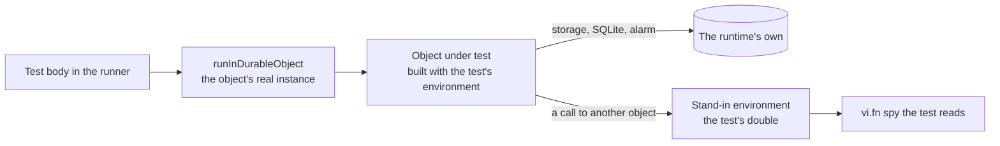

# Workers Vitest pool

The idea was to run the Workers suites inside the Workers runtime through Cloudflare's Vitest integration, in place of the Workers doubles that `@esposter/db-mock/workers` hand-builds: the realtime Durable Object suites, the jobs Worker's handlers and the web server's Workers-facing tests. The integration is now `@cloudflare/vitest-plugin`. The package it was published as, `@cloudflare/vitest-pool-workers`, was renamed to it and deprecated, so the successor is the only candidate.

Nothing is adopted. The idea is deferred rather than rejected, because the realtime case turns on limits the plugin's own documentation names. A named upstream change would flip that verdict, and the revisit triggers below say which.

## Verdicts

| App      | Verdict         | Doubles it would delete                                                                   | Doubles it keeps                                                                 |
| -------- | --------------- | ----------------------------------------------------------------------------------------- | -------------------------------------------------------------------------------- |
| realtime | Keep (deferred) | `createMockObjectState` and the `cloudflare:workers` alias, for the Durable Object suites | The stand-in environment for calls between objects, and the spies that read them |
| jobs     | Keep            | The bucket registry (`getBucket` and its open, clear and dispose helpers)                 | The queue recorder, the object-stub services and the wrangler reader             |
| web      | Keep            | None                                                                                      | All of `db-mock`                                                                 |

No app deletes a double today. Each row's "would delete" column is what the verdict would delete if its revisit trigger held.

## How a suite would run

The pool runs the test body in the runtime, so a test reaches a real object through `runInDurableObject`, and the object's own state, storage and alarm are the runtime's. The one thing the test still supplies is a stand-in for the bindings to other objects, because the spies a test reads live in the runner and cannot see a call that the runtime sends through a binding.

## The evidence

| Question              | Answer                                                                                                                                                                                                                                                                       | Source                                                                                                                                                                  |
| --------------------- | ---------------------------------------------------------------------------------------------------------------------------------------------------------------------------------------------------------------------------------------------------------------------------- | ----------------------------------------------------------------------------------------------------------------------------------------------------------------------- |
| Is the name current?  | No. `@cloudflare/vitest-pool-workers` is deprecated and renamed to `@cloudflare/vitest-plugin`, from the plugin's 1.0.0 release.                                                                                                                                             | The npm metadata of both packages, and the [plugin changelog](https://github.com/cloudflare/workers-sdk/blob/main/packages/vitest-plugin/CHANGELOG.md), its 1.0.0 entry |
| Vitest major          | The successor's peer range covers Vitest 4.1 and Vitest 5.0 and later, so the catalog's Vitest major is accepted. The deprecated package's range covers Vitest 4 only.                                                                                                       | The peer ranges in both npm manifests                                                                                                                                   |
| Its own Miniflare     | The successor depends on one exact Miniflare version, and the catalog pins that same version. pnpm resolves one copy, shared with `db-mock` and wrangler. The lockfile already holds a second, older Miniflare for web's dev dependencies, which the plugin does not add to. | The successor's manifest, and `pnpm why miniflare` on a worktree install                                                                                                |
| Wrangler              | The successor has no wrangler dependency since its 1.9.0 release. Wrangler stays a CLI tool in the repo.                                                                                                                                                                     | The plugin changelog, its 1.9.0 entry                                                                                                                                   |
| Real object instances | `runInDurableObject`, `runDurableObjectAlarm`, `evictDurableObject`, `listDurableObjectIds` and `reset` are exported. A port of the topic object's suite ran against the real instance and real storage, and passed once two runtime-forced changes landed.                  | The plugin's `types/cloudflare-test.d.ts`, and the port described under the realtime verdict                                                                            |
| Isolation             | Isolation is per test file, not per test, so the repo's `reset()` in `afterEach` is still needed.                                                                                                                                                                            | The [isolation page](https://developers.cloudflare.com/workers/testing/vitest-integration/isolation-and-concurrency/)                                                   |
| WebSockets            | WebSockets with Durable Objects are not supported under per-file isolation. Four of the five realtime object suites drive sockets. Not measured here.                                                                                                                        | The [known-issues page](https://developers.cloudflare.com/workers/testing/vitest-integration/known-issues/), and the suites                                             |
| Clock                 | A faked `Date` reaches the object's own `Date.now()`. It does not reach the alarm clock: `setAlarm` with a time below the runtime's clock is taken as due now, and `getAlarm` returns the runtime's clock.                                                                   | Two probes in the port's worktree                                                                                                                                       |
| Bindings (jobs)       | Real R2 `put` and `get`, a D1 query, a queue producer `send`, and `createExecutionContext` with `waitOnExecutionContext` all passed. `createMessageBatch`, `createScheduledController` and `applyD1Migrations` are exported.                                                 | A probe in the port's worktree, and the plugin's types                                                                                                                  |
| Queue reads           | `getQueueResult` accepts only batches built by `createMessageBatch` and contexts built by `createExecutionContext`. A producer's sent messages cannot be read back through it.                                                                                               | The plugin's types                                                                                                                                                      |
| Cross-script bindings | The pool refuses to start while a Durable Object binding names a Worker it does not load. A stand-in Worker with the same class names let the probe run; the real realtime Worker was not loaded.                                                                            | The probe's startup error, and the jobs wrangler config                                                                                                                 |
| Nuxt environment      | The plugin refuses any project environment other than `node` in its `parseProjectOptions`, and a per-file `happy-dom` directive stopped the pool's worker from starting. The docs say custom environments are not supported.                                                 | The plugin's pool build, the [configuration page](https://developers.cloudflare.com/workers/testing/vitest-integration/configuration/), and a probe                     |
| Coverage              | V8 works. One test gives the same statement and line figures under the pool as under the node run, so V8 reflects execution inside the runtime. The known-issues page says native V8 is unsupported and Istanbul is required; the measurement contradicts it.                | Paired runs in the port's worktree, and the known-issues page                                                                                                           |
| CI blob and merge     | The pool writes a `blob.json` under `.vitest/blob`, the kind of file each CI coverage shard uploads. The cross-project merge was not run.                                                                                                                                    | A run in the port's worktree, and `.github/workflows/CI.yaml`                                                                                                           |

## Realtime

The realtime suites build their objects directly over `createMockObjectState`, a hand-built storage with its own SQLite, alarm and socket registry. A real object over the runtime's storage would retire it, and that is the one double the pool would replace outright.

The port moved the topic object's suite, four of its seven tests, to the pool. It ran against the real instance, and it passed once two of its assertions were reshaped for what the runtime does:

- A window armed by one publish and left in place by the next is bounded by the real clock, not by a faked `Date`, so the assertion became a range read on the real clock.
- The pool file dropped the fake clock, because the alarm does not follow it.

The stand-in environment stayed. The topic object calls another object through its `USER` binding, and the test's spy lives in the runner, so the pool's real binding would never reach it. The stand-in is the same kind of double the suites already use for object stubs, so the pool does not delete it.

Four of the five realtime object suites drive sockets, most of them the call and room suites, and the docs exclude WebSockets under per-file isolation. Moving only the socket-free suite would leave the Node harness beside the pool for the rest, which the `no-compatibility-debt` rule forbids. So the package cannot move as a whole today.

## Jobs

The jobs suites reach the database, the buckets and the queues through Miniflare, and `db-mock` already boots the same Miniflare version the plugin pins. Adopting the pool changes the host those bindings run in, not their fidelity. The gain is the thin wrappers around the bindings: the bucket registry, and the D1 boot if the pool's own D1 were used with migrations applied through its helper, which was not measured.

Three costs stand against that gain:

- The jobs Worker's four object bindings name the realtime Worker, so every jobs run must load a Worker of that name. The probe used a stand-in with the four class names. Loading the real realtime Worker was not measured.
- A queue producer's messages cannot be read back through the pool's helpers, so the queue recorder, which the suites assert against, would stay.
- The object-stub services are mocked at the service boundary by the suites themselves. They work in the runtime too, but they are not what the pool would replace.

## Web

The Nuxt environment is a custom Vitest environment. Several hundred web test files opt into it with a per-file directive. `apps/web/vitest.config.ts` sets it for every file through `defineVitestProject` and then restores `node` as the project's default, so the plugin's project-level refusal does not fire. The failure is the per-file directive: a probe with a custom environment stopped the pool's worker from starting. Web's server suites on the `node` environment could in principle move, but they share one project with the Nuxt suites, so the split would be a second configuration of web's test wiring. The whole of `db-mock` stays.

## Measured numbers

These are the figures the verdicts rest on. They were taken once, in a throwaway worktree, and are rounded to the magnitudes that matter. Each configuration ran five times and the figures are medians. Memory is the resident memory of the whole run's process tree, sampled every 100 ms, so shared pages are counted once per process.

| Configuration                              | Wall time   | Peak summed resident memory |
| ------------------------------------------ | ----------- | --------------------------- |
| One file, four tests, node harness         | about 1.1 s | about 500 MB                |
| One file, four tests, pool                 | about 3.0 s | about 640 MB                |
| Three files, four tests each, node harness | about 1.2 s | about 920 MB                |
| Three files, four tests each, pool         | about 4.5 s | about 1.2 GB                |

The pool's fixed cost is about 1.9 s over the node harness per run, and each extra file adds about 0.75 s, against about 0.06 s on node. The figures were taken with a one-minute machine load of about 4.6. Earlier samples taken under heavier load ranged more widely and are not used.

## Revisit when

Each app's verdict is independent. Its own trigger is what flips it.

- **realtime** — the known-issues page drops the WebSocket limit for Durable Object suites under per-file isolation, and the alarm clock follows a faked `Date`. Both are needed. Without the socket limit lifted, the suites cannot move; without the clock, the coalescing assertions change shape.
- **jobs** — the pool reads a producer's sent messages, and it starts without the realtime-named Worker present while the jobs config still declares its object bindings. Either alone leaves the stand-in or the recorder in place.
- **web** — the plugin accepts a non-`node` project environment and runs the per-file Nuxt directive. The refusal is in the plugin's own code, so this is a change to the plugin's design, not a bug fix.

Any revival re-measures with the same method before a change is written. A revived idea moves to `changes/` under the id `architecture-workers-vitest-pool`, and its tasks name the suites they port.

## Key files

| File                                                                 | Role                                                                                     |
| -------------------------------------------------------------------- | ---------------------------------------------------------------------------------------- |
| `packages/db-mock/src/services/createMockObjectState.ts`             | The hand-built object state the realtime suites run on, and the double the pool replaces |
| `packages/db-mock/src/cloudflareWorkers.ts`                          | The `cloudflare:workers` stand-in the three apps alias to                                |
| `packages/db-mock/src/createMockDb.ts`                               | The Miniflare boot every suite shares, for D1, R2 and Queues                             |
| `packages/db-mock/src/workers/services/createObjectStub.ts`          | The stand-in object stub the suites use for calls between objects                        |
| `packages/db-mock/src/workers/services/roomObjectCalls.ts`           | The recorder of room-object calls, kept under the pool                                   |
| `packages/db-mock/src/workers/services/getBucket.ts`                 | The bucket registry the pool would replace                                               |
| `packages/db-mock/src/workers/services/getJobQueue.ts`               | The queue double the pool would not replace, because producer sends cannot be read back  |
| `packages/db-mock/src/workers/services/readWranglerConfiguration.ts` | The wrangler reader, which reads config as data and stays                                |
| `apps/realtime/vitest.config.ts`                                     | The realtime project's configuration, with the `cloudflare:workers` alias                |
| `apps/realtime/src/durableObjects/TopicObject.test.ts`               | The suite the port ran against, four of its seven tests                                  |
| `apps/realtime/wrangler.jsonc`                                       | The realtime Worker's bindings, which the pool would load                                |
| `apps/jobs/vitest.config.ts`                                         | The jobs project's configuration                                                         |
| `apps/jobs/wrangler.jsonc`                                           | The jobs Worker's bindings, including the object bindings that name the realtime Worker  |
| `apps/web/vitest.config.ts`                                          | The web project's configuration, which sets the Nuxt environment for every file          |
| `packages/configuration/src/services/getVitestConfiguration.ts`      | The shared Vitest factory every project extends                                          |
| `.github/workflows/CI.yaml`                                          | The coverage shards and the merge job that read every suite's blob                       |

## Notes

- The plugin's docs and its own changelog disagree about V8 coverage. The measurement settles it for this plugin version and this Vitest major, so the docs are cited only for the isolation and environment rules, which the measurement agrees with.
- The port's alarm assertion was a workaround, and it changes what the test asserts. A port that keeps the assertion's exact form cannot be a mechanical move, which is why the port is evidence and not a migration.
- A later adoption would name the successor. The deprecated name fails the catalog's deprecated-package check, so it cannot reach the catalog in either form.

## Sources

- [`@cloudflare/vitest-plugin` on npm](https://www.npmjs.com/package/@cloudflare/vitest-plugin): the manifest, its peer and pinned dependency ranges, and its published types.
- [`@cloudflare/vitest-pool-workers` on npm](https://www.npmjs.com/package/@cloudflare/vitest-pool-workers): the deprecation notice and the final release's ranges.
- [Plugin changelog](https://github.com/cloudflare/workers-sdk/blob/main/packages/vitest-plugin/CHANGELOG.md): the rename in its 1.0.0 entry, Vitest 5 support in 1.4.0, and the wrangler dependency's removal in 1.9.0.
- [Workers Vitest integration](https://developers.cloudflare.com/workers/testing/vitest-integration/), with its [configuration](https://developers.cloudflare.com/workers/testing/vitest-integration/configuration/), [isolation](https://developers.cloudflare.com/workers/testing/vitest-integration/isolation-and-concurrency/) and [known issues](https://developers.cloudflare.com/workers/testing/vitest-integration/known-issues/) pages.
