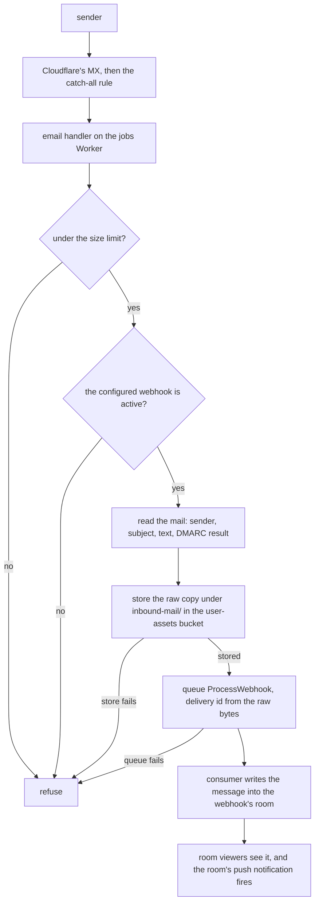

# Inbound Mail

Mail sent to any address at the domain arrives as a message in one private room, delivered by the same queue job as an [inbound webhook](../../../specs/esbabbler/webhooks/design.md) and gated by the room's own [roles](../../../specs/esbabbler/rbac/design.md). The design is kept whole so that reviving it checks it against what exists then; nothing here is built.

**Why deferred**

- Nobody has the bandwidth to read a mail room today, so the part that earns its cost, a reader, has no reader.
- The reader may turn out to be an agent that answers mail, not a person who opens a room. A room is the right surface for the first and probably the wrong one for the second, and the stored original serves either.

**Cheaper interim:** store the mail and do nothing else with it. Email Routing's catch-all rule sends every address to the jobs Worker, whose `email` handler runs only the first gates of the design below, the size limit and the raw copy written under `inbound-mail/` in the private `user-assets` bucket, and refuses the mail when it cannot be stored. Nothing is parsed, queued or shown. A person or an agent reads the `.eml` files from the bucket when there is a reason to, and a lifecycle rule bounds how long they stay. The trade is that mail nobody reads within that retention is gone, and nothing answers a sender. The interim is the design's first half, so reviving the room adds the parse, the webhook and the queue and moves nothing already stored. Until it is built the domain publishes only the [registrar change](../../../changes/infra-cloudflare-registrar/design.md)'s no-mail baseline.

**Revisit when:** the stored mail is being read by hand often enough to want a reader, or an agent is wired to answer it. The first calls for the room below as written. The second calls for deciding the reader before the surface, with the stored raw copies as the shared input.

## What works today against what the design adds

Today the domain publishes no mail records and receives nothing. The jobs Worker already holds everything a mail handler needs: the `PROCESS_WEBHOOK_QUEUE` producer binding, the D1 `CORE` binding and the private `USER_ASSETS` bucket. A webhook already turns a payload into a message from a bot identity, with retries, a dead-letter queue and a redelivery-safe write.

The design adds an `email` handler to the jobs Worker, one variable naming the webhook, two Email Routing resources and a lifecycle rule. It adds no table, no permission, no queue and no page.

## How it works

The gates run cheapest first, and the raw copy is stored before the queue is touched, so any later failure leaves the original in the bucket. The handler never throws past the gates. Each failure is a `setReject`, which Cloudflare documents as a permanent SMTP error, so a sender is told rather than silently dropped. The documentation does not say what a sender sees when a Worker throws, and that is why nothing here is left to throw.

**The message is a webhook message.** The handler builds a `webhookPayloadSchema` payload (`username` is the sender's display name or address cut to its bound, `content` is the escaped text naming the sender, the subject and the address the mail was sent to), parses it against that schema as the route does, and sends one `ProcessWebhook` job. The consumer is unchanged. Everything the room offers for a webhook message follows: the bot identity and its "app" badge, search over the mail's text and sender name, live delivery and a push to each member.

**The raw bytes name the delivery.** The delivery id is a digest of the whole raw message, so an identical redelivery writes nothing twice. Keying on the `Message-ID` header was rejected: a sender chooses it, so one could reuse another mail's id and suppress it.

**Access is the room's, and only the room's.** The room is private and invite-only. Members read; the owner and a role holding `ManageWebhooks` can switch the inbox off through the webhook's `isActive` flag, which makes every new mail bounce rather than pile up; a role holding `ManageMessages` clears it. No new permission is added. "Admin" means whoever the room's owner invites and gives a role, which is the model RBAC already enforces for every guarded read.

## Decisions

- **A room, not a mail client.** A standalone client needs its own list, reader, search, live updates, notifications and access rules, each of which a room already has. The client was rejected because it rebuilds a smaller copy of the messaging module that then drifts from it.
- **No site-wide admin role.** RBAC is per room and the repository has no notion of a platform operator. The inbox needs none, because the configured webhook names the room and the room's owner is the operator by data, not by configuration. Adding a platform role was rejected: a new table, a new guard and a new surface to attack, for one room.
- **One catch-all address space, one room.** Every address at the domain lands in the same room, and the message names the address it was sent to. Per-room addresses were rejected: the local part is one global namespace, so letting any user claim `name@esposter.com` needs a platform arbiter, and it exposes every user's room to the open internet's mail.
- **Plain text only, never the mail's markup.** The handler takes the text part, or the text of an HTML-only body with its tags removed, and escapes it. Rendering a mail's HTML was rejected: remote images track the reader, and markup from a stranger is the oldest route to a script in a reader's browser.
- **A mail that fails authentication is kept and marked.** Cloudflare validates DMARC before it invokes the Worker and prepends an `Authentication-Results` header, and only the header whose server name is `mx.cloudflare.net` can be trusted, since a sender may supply others. Refusing a failed mail was rejected: a support or abuse report from a badly configured sender is exactly the mail the inbox is for, and the documentation does not say what Cloudflare itself does with a failure. The mark tells the reader to distrust links in it.
- **Mail is capped well under the platform limit.** Cloudflare accepts up to 25 MiB and rejects larger. The handler holds the whole message in memory to hash and parse it, so it refuses above a lower constant of its own rather than spend a Worker's memory on a 25 MiB parse.
- **The raw copy lives in the private user-assets bucket under `inbound-mail/`.** No job lists a whole bucket, and the one listing helper is prefix-scoped, so a prefix no account owns is never swept. A bucket of its own was rejected as a binding, a bucket, a lifecycle and a name for one prefix. A lifecycle rule scoped to that prefix expires the copies after a retention declared once in the program.
- **Dev receives nothing.** One domain has one catch-all, and it names the production jobs Worker. The development Worker carries the same handler and is never invoked.
- **The MIME parser is a library the dependency admission page decides.** Parsing multipart bodies, charsets and encodings by hand was rejected as a standing bug source. The handler's one dependency is chosen at build under [dependency admission](../../../specs/architecture/dependency-admission/design.md) and wrapped behind one reading function.

## Failure and retry

A refusal returns to the sender at once. A mail that is stored and queued is then the webhook job's: retried to its retry count, then dead-lettered, replayed with the attempt counter, and quarantined to R2 past the cap, as [Cloudflare services](../../../specs/architecture/cloudflare-services/design.md) sets out for every job. The raw copy exists before any of that, so a quarantined mail loses nothing.

## Not built

- **Replies.** Cloudflare's `reply()` works only against a valid DMARC result, to the original sender, from the receiving domain, and Email Service sending is billed after an included monthly allowance. Replying is a feature of its own, and the agent case above is where it would most likely come from.
- **Spam filtering and a per-sender budget.** Revived when the room holds more than a person can read. The kill switch is the interim.
- **A way to open the original from a message.** The raw copy is kept and read by hand until a reader needs more than the text.
- **Attachments.** The text of a mail is read, and its attachments stay in the raw copy.

## Key files

| File                                                                                          | Role                                                                     |
| --------------------------------------------------------------------------------------------- | ------------------------------------------------------------------------ |
| `apps/jobs/src/worker.ts`                                                                     | Would gain the `email` handler beside `queue` and `scheduled`            |
| `apps/jobs/wrangler.jsonc`                                                                    | Would gain the variable naming the inbox webhook, per environment        |
| `apps/jobs/src/handlers/processWebhookHandler.ts`                                             | The consumer that writes the message, unchanged                          |
| `packages/db-schema/src/models/message/webhook/WebhookPayload.ts`                             | The payload the handler builds, and the sanitising and bounds it carries |
| `packages/db-schema/src/services/message/webhook/constants.ts`                                | The content bound a long mail is cut to                                  |
| `apps/infra/src/cloudflare/resources/r2BucketLifecycles/prodR2EsposterUserAssetsLifecycle.ts` | Would gain the rule that expires the raw copies                          |
| `apps/infra/src/cloudflare/resources/zones/esposterCom.ts`                                    | The zone the routing resources belong to                                 |

## Notes

- **The catch-all names the jobs Worker, so it waits for the Worker's deploy.** The deploy that ships the `email` handler comes first and `pnpm infra:up` second, the same order the first deploy uses for a custom domain.
- **Cloudflare owns Email Routing's own records and locks them.** The MX, SPF and DKIM records it adds cannot be edited from the DNS page, so the program declares the routing settings and the catch-all and never a `DnsRecord` for those three. Existing non-Cloudflare MX records block onboarding, so the null MX and SPF records from the registrar change are deleted in an apply of their own, before the routing resources are created: Pulumi runs independent creates and deletes in parallel, and a create that races the delete is refused.
- **The inbox room holds no other webhook.** A room takes one webhook (`WEBHOOK_MAX_LENGTH`), and the inbox's is its mail bot.
- **A stranger's mail is untrusted input at every step.** Its text is escaped, its markup is dropped, its link text is never followed by the Worker, and nothing it contains reaches a query.
- **A revival decides one thing first: who reads.** The room, the agent and the by-hand interim all start from the same stored original, so the interim never has to be undone.

## Sources

- [Email handler API](https://developers.cloudflare.com/email-service/api/route-emails/email-handler/): the `email(message, env, ctx)` signature, `rawSize`, `setReject`, the DMARC check before invocation and the trusted `Authentication-Results` header.
- [Email Service limits](https://developers.cloudflare.com/email-service/platform/limits/): the 25 MiB inbound size and the rules per domain.
- [Email Service pricing](https://developers.cloudflare.com/email-service/platform/pricing/): inbound email unlimited on both Workers plans, Email Routing Workers billed under Workers pricing, and sending's included allowance.
- [Email Service domains](https://developers.cloudflare.com/email-service/configuration/domains/): the MX, SPF and DKIM records Email Routing writes, their lock, and the block on existing non-Cloudflare MX records.
