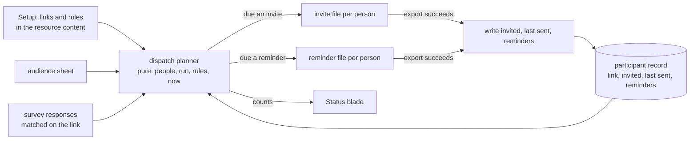

# Program send rules

## Why deferred

The rules and the planner are designed to be built, but the dispatch record they keep is meant to be written by a sender, and sending is itself deferred ([email sending](../email-sending/design.md)). Built now, the only dispatch event is an export, which records a dispatch that may never have been sent, and the planner's invite and reminder counts would drift from what recipients received. A change waiting on a deferred idea would sit open with no unit clearing its blocker, so the whole design waits here with its tasks and its spec delta, ready to move into `changes/` unchanged.

## Revisit when

Email sending is built, or the owner decides that an export is the dispatch event for good and a recorded dispatch means "file produced".

The folder holds the proposal and this design only, as a deferred idea does. The tasks and the spec delta this design was first written with are rewritten from it when the idea moves into `changes/`; the first draft of both is in the history of `openspec/changes/resource-program-send-rules/` at `d3387f9626`.

## Context

A program today binds three resources and then does the owner's bookkeeping for them: it issues a link per person, joins the links to responses, and exports the email once per person. It states no rule. Who is invited, when a reminder is due and how many reminders one person gets are left to the owner's memory, and the program cannot answer "who is due now". Sending itself is out of reach for now, since the platform has no sender and building one is [deferred](../email-sending/design.md); the export is the only way a message leaves.

## The definition

A program is two layers, and the spec names them apart so nothing about a run is mistaken for configuration.

- **Policy, in the resource.** The three links, the key column, and the sending rules. This is the program's content and its whole surface in Setup. It says what to send and under what limits, and holds no fact about any person.
- **The run, in storage.** One record per audience person, keyed by the person: their link, the date they were invited, the date they were last sent anything, and how many reminders they have had. It is what the program has done under its policy, never what it is. It is the participant record that already exists, with the dispatch facts added to it.

Status, the dataset and the exports are reads over the policy, the audience, the run and the survey's responses. None of them is a state of the program.

## How it works

The planner takes each audience person with their run record and whether they responded, and returns one of three answers: due an invite, due a reminder, or not due. The rules are only restrictions on the reminder answer, so a program with no rules behaves as a manual routine that lists who has not responded.

## Decisions

- **Rules restrict, they never add.** A person never invited is due an invite, and a person invited and not responded is eligible for a reminder, whatever the rules say. A rule narrows who of the eligible is due, so an empty rule set is the old behaviour and a rule can only make the program send less. The alternative was rules that grant sends, such as a schedule that invites on a date, which needs a clock the platform does not run.
- **The reminder rule is the one rule to build.** It has two numbers: the days since the person was last sent anything, and the most reminders one person receives. It answers the question the owner asks by hand each time. Further rules are a new optional entry in the rules section and one more test in the planner, as a new response mode is one more arm in the survey's validator.
- **The planner is one pure function, read by every surface.** Status counts, the invite export and the reminder export call the same function with the same inputs, so the number the owner sees due is the number the export contains. The alternative was each surface filtering for itself, which is how the invite and reminder exports already differ on who counts as awaiting.
- **Exporting is what records a dispatch.** The platform cannot see a message leave, so the export is the only event it knows, and the record says the file was produced rather than that mail arrived. A refused export records nothing, and a later sender writes the same three fields from a real delivery. The alternative was a mark-as-sent step after the export, which asks the owner to confirm what they did outside the platform and is forgotten as readily as the generate step was.
- **The generate step is removed.** The link per person is issued when a dispatch is read or the links are downloaded, for exactly the people who lack one. The storage key already makes the issue idempotent and race-safe, so nothing about that guarantee changes; only the button goes. The alternative was keeping it as an explicit step, which exists only to make the owner do by hand what the first read can do.
- **The dispatch record lives on the participant.** Three fields beside the link, written when an export succeeds. The alternative was an append-only log of dispatches, which answers questions nobody asks, such as the history of every send, at the cost of a second table with its own purge and restore rules. The record answers what the rules read: when, and how many.
- **Status stays the run's status.** The Status blade lists each person with their dispatch facts and whether they responded, and the dataset carries the same two new columns without the key value or the link, since a dashboard bound to it can be published.

## Rejected

- **A started state for a person who has a saved draft.** It reads survey drafts into the program, and it changes no action: reminders already reach everyone who has not finished. The survey owns its drafts, so a funnel's middle is a read of the survey, not a program concept. Recorded under rejected as the program started status.
- **A program with no run state, links derived from a secret.** A link computed from a server secret and the key value would need no participant record and no generate step. It was rejected for this change because it replaces how every link is issued and checked, which is a separate decision from the program's rules, and because the dispatch record still needs a home per person. Revisit when the record's fields prove a burden.
- **A closing date on the program.** A survey closes by its own switch, and a second clock beside it leaves a link that neither works nor says why. The reasoning is the [link expiry](../program-link-expiry/design.md) page's.
- **Rules that filter the audience.** Which people are in scope is a question about a sheet's columns, which needs the sheet's filter model brought into a program. It is [deferred](../program-audience-filter/design.md) with its trigger.
- **Sending on a schedule.** A schedule needs a sender, and the sender is the [deferred](../email-sending/design.md) email sending.
- **Inviting everyone again.** After the email changes an owner may want it to reach everyone. A person already invited is sent a reminder, and the reminder rule's limits apply, so the owner who wants more clears the rule. A reset of the record is not built until someone needs it.

## Risks and trade-offs

- A dispatch recorded at export may not have been sent, so a reminder's delay counts from a file that sat unsent. The Status blade shows the dates, so the owner can read the gap.
- Two owners exporting at once write the same fields. The write merges on the record's own version, so the later export sees the earlier one's count and the rule holds.
- The reminder rule is read against the person's last dispatch, so a person invited and then reminded is timed from the reminder, as a cadence is.

## Key files

| File                                                                         | Role                                                                        |
| ---------------------------------------------------------------------------- | --------------------------------------------------------------------------- |
| `apps/web/shared/models/resource/program/ProgramResource.ts`                 | the program content, which gains the rules section                          |
| `packages/db-schema/src/models/program/ProgramParticipantEntity.ts`          | the participant record, which gains the three dispatch fields               |
| `apps/web/server/services/program/generateProgramParticipants.ts`            | the issue of a link per person, called by a dispatch instead of by a button |
| `apps/web/server/services/program/readProgramInvites.ts`                     | the invite and reminder export's read, which takes its people from the plan |
| `apps/web/server/services/program/readProgramStatusRows.ts`                  | the status join, which carries the dispatch facts                           |
| `apps/web/server/services/dataset/programStatus/readProgramStatusDataset.ts` | the status dataset, which gains the invitation date and the reminder count  |
| `apps/web/server/trpc/routers/program.ts`                                    | the program procedures, which lose generate and gain the recorded export    |
| `apps/web/app/components/Resource/Program/Setup.vue`                         | the bindings blade, which gains the reminder rule fields                    |
