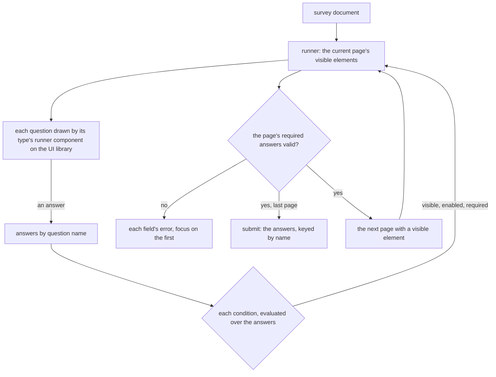

# Survey on the Editor Core

The Survey resource is authored in SurveyJS Creator and answered in SurveyJS's form library. The Creator is commercially licensed and is the app's largest client dependency, well over a megabyte gzipped. The form library (`survey-core` and its Vue UI) is MIT. The idea is to rebuild both on the [headless block editor](../../../specs/headless-block-editor/editor-core/design.md): a survey as a typed document of pages, panels and questions, authored in an editor of our own on the page builder's shell, and answered by a runner drawn with the UI library. It would be the core's second consumer after the [page builder](../../../changes/resource-page-builder-program/design.md), and the one that shows whether the core is generic, since a survey is a different domain on the same tree.

## The survey as a block document

A survey already has the core's shape. SurveyJS's JSON is pages of elements, an element is a question or a panel of more elements, and every question has a type that selects its schema. So the survey document is the core's document over a survey registry:

```ts
// The root: the survey's own settings, its content only pages
interface SurveyRootProps {
  completedHtml: string;
  description: string;
  logo: string;
  title: string;
}
// A page and a panel each hold one slot of elements
interface SurveyPageProps {
  elements: SurveyElement[];
  id: string;
  title: string;
  visibleIf: string;
}
// Every question type extends the shared question props with its own
interface SurveyQuestionProps {
  description: string;
  enableIf: string;
  id: string;
  isRequired: boolean;
  name: string;
  requiredIf: string;
  title: string;
  visibleIf: string;
}
```

- **The registry** has one type per question type the Creator's toolbox offers today, enumerated from `survey-core`'s serializer when the change is written so none is missed. Each type's props schema holds its own fields: choices, rate values, the rows and columns of a matrix, the template of a dynamic panel. A matrix's rows and columns are props, not slots, because they are values a question answers by, not elements an author drags between.
- **The root's content takes pages only**, and a page's and a panel's slot take panels and every question type. This is the declared root the [editor core](../../../specs/headless-block-editor/editor-core/design.md) declares for a registry.
- **A question's name is its answer's key.** Responses are stored keyed by question name, so names are unique across the document as ids are. The survey's schema refines the core's document schema with that check, and the core needs nothing new for it.

## Logic

SurveyJS's conditions are an expression language over answers: `{age} >= 18 and {country} = 'NZ'`, `{choices} contains 'other'`, `iif(...)`, `age({birthdate})`, `sum(...)`. The visible, enabled and required conditions, calculated values, triggers and validators are all written in it. The [math expression](../../../changes/shared-math-expression/design.md) evaluator that replaces mathjs stays numeric by design, because a sheet compiles each formula to plain number arithmetic, and a type check in every operator of every cell would undo that. So the survey runner gets a parser and compiler of its own, over a value model of strings, booleans and arrays, with names bound to answers and the list operators and functions SurveyJS documents. SurveyJS's grammar differs from the sheet's anyway: `{name}` references, `=` as equality, `contains`. It reuses the evaluator's numeric function table and its error wording.

## The runner and the creator



- **The runner** draws each question with a component of the UI library: the text field, the radio group, the checkbox group, the select, the rating, the file field and the signature pad. A matrix is drawn as a table of those. The theme is the UI library's tokens rather than SurveyJS's theme JSON. Page flow, progress, required checks and completion are the runner's own. Each question type's answer is validated by a Zod schema derived from its props, which is the same check the server runs on a submitted response.
- **The creator** is the page builder's shell over the survey registry, drawn without the canvas frame, since a survey has no published page to match. The palette lists the question types, the layers tree shows pages, panels and questions, and the Content panel is `UiSchemaForm` over each type's form schema. The preview is the runner itself. A condition is edited in a builder of answer, operator and value that writes the expression, with the raw expression beside it.
- **What reads a survey today keeps reading it.** The response summary's question kinds and choice labels, the dataset's columns and the program invites all read the document's questions by name and type, in place of `survey-core`'s model.

## The stored surveys

The page builder deletes every webpage and email at its cutover. A survey cannot be deleted that way, because its responses are the owner's data and are keyed by the question names in its JSON. So this rebuild migrates. A converter reads each stored SurveyJS JSON into the survey document, and the cutover runs it as a backfill. The converter must cover every construct present in the stored surveys, not only those the toolbox offers, so the change opens with a read-only scan of every stored survey that counts each question type, property and expression function in use. A construct no survey uses is still built if the toolbox offers it, since an owner may reach for it the day after the cutover.

## Why deferred

- **The pain is already gone.** The cost a reader paid was the Creator loading at startup on every page. SurveyJS now loads with the survey's own components (`apps/web/app/services/survey/registerSurveyCreatorPlugin.ts`), so it costs only the routes that author or answer a survey.
- **The licence is settled while Esposter is free.** [Survey creator licence](../../../rejected/resource/survey-creator-licence/design.md) records the open-source exception that waives it.
- **The core is not proven yet.** The page builder is its first consumer, and the registry root it needs is unbuilt. A second consumer designed before the first ships would be redesigned with it.
- **The work is large.** It covers every question type, the logic language, the runner's flow, the creator and a migration of stored surveys that hold responses.

## Revisit when

The page builder's editors run on the core, which is the [flowchart on the editor core](../flowchart-on-editor-core/design.md)'s trigger too. Or the open-source exception ends, as [paid storage tiers](../../../changes/resource-paid-storage-tiers/design.md) would end it, and a licence would otherwise be bought.

## Cheaper interim

SurveyJS stays, loaded with the survey's own Editor and respondent View rather than at startup.

## Sources

- [SurveyJS — Conditional logic and dynamic texts](https://surveyjs.io/form-library/documentation/design-survey/conditional-logic) — the expression language the runner's conditions are written in, with its operators and functions.
- [SurveyJS — Licensing](https://surveyjs.io/licensing) — the Creator's commercial licence beside the MIT form library.
