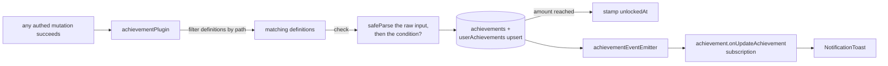

# Unlock Pipeline

Every authed mutation flows through `achievementPlugin`, which turns matching procedure calls into progress rows and pushes unlocks to the client over a tRPC subscription.

## How it works

The plugin runs **after** `next()` and only for successful mutations. For each definition whose `triggerPath` equals the called path (and whose `check` passes: the raw input parses against the trigger's schema, and the definition's condition, if any, holds for the parsed input): lazily insert the `achievements` row on first encounter, upsert the caller's `userAchievements` counter, skip entirely if already unlocked, stamp `unlockedAt` when the threshold is met, and finally emit one `updateAchievement` event with everything that changed. The subscription filters events to the session user and the toast list shows progress/unlocks live anywhere in the app.

The achievement router is merged separately from the main root router to break a circular dependency — the plugin needs `TRPCPaths` derived from the routers it wraps.

## Procedures

| Procedure                          | Auth         | Input            | Purpose                                       |
| ---------------------------------- | ------------ | ---------------- | --------------------------------------------- |
| `achievement.readAchievementMap`   | authed       | —                | all definitions (hidden ones masked as `???`) |
| `achievement.readUserAchievements` | rate-limited | optional user id | a user's progress rows (defaults to caller)   |
| `achievement.onUpdateAchievement`  | authed       | —                | live progress/unlock events                   |

## Key files

Paths relative to `apps/web`; `packages/` ones to the repo root.

| File                                                                         | Role                               |
| ---------------------------------------------------------------------------- | ---------------------------------- |
| `server/trpc/plugins/achievementPlugin.ts`                                   | the middleware                     |
| `shared/services/achievement/definitions/defineAchievementDefinition.ts`     | the per-definition `check`         |
| `shared/services/achievement/conditions/`                                    | typed predicate helpers            |
| `shared/models/db/message/ZonedCreateMessageInput.ts`                        | a send with the sender's time zone |
| `shared/services/achievement/achievementDefinitions.ts`                      | merged definition map              |
| `server/trpc/routers/achievement.ts`                                         | read + subscription procedures     |
| `app/components/Achievement/`                                                | gallery grid + notification toasts |
| `packages/db-schema/src/schema/achievement/userAchievementsInAchievement.ts` | progress rows                      |

## Notes

- Processing is synchronous in the request path, in the mutation's best-effort tail ([persist then notify](../../architecture/persist-then-notify/design.md)) — the whole post-mutation block and each definition's writes sit behind their own `getResultAsync` boundaries, so a failure is logged with its path, user, and definition name. Nothing needs a retry: a lost counter increment self-heals on the next trigger, and an unmet `amount: 1` condition re-evaluates on the next qualifying call. Escalate to EventGrid only if plugin latency ever shows in traces.
- A time-of-day condition (`isWithinTime`) reads the hour in the time zone the triggering call carries, never the server's, which is UTC in production. `message.createMessage` takes the sender's IANA zone beside the message (`ZonedCreateMessageInput`), the client sending `Temporal.Now.timeZoneId()`, and the procedure drops it before the message is written, so the zone is read by the condition alone. A send at six in the morning in Sydney earns the early-bird window there.
- `readUserAchievements` accepts another user's id, so achievement showcases on user-facing surfaces need no new procedure.
