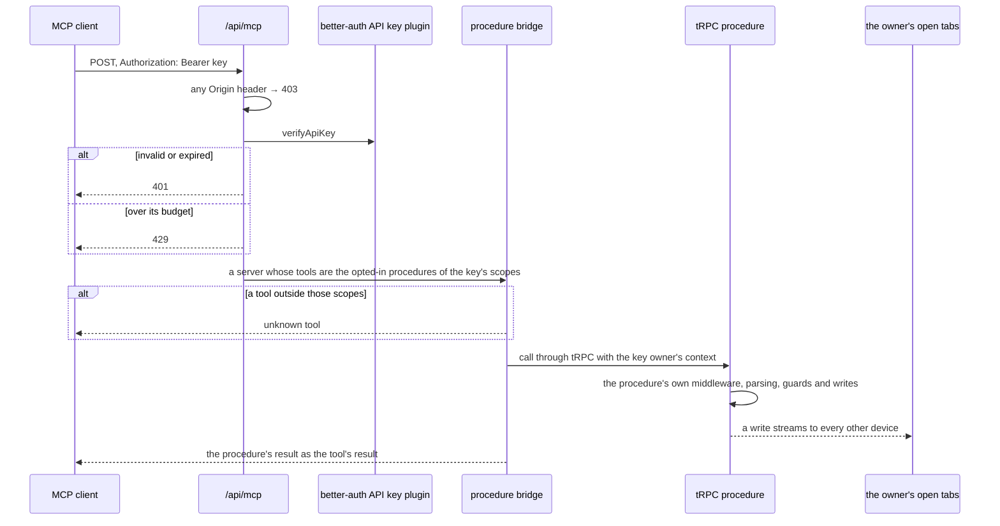

# Agent Access

A Claude Code session, or any other MCP client, reaches Esposter through one endpoint. Every read and write in the app is already a tRPC procedure that describes itself the way [write once](../write-once/design.md) asks, which is everything an agent's tool needs, so the endpoint serves procedures rather than tools of its own. Exposing an operation to an agent is one line on its procedure, and nothing on this page changes when one is added.

## Opting a procedure in

The tRPC root declares a meta type whose optional `mcp` key makes a procedure a tool, and a procedure that should be a tool says so:

```ts
readThings: standardAuthedProcedure
  .meta({ mcp: { description: "What an agent reads this for, and when to call it", scope: McpScope.Resources } })
  .input(readThingsInputSchema)
  .query<Thing[]>(async ({ ctx, input }) => { … }),
```

- **The description and the scope are the only new things.** An agent chooses a tool by what it is told the tool is for, and a procedure has no other place to say it. Written for the agent: when to call it, and what its fields mean where their names do not say. The scope says which keys reach the tool, below.
- **Its input is one object.** An MCP tool's input schema must be one, so every procedure that opts in is a query or a mutation with exactly one object input. No two may map to one tool name either, since turning dots to underscores could give two paths the same name. `getMcpTools.test.ts` walks the router and fails on either.
- **A procedure shaped for the browser may be the wrong shape for an agent.** The answer is a procedure shaped for the agent, never a branch in the bridge: a whole-list save at a content version is a poor tool for adding one todo, so the TodoList has its own follow-up procedures ([TodoList agent follow-ups](../../resource/todolist-agent-follow-ups/design.md)).

## The endpoint

`POST /api/mcp` serves the Model Context Protocol over its Streamable HTTP transport, stateless: each request builds a server, answers one JSON-RPC message with a JSON response, and closes. The server never pushes a message unprompted, so the router's 405 to any other method is the answer the transport allows.



- **`Origin` is refused.** The transport requires the server to validate it, so no web page can drive the endpoint from a reader's browser. Its callers are command-line clients, which send none, so a request carrying one is answered 403 before its key is read.
- **The key owner is the caller.** The route reads the key's owner and builds the tRPC context with a session payload for them, `getSessionPayload`, which the rate-limited middleware takes instead of reading one from the cookie. The session is never stored and authenticates nothing: its id is the key's own device, `agent-<key id>`, so the owner's open tabs take the agent's writes as another device's and show them live.
- **A tool is its procedure.** Its name is the procedure's path with the dots turned to underscores, since a tool name takes no dot in every client; its input schema is the procedure's input as JSON Schema, through the one conversion the content tools describe a type with; and calling it calls the procedure through tRPC's own call path, so its middleware, parsing, guards and rate limit all run as they do for the browser. A rejection is the tool's result, flagged as an error, so the agent reads why its call failed; a name that is no tool is a protocol error.
- **A read says it changes nothing.** MCP treats a tool as possibly destructive unless it declares `readOnlyHint`, so every tool states it: true for a query, false for a mutation, read off the procedure's type. A client can then let every read through and keep its confirmation prompt for writes.
- **The raw arguments reach tRPC.** The bridge uses the SDK's low-level server rather than `McpServer`, which parses a tool's arguments with its schema and hands on the parsed output. tRPC would then parse that output a second time, which holds only while every input's transforms are idempotent.

## Scopes

A key reaches only the kinds of work it was made for. `McpScope` holds them — `FollowUps`, the TodoList's follow-up procedures, and `Resources`, the generic tools over every resource ([agent content tools](../agent-content-tools/design.md)) — and each procedure that opts in names exactly one. The scope sits in the procedure's meta beside its description, so the bridge keeps no list of which tool belongs where.

- **A key's scopes are its better-auth permissions**, the plugin's per-key record of resource to actions, kept as `{ mcp: [...] }`. The plugin sets permissions only from the server, so a key is created by `user.createApiKey`, which calls the plugin's `createApiKey` with the scopes the owner ticked and the caller's own id. A key with no scope is refused at the input, since it would reach nothing.
- **Deny by default.** The route reads the verified key's permissions through `getApiKeyScopes`, which answers the scopes only when the record parses as this app writes it. No permissions, an unknown scope or any other shape reads as none, so a key made by the plugin's own create route, which takes no permissions from a client, reaches no tool.
- **Checked in one place.** `createMcpServer` keeps only the tools of the key's scopes, for listing and for calling alike, and every call an agent makes passes through it. A tool outside them is not listed, and calling it by name is the same unknown-tool error as a name that was never a tool, so a key learns nothing of what lies beyond its scopes. The procedure's own guards run after, as for the browser: a key reaches only its owner's resources however its scopes read.
- **The owner's alone.** A procedure whose reversal nothing can undo declares `humanOnly` beside its meta, with the reason it is never served. `getMcpTools` skips it whatever `mcp` says, so it is never a tool and never callable by name. Publishing and moving to the recycle bin stay agent tools, since a revision, the bin or an unpublish can undo them.

## Attribution

An agent writes as the key's owner, so its writes need a mark of their own. The route puts the verified key's id and name on the context as `apiKey`, absent on a person's own request, and `writeResourceActivity` copies both onto every [activity log](../../resource/activity-log/design.md) entry, `""` for the owner's own hand. A saved-content entry coalesces per user and key, so an agent's run of saves and a stretch of the owner's typing stay separate lines, and the log names the key on an agent's entries by the name it held when it wrote. The trail tells keys apart rather than devices: the owner's own browsers are one hand, and a key is the unit the owner creates, names and revokes.

## The credential

An **API key** from better-auth's own plugin, `@better-auth/api-key`, never a token table of ours: key storage and verification are security-shaped, which the [dependency admission](../dependency-admission/design.md) stop list keeps in a library.

- **Stored hashed**, shown once when it is created, and listed afterwards by its name and first characters.
- **Created, listed and deleted under API keys in the user settings.** Creating goes through `user.createApiKey`, which asks which scopes the key holds; listing, with each key's scopes, and deleting go through the plugin's client. Deleting one is how a leaked key is revoked; the agent using it is refused from its next call.
- **Named**, since a key is told apart from the owner's others only by its name in that list.
- **Rate-limited per key** by the plugin, with the standard limiter's budget and window rather than the plugin's default of ten a day, since a drain calls a tool per step. Its calls also spend from the owner's own standard budget in the procedure's middleware, as any signed-in call does.
- **Never a session.** `enableSessionForAPIKeys` stays off, so a key opens nothing in the app's ordinary tRPC route. It is verified only by the MCP endpoint and reaches only the procedures that opt in there under its scopes, so no key can create or delete another.
- **Its table is ours.** The plugin's model is `auth.apiKeys` in `@esposter/db-schema`, pointed at its export as every core auth model is, and the adapter's schema check suite runs with the plugin, so a field the plugin adds fails a test rather than a sign-in.

## Dependencies

- `@modelcontextprotocol/sdk` serves the transport and the protocol. It tracks an outside spec, so it is kept and bumped, never absorbed.
- `@better-auth/api-key` owns the keys. It is better-auth's own plugin, versioned with it.

## Key files

| File                                                                | Role                                                                     |
| ------------------------------------------------------------------- | ------------------------------------------------------------------------ |
| `apps/web/server/api/mcp.post.ts`                                   | the endpoint: `Origin`, the key and its scopes, the owner's context      |
| `apps/web/server/services/mcp/createMcpServer.ts`                   | the bridge: the tools of the key's scopes, each called through tRPC      |
| `apps/web/server/services/mcp/createMcpServer.test.ts`              | each scope's tools listed and called, and refused to every other scope   |
| `apps/web/server/services/mcp/getMcpTools.ts`                       | walks the router for the procedures whose meta opts in, reads marked     |
| `apps/web/server/services/mcp/getMcpTools.test.ts`                  | one object input per tool, no two tools one name, each scope's tools     |
| `apps/web/server/models/trpc/Meta.ts`                               | the meta type every procedure may opt into MCP with, under a scope       |
| `apps/web/shared/models/auth/McpScope.ts`                           | the scopes a key may hold                                                |
| `apps/web/shared/services/auth/getApiKeyScopes.ts`                  | a verified key's scopes, none unless its permissions parse               |
| `apps/web/server/trpc/routers/user.ts`                              | `createApiKey`, the one place a key's scopes are set                     |
| `apps/web/server/trpc/context.ts`                                   | carries a session the route already authenticated, and the agent's key   |
| `apps/web/server/services/resource/writeResourceActivity.ts`        | names the key on every activity entry an agent's write leaves            |
| `apps/web/server/trpc/middleware/getRateLimitedMiddleware.ts`       | takes that session before reading one from the cookie                    |
| `apps/web/server/services/auth/getAgentSessionPayload.ts`           | the key owner's session payload, on the key's own device                 |
| `apps/web/server/services/auth/apiKeyPlugin.ts`                     | the API key plugin's options, shared with the adapter's test             |
| `apps/web/server/services/auth/drizzleAdapterConfiguration.test.ts` | runs better-auth's schema check with the plugin, covering `auth.apiKeys` |
| `packages/db-schema/src/schema/auth/apiKeysInAuth.ts`               | the plugin's table                                                       |
| `apps/web/app/components/User/ApiKeysCard/Index.vue`                | the API keys section of the user settings                                |
| `apps/web/app/components/User/ApiKeysCard/CreateButton.vue`         | names a new key and ticks the scopes it holds                            |

## Sources

- [Model Context Protocol — transports](https://modelcontextprotocol.io/specification/2025-06-18/basic/transports) — one endpoint path taking POST, a GET that may answer 405, optional sessions, and the requirement to validate `Origin`.
- [Better Auth — API key plugin](https://www.better-auth.com/docs/plugins/api-key) — hashed keys shown once, per-key rate limits, `verifyApiKey`, sessions for keys as an opt-in left off here, and per-key `permissions` set and updated only from the server.
- [Model Context Protocol — schema reference](https://modelcontextprotocol.io/specification/2025-06-18/schema) — `readOnlyHint`, default false, under which a client treats a tool as possibly destructive.
