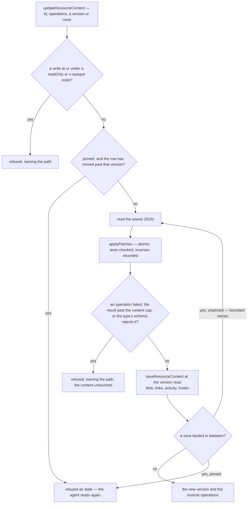

# Agent content tools

An agent reaches the app through the MCP endpoint, with a key holding the scopes it was made for ([agent access](../agent-access/design.md)). Under the `Resources` scope it finds the owner's resources, learns a type's shape, reads what a resource holds and edits it, through four tools that read every type's declaration off the row they are handed. A type is agent-reachable because it is in `ResourceDefinitionMap`, so a type added next year is reachable the day it exists, and the tool list stays the same length as types are added.

## The tools

All four sit on the cross-type `resource` router. The two that take an id are built on `getOwnerProcedure` with no type, the typeless owner guard `resource.readResource` uses, so each acts only on the key owner's own resources.

| Procedure                            | Kind     | Input                                       | Answers                                                         |
| ------------------------------------ | -------- | ------------------------------------------- | --------------------------------------------------------------- |
| `resource.readResources`             | query    | the explorer's filters — name, types, tags  | a page of the owner's resources, as the explorer lists them     |
| `resource.readResourceContentSchema` | query    | a type                                      | its capabilities and its content schema as JSON Schema          |
| `resource.readResourceContent`       | query    | an id, a pointer and a page                 | the JSON at the pointer, and the content version it was read at |
| `resource.updateResourceContent`     | mutation | an id, operations, and optionally a version | the new content version, and the operations that undo the edit  |

`resource.readResources` is the explorer's own read, opted in. Its `updatedAfter` and `updatedBefore` filters are coerced dates, because the bridge hands tRPC an agent's raw JSON with no SuperJSON revival, so a date arrives as the ISO string a coerced date reads and the browser's revived Date passes too.

## Describing a type

One conversion, `getAgentJsonSchema`, turns a Zod schema into the JSON Schema an agent reads. The describe tool converts a type's content schema through it, and the bridge converts every tool's input through it, so the two never disagree about a shape.

- **The input side.** Zod converts either side of a schema, and an agent is a writer, so a normalised string is a string and a field with a default is optional. An input defaulted with `.prefault({})` converts to the object with its default beside it, so a defaulted object is still the one object a tool's input must be.
- **A Date is a `date-time` string**, the form `JSON.stringify` stores and a content schema reads back. Zod has no JSON Schema for a Date, so the conversion's `unrepresentable` handler writes one, and throws on anything else: a Map, a Set or a BigInt in a schema never reaches an agent as `{}`.
- **Undescribed parts are marked.** `z.unknown()` and `z.any()` are stamped `x-opaque`, the key `OPAQUE_KEY` names, so the agent sees where the schema stops describing.
- **Read-only fields say so.** A schema given `.readonly()` or `.meta({ readOnly: true })` reaches the agent as JSON Schema's own `readOnly` keyword.
- **Enums come through as `enum` lists**, so the legal values arrive in the same answer as the shape.
- **The resource schema follows its editor.** Flowchart node data describes its optional label and edges have no writable data; Notes check documents against the shared writing kit; Survey models must be JSON objects; and the HTML or CSS captured by GrapesJS is read-only until the page builder replaces that format.

## Reading

A read answers the stored JSON, through `JSON.parse` alone, rather than the content after the schema's parse: the save already ran the schema's transforms, so the stored JSON is exactly the document a patch addresses. Content never saved reads as `null`, the document a first patch replaces whole with `add ""`.

- **A pointer selects.** An RFC 6901 JSON Pointer picks a subtree, so an agent reads a Sheet's columns without its rows. A pointer to nothing is refused, naming it.
- **An array is paged.** An array at the pointer is answered a page at a time, at most `MAX_READ_LIMIT` items, its whole length beside the page.
- **Past `MAX_AGENT_READ_SIZE` the content is left out**, and the answer gives the size of each member instead — each key of an object, or each index of the page — or, for a leaf such as a long string, its own `size`, so the agent narrows the read rather than receiving a truncated document. A leaf's size is the UTF-8 byte length of its JSON encoding, quotes included, and the cap applies to that value. The cap sits well under the output Claude Code accepts from one tool call by default.
- **The version is never newer than the content.** The owner guard reads the row before the read reads the blob, so a save landing in between leaves the answered version behind the content, and a patch pinned to it is refused as stale rather than applied over a save the agent never read.

## Editing

An edit is a list of RFC 6902 operations — add, remove, replace, move, copy and test — each addressed by a JSON Pointer, at most `MAX_PATCH_OPERATIONS` of them. `applyPatches` (`apps/web/shared/services/jsonPatch/applyPatches.ts`), the app's one RFC 6902 applier, applies them atomically: if any operation fails, a failed test included, none applies. Appending is the pointer's `-` index, so adding a row is `add /data/rows/-` with no index to know.

- **Paths an agent may not write are refused first.** Every operation's path, and the `from` of a move or a copy, is walked down the type's agent JSON Schema — through each union's branches and each `$ref` — and one at or under a node marked `readOnly` or `x-opaque` on any branch is refused, naming the path, before the content is read. A `test` only compares, so it reads anywhere. A write above a marked node carries its own value for it, which the type's schema parses like any other, and a key the schema does not name is the parse's to strip or refuse. The refusal is read off the schema the agent was given, so it can know it in advance, and no type is special-cased.
- **Bounded like any other save.** A copy shares the value it copies, so a document copied into itself doubles with every operation, and a request of a few dozen would expand past what any string holds. The patched document, and the inverses the answer hands back, are each measured against `MAX_RESOURCE_CONTENT_SIZE`, the cap a staged save is held to, by a walk that stops once it passes the cap rather than serializing the document, and a patch past it is refused.
- **The result is parsed before the door.** The patched document is parsed with the type's own schema, and one it rejects is refused as the caller's mistake, each issue naming its path, rather than surfacing as a server fault. The parsed document then goes through `saveResourceContent`, which does everything a save does: the blob and its hash, the [resource links](../resource-links/design.md) projected from the content, the activity entry naming the agent's key, the type's after-save hook, the revision interval and the save event.
- **Two modes of version.** Pinned with the content version the agent read, the patch is refused as stale once the row has moved past it, before the read or at the door. Unpinned, the patch applies to the latest content with its `test` operations the only guard, and a save landing between the read and the write is retried — read again, reapplied — up to `MAX_CONTENT_UPDATE_ATTEMPTS` times rather than written over. The tool's description states both, so the agent chooses.
- **Reversible.** The answer carries the inverse operations, so an agent undoes its own edit in one call, and the owner undoes it from version history.

The read-change-save-retry loop is `updateResourceContent(ctx, resource, update, contentVersion)`, generic over the type: `update` is handed the stored JSON and answers the content to save beside what the call returns. The TodoList's follow-up procedures run through it too, `updateTodoListContent` parsing the stored list with its schema, or starting an empty one, for the change each makes in place ([TodoList agent follow-ups](../../resource/todolist-agent-follow-ups/design.md)).

[Delta content saves](../../resource/delta-content-saves/design.md) do not apply. They make a browser's whole-document save cheap on the wire, while a patch is already the size of the edit and the stored bytes are on the server.

## The test that holds every type

`getAgentJsonSchema.test.ts` iterates `ResourceTypes`, with no list of its own. For each type it converts the content schema through the agent conversion, expects a root object, and compares the paths the conversion marks `x-opaque` or `readOnly` — written as JSON Pointers, `-` for an array's items and `*` for a record's values, such as a Note's `/doc/attrs/*` — with what the test records for that type. A new `z.unknown()` or read-only field in any schema fails it until the part is described or its path recorded, so no type's reach widens or narrows unseen. A Flowchart's node label is described and writable; edge data has no writable keys. Beside it, `getMcpTools.test.ts` names every tool each scope reaches, so a procedure opting in under a scope is a line someone wrote down.

## Notes

- A value past the read cap that holds no members, such as one very long string, has no narrower pointer to read, and is reached only by writing over it.
- The patch input's `value` is any JSON until the type's schema parses the result, so `resource.updateResourceContent` is on the router input test's list of opaque inputs, bounded by the request body limit.

## Key files

| File                                                                  | Role                                                                       |
| --------------------------------------------------------------------- | -------------------------------------------------------------------------- |
| `apps/web/server/trpc/routers/resource.ts`                            | the describe, read and update tools, and `readResources` opted in          |
| `apps/web/server/services/mcp/getAgentJsonSchema.ts`                  | the one conversion the bridge and the describe tool share                  |
| `apps/web/server/services/mcp/getAgentJsonSchema.test.ts`             | every content schema converts, its unwritable paths recorded per type      |
| `apps/web/server/services/mcp/checkIsAgentWritablePath.ts`            | walks a pointer down the agent JSON Schema, refusing a marked node         |
| `apps/web/server/services/mcp/getJsonSchemaBranches.ts`               | a node's union branches and the definitions its `$ref`s name               |
| `apps/web/server/services/resource/requireAgentWritableOperations.ts` | refuses a patch reaching a read-only or undescribed path                   |
| `apps/web/server/services/resource/applyResourceContentPatches.ts`    | applies a patch and parses the result, each failure the caller's mistake   |
| `apps/web/server/services/resource/updateResourceContent.ts`          | read, change and save at the version read, retried when unpinned           |
| `apps/web/server/services/resource/readStoredResourceContent.ts`      | the stored JSON a read selects from and a patch applies to                 |
| `apps/web/server/services/resource/readContentAtPointer.ts`           | the value at a pointer, an array's page, and the member sizes past the cap |
| `apps/web/server/services/resource/checkIsJsonSizeWithin.ts`          | a value's JSON size against a cap, without serializing it                  |
| `apps/web/shared/models/jsonPatch/JsonPatchOperation.ts`              | the six operations and their schema                                        |
| `apps/web/shared/services/jsonPatch/applyPatches.ts`                  | the app's one RFC 6902 applier                                             |
| `apps/web/server/services/resource/todoList/updateTodoListContent.ts` | the follow-ups' change, through the generic update                         |
| `apps/web/shared/models/flowchartEditor/data/GraphNode.ts`            | the node label the Flowchart editor reads and writes                       |
| `apps/web/shared/models/flowchartEditor/data/GraphEdge.ts`            | the empty data shape the edge editor uses                                  |
| `apps/web/shared/models/resource/note/NoteResource.ts`                | validates documents with the Note writing kit's schema                     |
| `apps/web/shared/services/resource/note/getNoteExtensions.ts`         | the extension set shared by the Note editor, renderer and validator        |
| `apps/web/shared/models/resource/survey/SurveyResource.ts`            | requires a serialized JSON object for a Survey model                       |
| `apps/web/shared/models/webpageEditor/data/WebpageEditor.ts`          | marks captured HTML and CSS read-only                                      |
| `apps/web/shared/models/emailEditor/data/EmailEditor.ts`              | marks captured HTML read-only                                              |

## Sources

- [RFC 6902 — JSON Patch](https://www.rfc-editor.org/rfc/rfc6902.html) (IETF) — the six operations, `test` succeeding only on an equal value, a failed operation failing the whole patch, and `-` appending to an array.
- [RFC 6901 — JSON Pointer](https://www.rfc-editor.org/rfc/rfc6901.html) (IETF) — the path every read and operation is addressed by.
- [Zod — JSON Schema](https://zod.dev/json-schema) — `z.toJSONSchema`'s input side, a Date among the unrepresentable types, the `unrepresentable` handler that substitutes a schema, and metadata copied into the output.
- [JSON Schema Validation 2020-12](https://json-schema.org/draft/2020-12/json-schema-validation) (section 9.4) — `readOnly`: a value the owning authority manages, whose modification it may reject.
- [Claude Code — MCP](https://code.claude.com/docs/en/mcp) — the 25,000-token default limit on one MCP tool call's output, which the read cap stays under.
