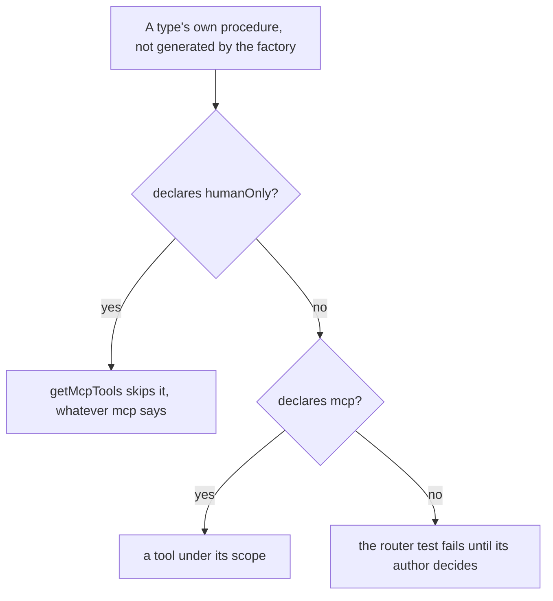

# Agent keys

Keys carry scopes, reads are marked read-only and an agent's writes name their key ([agent access](../../agent-access/design.md)). This page also covers two parts: the keys that existed before scopes, which hold none and so reach no tool, and the operations no key should reach whatever its scopes.

## The keys made before scopes

Every key created before scopes was made for the follow-ups, the only tools there were. Each holds no permissions, which the endpoint reads as no scope, so a drain that worked yesterday is refused every tool until its owner makes a new key. A backfill gives each existing key the `FollowUps` scope and nothing else. The keys live in `auth.apiKeys` in Postgres, which a session cannot reach in production, so the backfill is a data migration applied at startup — an `UPDATE` of every key whose permissions are null to `{"mcp":["FollowUps"]}` — rather than a script run as the `backfills` skill runs one.

## The owner's alone

`Meta` carries `humanOnly`, the reason a procedure is never served to a key, and the bridge skips any procedure declaring it. The rule is set out in [agent access](../../agent-access/design.md); the procedures it keeps with the owner are these.

| Procedure                                                                                 | Why it stays the owner's                                                                                                                       |
| ----------------------------------------------------------------------------------------- | ---------------------------------------------------------------------------------------------------------------------------------------------- |
| `resource.purgeResource`                                                                  | the one delete nothing restores, already behind the type-the-name guard ([destructive confirmation](../../destructive-confirmation/design.md)) |
| `survey.deleteSurveyResponse`                                                             | deletes a respondent's answer from its table outright, data the owner holds on someone else's behalf                                           |
| `survey.createSurveyResponse`, `survey.updateSurveyResponse`, `survey.readSurveyResponse` | a respondent's procedures, not the owner's acts at all                                                                                         |

A test over the router holds the declaration: every procedure on a resource type's router that `createResourceProcedures` did not generate declares `mcp` or `humanOnly`. The type's router is found by its name, which is the type uncapitalized, and the factory's procedures by calling the factory for the type, so the test lists nothing by hand and a new type-specific procedure fails it until its author decides.

The test is in `getMcpTools.test.ts`, and it landed with [lifecycle tools](../lifecycle-tools/design.md), which made the decisions for the rest of those procedures: the Blueprint's capture and deploy, the Program's participants and status and the Survey's response reads are served to keys, and the Email's compile and export and the Program's invite read are human-only. Each is a decision that unit made rather than one this page could make for it.

## Key files

| File                                                                                   | Role                                                                          |
| -------------------------------------------------------------------------------------- | ----------------------------------------------------------------------------- |
| `apps/web/server/models/trpc/Meta.ts`                                                  | `humanOnly` names why a procedure is never served                             |
| `apps/web/server/services/mcp/getMcpTools.ts`                                          | skips a human-only procedure                                                  |
| `apps/web/server/services/mcp/getMcpTools.test.ts`                                     | the tools each scope reaches, and no human-only procedure listed as one       |
| `apps/web/server/trpc/routers/resource.ts`                                             | `purgeResource` declares itself human-only                                    |
| `apps/web/server/trpc/routers/survey.ts`                                               | response deletion and the respondent procedures declare themselves human-only |
| `packages/db-schema/src/schema/auth/apiKeysInAuth.ts`                                  | the table the keys live in                                                    |
| `apps/web/server/db/migrations/20261013003850_api_keys_follow_ups_scope/migration.sql` | the backfill, applied at startup as the migration that owns it                |
